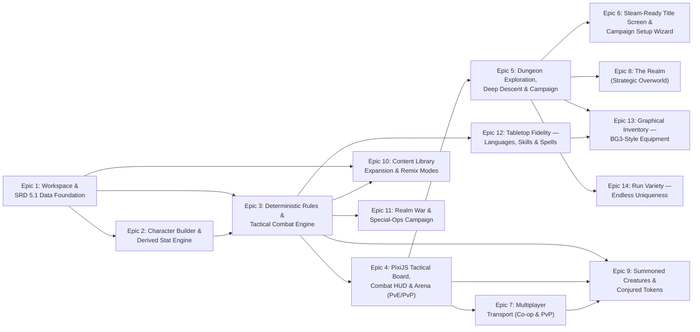

# SRD 5.1 Tactical Dungeon Crawler — Implementation Backlog

This backlog breaks down the [Master Specification](file:///home/jwesterl/ai/srd5-game/SPEC.md) and modular specs ([01](file:///home/jwesterl/ai/srd5-game/docs/spec/01-srd-data-schema.md), [02](file:///home/jwesterl/ai/srd5-game/docs/spec/02-character-builder.md), [03](file:///home/jwesterl/ai/srd5-game/docs/spec/03-combat-and-rules-engine.md), [04](file:///home/jwesterl/ai/srd5-game/docs/spec/04-dungeon-and-ai.md), [05](file:///home/jwesterl/ai/srd5-game/docs/spec/05-multiplayer-and-ui.md), [06](file:///home/jwesterl/ai/srd5-game/docs/spec/06-game-modes-and-progression.md), [07](file:///home/jwesterl/ai/srd5-game/docs/spec/07-main-menu-and-campaign-launcher.md), [08](file:///home/jwesterl/ai/srd5-game/docs/spec/08-summoned-creatures.md), [09](file:///home/jwesterl/ai/srd5-game/docs/spec/09-content-library.md), [10](file:///home/jwesterl/ai/srd5-game/docs/spec/10-realm-war-campaign.md), [11](file:///home/jwesterl/ai/srd5-game/docs/spec/11-tabletop-fidelity.md), [12](file:///home/jwesterl/ai/srd5-game/docs/spec/12-graphical-inventory.md), [13](file:///home/jwesterl/ai/srd5-game/docs/spec/13-run-variety.md)) into granular, dependency-ordered engineering tickets.

## Status Legend
- `[ ]` Todo
- `[~]` In Progress
- `[x]` Done

---

## Dependency Graph Overview

---

## Epic 1: Monorepo Scaffolding & SRD 5.1 Data Foundation
**Spec Reference**: [SPEC.md](file:///home/jwesterl/ai/srd5-game/SPEC.md), [01-srd-data-schema.md](file:///home/jwesterl/ai/srd5-game/docs/spec/01-srd-data-schema.md)

| ID | Status | Title | Package | Depends On |
| :--- | :---: | :--- | :--- | :--- |
| **SRD-101** | `[x]` | Initialize `pnpm` monorepo, TypeScript configs, Vitest, and CC-BY-4.0 legal notice | `root` | — |
| **SRD-102** | `[x]` | Define core SRD 5.1 enumerations, ChoiceSpec, and Declarative Effect/Modifier DSL Zod schemas | `@srd5/data` | SRD-101 |
| **SRD-103** | `[x]` | Define Zod schemas for Races, Subraces, Classes (L1–20), Subclasses, Backgrounds, and Feats | `@srd5/data` | SRD-102 |
| **SRD-104** | `[x]` | Define Zod schemas for Equipment, Weapons, Armor, Magic Items, Spells, and Monsters | `@srd5/data` | SRD-102 |
| **SRD-105** | `[x]` | Build SRD 5.1 ingestion, normalization, and Effect DSL overlay scripts | `@srd5/data` | SRD-103, SRD-104 |
| **SRD-106** | `[x]` | Bundle normalized SRD 5.1 JSON files and implement referential integrity validation suite | `@srd5/data` | SRD-105 |
| **SRD-107** | `[x]` | Implement typed Compendium lookup API and search/filter indices | `@srd5/data` | SRD-106 |
| **SRD-108** | `[x]` | Implement deterministic seeded PRNG (`Mulberry32`) and 5e Dice & Formula AST evaluator | `@srd5/engine` | SRD-102 |
| **SRD-109** | `[x]` | Scaffold Vite + React 19 + Tailwind client and build the SRD 5.1 Compendium Browser UI | `@srd5/client` | SRD-107 |

### Epic 1 Acceptance Criteria Details
- [x] **SRD-101**: `pnpm install`, `pnpm build`, `pnpm typecheck`, and `pnpm test` run cleanly across `packages/data`, `packages/engine`, `packages/transport`, and `packages/client`. Includes `LEGAL.md` with exact WotC CC-BY-4.0 attribution.
- [x] **SRD-102..106**: 100% of bundled JSON records in `packages/data/src/srd/*.json` pass Zod parsing, cross-reference checks (every spell, item, feature, and monster trait resolves), and SRD 5.1 Product Identity allowlist verification.
- [x] **SRD-108**: Unit tests verify deterministic PRNG replay, `2d20kh1` (Advantage), `2d20kl1` (Disadvantage), Advantage+Disadvantage cancellation, `4d6kh3`, Halfling *Lucky* rerolls, *Great Weapon Fighting* rerolls, critical hit dice doubling, and variable substitution (`@strMod`, `@prof`, `@slotLevel`).
- [x] **SRD-109**: Players can browse, search, and filter all SRD 5.1 Races, Classes, Spells, Equipment, Magic Items, and Monsters in the web UI.

---

## Epic 2: Character Builder & Derived Stat Engine
**Spec Reference**: [02-character-builder.md](file:///home/jwesterl/ai/srd5-game/docs/spec/02-character-builder.md)

| ID | Status | Title | Package | Depends On |
| :--- | :---: | :--- | :--- | :--- |
| **SRD-201** | `[x]` | Define `CharacterBuildState` and `DerivedCharacterSheet` schemas | `@srd5/engine` | SRD-106 |
| **SRD-202** | `[x]` | Implement Ability Score generation validators (Standard Array, 27-Point Buy, Seeded `4d6kh3`) | `@srd5/engine` | SRD-108, SRD-201 |
| **SRD-203** | `[x]` | Implement Choice Tree validator and SRD duplicate proficiency replacement rule | `@srd5/engine` | SRD-201 |
| **SRD-204** | `[x]` | Implement 10-stage `computeDerivedCharacter()` pipeline (Abilities, Saves, Skills, HP, AC, Attacks, Spells) | `@srd5/engine` | SRD-202, SRD-203 |
| **SRD-205** | `[x]` | Implement Level-Up progression engine (Levels 1–20, Subclass unlocks, ASI/Feat, Multiclass spell slots) | `@srd5/engine` | SRD-204 |
| **SRD-206** | `[x]` | Create 4 pre-generated SRD iconic party members (Level 1 Fighter, Wizard, Cleric, Rogue) | `@srd5/data` | SRD-204 |
| **SRD-207** | `[x]` | Build 7-step Character Builder Wizard UI (Origin, Class, Abilities, Background, Equipment, Spells, Review) | `@srd5/client` | SRD-109, SRD-204 |
| **SRD-208** | `[x]` | Build interactive Character Sheet Drawer, Level-Up Modal, and IndexedDB / `.srd5.json` Roster Persistence | `@srd5/client` | SRD-205, SRD-207 |

### Epic 2 Acceptance Criteria Details
- [x] **SRD-204**: Unit tests verify competing AC calculation formulas (Unarmored Defense Barbarian/Monk, Draconic Resilience, Mage Armor, Light/Medium/Heavy Armor + Shield + Defense Fighting Style) always select the highest valid base formula and stack additive bonuses properly.
- [x] **SRD-204**: Weapon attack profile tests verify Finesse (`max(STR, DEX)`), Two-Weapon Fighting off-hand damage modifier omission/inclusion, Archery (`+2` to hit), and Dueling (`+2` damage).
- [x] **SRD-207..208**: Users can create any SRD 5.1 character from scratch, inspect full derived stats and formula tooltips, export/import `.srd5.json` character files, and assemble a 1–4 hero Party Roster.

---

## Epic 3: Headless Tactical Combat & Rules Engine
**Spec Reference**: [03-combat-and-rules-engine.md](file:///home/jwesterl/ai/srd5-game/docs/spec/03-combat-and-rules-engine.md)

| ID | Status | Title | Package | Depends On |
| :--- | :---: | :--- | :--- | :--- |
| **SRD-301** | `[x]` | Implement 5-ft Grid model, Creature Footprints (`1x1`..`4x4`), and A* Pathfinding with Difficult Terrain | `@srd5/engine` | SRD-108 |
| **SRD-302** | `[x]` | Implement Corner-to-Corner Line of Sight, Cover (`+2`/`+5`/Total), and Lighting/Vision (`Darkvision`) | `@srd5/engine` | SRD-301 |
| **SRD-303** | `[x]` | Implement AOE template grid rasterizers (`sphere`, `cube`, `cone`, `line`, `cylinder`) | `@srd5/engine` | SRD-301 |
| **SRD-304** | `[x]` | Implement Initiative tracker, Surprise round handling, and Turn Budget state machine | `@srd5/engine` | SRD-204, SRD-301 |
| **SRD-305** | `[x]` | Implement Weapon Attack, Unarmed Strike, Two-Weapon Fighting, Grapple, and Shove resolution | `@srd5/engine` | SRD-302, SRD-304 |
| **SRD-306** | `[x]` | Implement Spellcasting execution engine (Slots, Bonus Action spell rule, Scaling, Saving Throws, Attack Rolls) | `@srd5/engine` | SRD-303, SRD-304 |
| **SRD-307** | `[x]` | Implement Damage pipeline (Immunity/Resistance/Vulnerability, Temp HP), Instant Death, and Death Saving Throws | `@srd5/engine` | SRD-305, SRD-306 |
| **SRD-308** | `[x]` | Implement Concentration tracking (`DC = max(10, floor(dmg/2))`), Hazard Zones, and all 15 SRD Conditions | `@srd5/engine` | SRD-307 |
| **SRD-309** | `[x]` | Implement Reaction Interrupt pause/resume architecture (`Opportunity Attack`, `Shield`, `Counterspell`, `Protection`, `Uncanny Dodge`) | `@srd5/engine` | SRD-305, SRD-306, SRD-308 |
| **SRD-310** | `[x]` | Author Combat Tier A executable Effect DSL definitions (All L0–L3 combat spells, L1–L5 class features, CR 0–5 monsters) | `@srd5/data`, `@srd5/engine` | SRD-308, SRD-309 |
| **SRD-311** | `[x]` | Implement `LocalTransport` and `projectPlayerView()` Fog-of-War state filter | `@srd5/transport` | SRD-302, SRD-309 |

### Epic 3 Acceptance Criteria Details
- [x] **SRD-301..303**: Pathfinding respects allied traversal (difficult terrain cost), blocks ending a move on occupied cells, blocks moving through hostile spaces (unless 2 sizes different or Halfling), and detects exact steps that exit enemy melee reach.
- [x] **SRD-306**: Enforces the SRD Bonus Action spellcasting restriction (casting a bonus action spell restricts main action spells to 1-action cantrips on the same turn).
- [x] **SRD-307..309**: Automated headless combat tests verify *Shield* reaction turning a hit into a miss, Concentration breaking on failed CON saves, automatic Critical Hits on melee hits within 5 ft against `paralyzed`/`unconscious` targets, and Death Save outcomes (`Nat 1` = 2 fails, `Nat 20` = 1 HP recovery).
- [x] **SRD-310**: Automated headless tests verify executable Effect DSL definitions for all Level 0–3 spells, Level 1–5 activated class features, and CR 0–5 monster attacks, saving throws, and multiattack sequences.
- [x] **SRD-311**: Automated tests verify `LocalTransport` command/event subscription pipeline and `projectPlayerView()` Fog-of-War state projection (marking unexplored/remembered/visible cells, stripping unspotted traps and hidden monsters, and redacting authoritative RNG seed).

---

## Epic 4: PixiJS Tactical Board UI, Combat HUD & The Arena (PvE & PvP)
**Spec Reference**: [04-dungeon-and-ai.md](file:///home/jwesterl/ai/srd5-game/docs/spec/04-dungeon-and-ai.md), [05-multiplayer-and-ui.md](file:///home/jwesterl/ai/srd5-game/docs/spec/05-multiplayer-and-ui.md), [06-game-modes-and-progression.md](file:///home/jwesterl/ai/srd5-game/docs/spec/06-game-modes-and-progression.md)

| ID | Status | Title | Package | Depends On |
| :--- | :---: | :--- | :--- | :--- |
| **SRD-401** | `[x]` | Implement Tactical Monster AI utility planner (`brute`, `skirmisher`, `artillery`, `controller`, `support`) with dynamic team/faction hostility evaluation | `@srd5/engine` | SRD-310 |
| **SRD-402** | `[x]` | Build PixiJS v8 `<TacticalCanvasViewport />` with pan/zoom camera, terrain tile layer, and 5-ft grid overlay | `@srd5/client` | SRD-311 |
| **SRD-403** | `[x]` | Build PixiJS Creature Token layer (HP arcs, condition badges, facing, move animations, floating combat text) | `@srd5/client` | SRD-402 |
| **SRD-404** | `[x]` | Build interactive PixiJS overlays: A* path preview with Opportunity Attack warnings, LoS/Cover rays, and AOE templates | `@srd5/client` | SRD-303, SRD-403 |
| **SRD-405** | `[x]` | Build PixiJS dynamic Lighting & Fog-of-War mask layer (`unexplored`, `remembered`, `dim`, `bright`, `darkvision`) | `@srd5/client` | SRD-311, SRD-402 |
| **SRD-406** | `[x]` | Build React Tactical Combat HUD (Initiative ribbon, Party portraits, Action/Spell/Item hotbar, Turn budget indicator) | `@srd5/client` | SRD-403 |
| **SRD-407** | `[x]` | Build Reaction Interrupt Modal, Animated Dice Tray, and Combat Log with hover formula breakdown tooltips | `@srd5/client` | SRD-309, SRD-406 |
| **SRD-408** | `[x]` | Build The Arena Mode (PvE Custom Skirmish/Endless Waves + Hot-Seat PvP 1v1 Party Duels on PixiJS canvas with dynamic teamId slots) | `@srd5/client` | SRD-401, SRD-404, SRD-407 |
| **SRD-409** | `[x]` | Implement Open Game Asset pipeline (Kenney CC0 spritesheet integration, game-icons.net SVG set, 3-tier AssetRegistry with procedural fallback) | `@srd5/client` | SRD-403, SRD-408 |
| **SRD-410** | `[x]` | Implement Manual Action Targeting Mode (single/multi/AOE) with cursor counter + AOE impact preview | `@srd5/client`, `@srd5/engine` | SRD-408 |

### Epic 4 Acceptance Criteria Details
- [x] **SRD-401**: AI unit tests verify Goblins use *Nimble Escape*, Wolves position for *Pack Tactics*, Artillery monsters seek cover and avoid melee, and AoE casters place *Fireball*/*Breath Weapon* templates to maximize enemy hits while avoiding allies using `areHostile()` and `areAllied()` from Spec 06 Section 2.3. Supports multi-way brawls (monsters fighting other hostile monster teams).
- [x] **SRD-408**: Players can launch Arena Mode in the browser: run PvE skirmishes against AI monsters, survive consecutive waves with breathers, or play hot-seat 1v1 PvP where each player commands their chosen party on the tactical grid using dynamic `teamId` slots (`team_red` vs `team_blue`).
- [x] **SRD-409**: Load bundled CC0/CC-BY tiles and tokens from sprite atlas with NEAREST scaling; render game-icons.net SVG icons for action buttons, spells, and conditions; and seamlessly fall back to procedural tabletop tokens when no sprite is assigned, ensuring zero broken textures across all SRD monsters.
- [x] **SRD-410**: Hotbar actions arm a pending target instead of firing immediately (except `self` spells): sword/bow/single-target spells commit on token click with LoS/cover ray; *Bless*-style multi spells pick N distinct allies; *Magic Missile*-style multi spells stack darts on the same target with a `🪄 ×N` cursor counter; *Fireball*-style AOE spells show a grid-snapped circle/cone/line preview with foe/ally hit counts before confirm; `Esc`/right-click cancels; verified at 1280×800 with zero console errors.

---

## Epic 5: Dungeon Exploration, The Deep Descent (NetHack Roguelite) & Campaign
**Spec Reference**: [04-dungeon-and-ai.md](file:///home/jwesterl/ai/srd5-game/docs/spec/04-dungeon-and-ai.md), [06-game-modes-and-progression.md](file:///home/jwesterl/ai/srd5-game/docs/spec/06-game-modes-and-progression.md)

| ID | Status | Title | Package | Depends On |
| :--- | :---: | :--- | :--- | :--- |
| **SRD-501** | `[x]` | Implement `DungeonFloorSpec` schema, multi-room state, and Party Marching Order movement in Exploration Mode | `@srd5/engine` | SRD-311 |
| **SRD-502** | `[x]` | Implement Interactive Props: Doors, Locked Chests, Secret Doors, and Traps (Passive Perception, Search, Pick Lock, Disarm) | `@srd5/engine` | SRD-501 |
| **SRD-503** | `[x]` | Implement Exploration-to-Combat transition and Stealth/Surprise checks when spotting monster groups | `@srd5/engine` | SRD-304, SRD-501 |
| **SRD-504** | `[x]` | Implement Short Rest (Hit Dice spending, *Song of Rest*, *Arcane Recovery*) and Long Rest (HP/Slot/Hit Dice reset, ambush check) | `@srd5/engine` | SRD-501 |
| **SRD-505** | `[x]` | Implement Loot tables, Magic Item Attunement (max 3), XP awards, and between-combat Level-Up flow | `@srd5/engine`, `@srd5/client` | SRD-208, SRD-504 |
| **SRD-506** | `[x]` | Author 3-floor starter campaign module: *"The Sunken Crypt of Kaelen"* (Levels 1–4) | `@srd5/data` | SRD-502, SRD-503, SRD-505 |
| **SRD-507** | `[x]` | Build Dungeon Exploration HUD (Stealth toggle, Marching Order, Rest Camp modal, Loot & Inventory modal, Save/Load slots) | `@srd5/client` | SRD-408, SRD-506 |
| **SRD-508** | `[x]` | Implement `DungeonGenerator` procedural floor algorithm (BSP rooms, corridors, stairs down/up, guaranteed BFS connectivity) | `@srd5/engine` | SRD-501, SRD-502 |
| **SRD-509** | `[x]` | Implement The Deep Descent Roguelite Engine (Biome tiers 1–13+, Depth scaling, Supply/Exhaustion tension, Shrines, Run Scoring) | `@srd5/engine`, `@srd5/client` | SRD-507, SRD-508 |
| **SRD-510** | `[x]` | Build click-to-inspect Prop Interaction Card (proximity indicator, state-gated actions, Esc/click-away dismiss) replacing the auto action panel | `@srd5/client`, `@srd5/engine` | SRD-502, SRD-507 |
| **SRD-511** | `[x]` | Implement Listen at door (WIS Perception vs `listenDc`, deterministic occupant hints, no encounter trigger) | `@srd5/engine`, `@srd5/client` | SRD-502, SRD-510 |
| **SRD-512** | `[x]` | Add placeable furniture props (`furniture` kind + types, search/inspect/hide interactions, Kaelen dressing + generator sprinkle) | `@srd5/data`, `@srd5/engine`, `@srd5/client` | SRD-502, SRD-510 |

### Epic 5 Acceptance Criteria Details
- [x] **SRD-501..507**: A player party can enter Floor 1 of *"The Sunken Crypt of Kaelen"*, explore rooms under fog of war, detect and disarm traps, pick locks, fight multiple monster encounters, take Short and Long Rests, equip and attune discovered SRD magic items, level up from Level 1 to Level 4, and defeat the Floor 3 boss.
- [x] **SRD-508..509**: Players can embark on an endless **Deep Descent Roguelite Run**: descend through procedurally generated floors, encounter depth-scaled monsters and themed biomes (Catacombs, Sunken Tombs, Magma Caverns, Deep Vaults), manage rations and exhaustion during rests, use Shrines of Fate, and view final run score and graveyard stats on run completion or party death. The generator + run loop are additionally reused as the Realm delve engine per Spec 06 §4.3 / SRD-806 (standalone Descent tile retired in favor of the Endless Delve quick option).
- [x] **SRD-510**: Approaching a prop shows only an indicator row (icon, kind, state, "click to inspect"); clicking the row or the map sprite opens one interaction card with state-gated actions and check previews (Pick Lock / Force DCs, disarm DC + fail margin, trap warnings); Esc/click-away dismisses it and actions keep the card open to show results; trap warnings appear on trapped chests/doors; verified by engine option-matrix tests and a DungeonView open-the-door-through-the-card integration test.
- [x] **SRD-511**: An adjacent hero can Listen at a door via the interaction card (check preview included): WIS (Perception) vs `listenDc ?? 12` yields tiered hints derived from untriggered adjacent-room encounters (silence / faint sounds / presence + character / numbers on decisive success) carried on a `note` field of `CHECK_RESOLVED` (also shown in the combat log and the card); listening never triggers encounters or spends resources; invalid targets/range rejected; verified by seeded engine tests and a card-level integration test.
- [x] **SRD-512**: `furniture` kind + 10 types with Zod schemas, engine options (search/rummage, pick/force on locked pieces, trap warnings), Stealth advantage near `hideSpot` pieces threaded from dungeon floors into surprise rolls, Kaelen dressing (10 pieces incl. dragon throne), deterministic generator sprinkle, per-type canvas glyphs, and HUD/card support including a hide-spot hint.

---

## Epic 6: Steam-Ready Title Screen & "New Game" Campaign Setup Wizard
**Spec Reference**: [07-main-menu-and-campaign-launcher.md](file:///home/jwesterl/ai/srd5-game/docs/spec/07-main-menu-and-campaign-launcher.md)

| ID | Status | Title | Package | Depends On |
| :--- | :---: | :--- | :--- | :--- |
| **SRD-601** | `[x]` | Build Steam-ready Title Screen & Main Menu (`TitleMenuView.tsx`) with dark fantasy styling, continue/load detection, and responsive handheld/desktop layout | `@srd5/client` | SRD-507, SRD-509 |
| **SRD-602** | `[x]` | Build 4-Stage "New Game" Campaign Launcher Wizard (`CampaignSetupWizard.tsx`) with Mode Selection, Difficulty presets, and Narrative Prologue | `@srd5/client` | SRD-601 |
| **SRD-603** | `[x]` | Build 4-Slot Campfire Party Assembly & Recruitment UI (Pregen quick-picks, Character Vault import, `.srd5.json` file drop, "Roll New Hero" builder return callback, and multiplayer seat assignment hook) | `@srd5/client` | SRD-208, SRD-602 |
| **SRD-604** | `[x]` | Build Universal In-Game Pause / System Menu (`PauseMenuModal.tsx`) with `Esc` toggle, Quicksave/Load, Settings, and Exit to Title | `@srd5/client` | SRD-507, SRD-601 |
| **SRD-605** | `[x]` | Build automated Playwright E2E suite verifying the complete New Game creation & launch flow across all 3 game modes at 1280×800 resolution | `@srd5/client` | SRD-602, SRD-603, SRD-604 |
| **SRD-606** | `[x]` | Implement Configurable Friendly Fire Ruleset & AOE Targeting Filter (`friendlyFireEnabled`) | `@srd5/engine`, `@srd5/client` | SRD-306, SRD-602 |
| **SRD-607** | `[x]` | Refactor Tactical Viewport to Full-Bleed Canvas with BG3-Style Docked Action Hotbar | `@srd5/client` | SRD-406, SRD-605 |
| **SRD-608** | `[x]` | BG3-Reference UI Polish: initiative portraits + enemy card, rich hotbar tooltips, token buff badges, portrait dock, floating combat text wiring, resizable hotbar | `@srd5/client` | SRD-607 |

### Epic 6 Acceptance Criteria Details
- [x] **SRD-601**: App launch defaults to `TitleMenuView` with CRPG dark-fantasy aesthetic, animated torchlight/vignette styling, active save detection ("Continue" enabled with floor/party info), Character Vault, Compendium, Settings, and statutory CC-BY-4.0 attribution modal.
- [x] **SRD-602**: Players can walk through Stage 1 (Mode Selection: Crypt of Kaelen / Deep Descent / The Arena) &rarr; Stage 2 (Difficulty: Explorer / Standard / Tactician with custom toggles) &rarr; Stage 4 (Narrative Prologue with thematic story briefing and launch CTA).
- [x] **SRD-603**: Players can configure a 1–4 member party in Stage 3: one-click populate with 4 SRD pregens (Valeros, Merisiel, Kyra, Ezren), select heroes from the Character Vault, drag-and-drop `.srd5.json` files, or launch the 7-step builder and automatically return the created hero to the chosen slot. Displays party balance synergy badges.
- [x] **SRD-604**: Pressing `Esc` or clicking the system gear icon in any gameplay mode opens `PauseMenuModal` to resume, quicksave to IndexedDB, load a saved slot, inspect party sheets, or return to the main menu with unsaved progress confirmation.
- [x] **SRD-605**: Playwright automated suite runs headlessly, navigates from Title Screen through New Game wizard, populates party, launches each game mode (Campaign, Deep Descent, Arena), and verifies zero UI clipping or console errors at 1280×800 (Steam Deck) resolution.
- [x] **SRD-606**: Unit tests in `@srd5/engine` verify that casting offensive AOE spells (*Fireball*, *Burning Hands*) with `friendlyFireEnabled: false` only damages hostile enemies and excludes party allies from saving throws and damage. Campaign setup wizard and difficulty presets correctly configure `friendlyFireEnabled` (false for Explorer, true for Standard/Tactician) with toggle in custom rules drawer.
- [x] **SRD-607**: Refactor `TacticalCombatHud` and `ActionHotbar` to a full-bleed canvas architecture where the PixiJS canvas renders 100% edge-to-edge (`inset-0`). The top bar is replaced with a floating top-center Initiative Ribbon pill; the bottom hotbar is replaced with a compact BG3-style docked icon grid ($\le 90\text{px}$ height) with 40×40px action slots, action/bonus economy pips, upward floating hover tooltips, and dedicated End Turn CTA. Verified at 1280×800 (Steam Deck) leaving $\ge 85\%$ vertical screen space for the tactical map.

---

## Epic 7: Cooperative & Competitive Multiplayer Extension
**Spec Reference**: [05-multiplayer-and-ui.md](file:///home/jwesterl/ai/srd5-game/docs/spec/05-multiplayer-and-ui.md), [06-game-modes-and-progression.md](file:///home/jwesterl/ai/srd5-game/docs/spec/06-game-modes-and-progression.md)

| ID | Status | Title | Package | Depends On |
| :--- | :---: | :--- | :--- | :--- |
| **SRD-701** | `[x]` | Implement authoritative WebSocket Room Server (`@srd5/server`) wrapping `@srd5/engine` | `@srd5/server` | SRD-311, SRD-504 |
| **SRD-702** | `[x]` | Implement `WebSocketTransport` client adapter, Lobby room codes, and Player-to-Character slot assignment (Co-op & PvP) | `@srd5/transport`, `@srd5/client` | SRD-701 |
| **SRD-703** | `[x]` | Implement multiplayer Reaction prompt timers and per-player Fog-of-War state synchronization | `@srd5/server`, `@srd5/client` | SRD-702 |
| **SRD-704** | `[x]` | Expand Combat Tier B & C Effect DSL coverage (Levels 6–20 spells, features, and CR 6–20 monsters) | `@srd5/data`, `@srd5/engine` | SRD-310 |

### Epic 7 Acceptance Criteria Details
- [x] **SRD-701**: `@srd5/server` hosts authoritative `@srd5/engine` game sessions in isolated rooms; runtime-validated client messages (`CREATE_ROOM`, `JOIN_ROOM`, `ASSIGN_SLOTS`, `DISPATCH_COMMAND`, `GET_STATE`, `LEAVE_ROOM`) are routed through `reduceGame()`, ownership checks reject commands for characters a player does not control, and each connected player receives only its own Fog-of-War `PlayerViewState` (hidden traps/monsters and the authoritative RNG seed stripped). Verified by unit tests over an in-memory socket and the `ws` transport adapter.
- [x] **SRD-702**: `@srd5/transport` exposes a single shared wire protocol plus a fully implemented `WebSocketTransport` (`GameTransport`) that connects via an injectable browser socket factory, hosts/joins rooms by normalized 6-character room codes (`abc-234` &rarr; `ABC234`), correlates `DISPATCH_COMMAND`/`ASSIGN_SLOTS`/`GET_STATE`/`LEAVE_ROOM` replies by `requestId`, projects Fog-of-War views to subscribers, and rejects server `ERROR`s with their coded error. `@srd5/client` adds a Multiplayer Lobby view (Title Menu &rarr; Co-op/PvP) that maps campfire seats to engine `PlayerSlotAssignment`s, distributes heroes evenly or splits them into two PvP teams, and launches a mission scoped to the local player's controlled heroes. Verified by transport/client unit tests and an end-to-end client-server integration test over an in-memory socket pipe.

---

## Epic 8: The Realm (Strategic Overworld / Master of Magic Style)
**Spec Reference**: [06-game-modes-and-progression.md](file:///home/jwesterl/ai/srd5-game/docs/spec/06-game-modes-and-progression.md)

| ID | Status | Title | Package | Depends On |
| :--- | :---: | :--- | :--- | :--- |
| **SRD-801** | `[x]` | Implement `OverworldMap` procedural generator (macro hex/tile grid, biomes, rivers, roads, elevation) | `@srd5/engine` | SRD-508 |
| **SRD-802** | `[x]` | Implement Overworld Party Travel loop (daily movement pace, foraging, weather, camping, day/night cycles) | `@srd5/engine` | SRD-504, SRD-801 |
| **SRD-803** | `[x]` | Implement Faction reputation engine (-100 to +100), procedural settlements, shops, and quest boards | `@srd5/engine` | SRD-801 |
| **SRD-804** | `[x]` | Implement Seamless Overworld-to-Tactical Grid battle generator (Wilderness encounters and Dungeon POI entries) | `@srd5/engine` | SRD-301, SRD-802 |
| **SRD-805** | `[x]` | Build PixiJS Overworld Viewport & Strategic Settlement HUD (World navigation, town services, quest journal) | `@srd5/client` | SRD-402, SRD-803, SRD-804 |
| **SRD-806** | `[x]` | Integrate Deep Descent generator + run loop as Realm dungeon-delver (dungeon_entrance POIs, lairs, shrines) and Endless Delve quick option, including New Game wizard tile rework (3 tiles) | `@srd5/engine`, `@srd5/client` | SRD-508, SRD-509, SRD-801, SRD-802 |
| **SRD-807** | `[x]` | Expedition travel: multi-day journey batching, cost preview, forced march (RPG party-scale, no armies) | `@srd5/engine`, `@srd5/client` | SRD-802 |
| **SRD-808** | `[x]` | Settlement adventuring hub: inn/market/temple/rumor tabs with rep-gating (hub menus, no walkable city maps) | `@srd5/engine`, `@srd5/client` | SRD-803, SRD-805 |
| **SRD-809** | `[x]` | Quest chains: stages, branches, competing offers, world-state + 2–3 starter chains (personal stories, no territory control) | `@srd5/data`, `@srd5/engine`, `@srd5/client` | SRD-803, SRD-806 |

### Epic 8 Acceptance Criteria Details
- [x] **SRD-801**: Seeded `generateOverworldMap()` emits a dense orthogonal macro grid with fractal elevation (sea-level oceans and coastal fringe), downhill rivers with symmetric banks, climate-driven 9-biome classification, movement-cost road networks linking spaced settlement sites on one connected landmass, and dungeon/shrine/lair POIs with delve seeds — verified by bit-exact replay tests, schema/referential-integrity checks, and multi-seed connectivity sweeps.
- [x] **SRD-801..805**: Players can generate an expansive procedural world map, travel between towns and factions across biomes, accept bounty and dungeon quests, recruit or buy gear in settlements, and engage wandering enemies or enter dungeon POIs with seamless transition into tactical turn-based combat on the 5-ft grid.
- [x] **SRD-806**: Entering a `dungeon_entrance` POI generates a bounded delve with run scoring that resolves back to the overworld; lairs clear as single floors; Endless Delve remains launchable with graveyard persistence; the New Game wizard shows exactly three tiles (Campaign / Realm / Arena).
- [x] **SRD-807**: Clicking a distant POI/tile shows total cost, days, rations, and arrival phase before committing; one order queues a multi-day expedition with dawn/dusk camp prompts (camp short/long, forage yes/no), ambush rolls, and POI-discovery stops; forced march trades HD/exhaustion risk for extra points and camping early allows a safe short rest without burning the day; 4/6/8 pt economy and ration/ambush/exhaustion rules unchanged.
- [x] **SRD-808**: Settlements expose a single adventuring hub (Inn rest + rumors that reveal nearby POIs, Market buy/sell/identify with rep-gated stock, Temple curse/disease removal and blessings, Tavern board with giver blurbs and accept/abandon); rumor acceptance reveals a POI; reputation tiers adjust prices and access (high rep perks, low rep closed gates/markup); inn stays the safe free Long Rest and wilderness rules are unchanged; explicitly no walkable tactical city maps.
- [x] **SRD-809**: Quest chains support stages (talk → delve/lair/battle → choice → turn-in), branches, timed/competing offers from two factions, and fail/expire states; bounty/dungeon/fetch/escort verbs resolve via existing tactical battle and POI delve commit-back; choices lock the other branch, shift reputation both ways, and unlock follow-ups while cleared POIs stay cleared; ships with chain infrastructure plus 2–3 starter chains; explicitly no faction AI turns or territory control.

---

## Epic 9: Summoned Creatures & Conjured Tokens
**Spec Reference**: [08-summoned-creatures.md](file:///home/jwesterl/ai/srd5-game/docs/spec/08-summoned-creatures.md)

| ID | Status | Title | Package | Depends On |
| :--- | :---: | :--- | :--- | :--- |
| **SRD-901** | `[x]` | Define `summon_creature` Effect DSL step, summon statblock schema, and `@casterMaxHp` formula variable | `@srd5/data` | SRD-310 |
| **SRD-902** | `[x]` | Implement engine summon pipeline (spawn, initiative, commanded actions, autonomous triggers, expiry/despawn) | `@srd5/engine` | SRD-304, SRD-308, SRD-901 |
| **SRD-903** | `[x]` | Implement transitive summon ownership and Fog-of-War projection (transport + server) | `@srd5/transport`, `@srd5/server` | SRD-701, SRD-902 |
| **SRD-904** | `[x]` | Build client summon presentation (token ring, medallion chip, hotbar switching, targeting exclusion) | `@srd5/client` | SRD-402, SRD-902 |
| **SRD-905** | `[x]` | Author executable overlays for Faithful Hound, Guardian of Faith, Arcane Hand, Arcane Sword (+ `3d10` correction) with headless tests | `@srd5/data`, `@srd5/engine` | SRD-902, SRD-903 |

### Epic 9 Acceptance Criteria Details
- [x] **SRD-901..905**: Casting *Faithful Hound*, *Guardian of Faith*, *Arcane Hand*, or *Arcane Sword* spawns a rules-accurate token (correct team, AC/HP, initiative, concentration linkage) instead of an adjudication card. Commanded summons take player-controlled turns; the hound auto-bites at its caster's turn start; the guardian triggers saves vs 20 radiant and despawns after dealing 60; ownership and fog behave in co-op/PvP; and the canvas shows summon rings, buffs, and labels with zero console errors at 1280×800.

---

## Epic 10: Content Library Expansion & Remix Modes
**Spec Reference**: [09-content-library.md](file:///home/jwesterl/ai/srd5-game/docs/spec/09-content-library.md), [01-srd-data-schema.md](file:///home/jwesterl/ai/srd5-game/docs/spec/01-srd-data-schema.md), [03-combat-and-rules-engine.md](file:///home/jwesterl/ai/srd5-game/docs/spec/03-combat-and-rules-engine.md)

| ID | Status | Title | Package | Depends On |
| :--- | :---: | :--- | :--- | :--- |
| **SRD-1001** | `[x]` | Author monster wave 1 (CR 0–2 staples: beasts, goblinoids, undead, NPCs; Tier-0 sprite reuse) with biome table wiring and headless tests | `@srd5/data`, `@srd5/engine` | SRD-310, SRD-106 |
| **SRD-1002** | `[x]` | Author monster wave 2 (CR 3–7 bruisers/controllers; Tier-1 atlas mappings for new NPC frames) with biome table wiring and headless tests | `@srd5/data`, `@srd5/engine`, `@srd5/client` | SRD-1001, SRD-401 |
| **SRD-1003** | `[x]` | Author monster wave 3 (CR 8+ bosses and lair threats) with biome/Delve boss tables and headless tests | `@srd5/data`, `@srd5/engine` | SRD-1002 |
| **SRD-1004** | `[x]` | Audit and complete SRD 5.1 spell coverage (L0–L9 gaps with Tier-A executable overlays and headless tests) | `@srd5/data`, `@srd5/engine` | SRD-310, SRD-106 |
| **SRD-1005** | `[x]` | Build remix modes: Daily Descent seed, Draft Party generator, and Boss Rush gauntlet | `@srd5/engine`, `@srd5/client` | SRD-408, SRD-508, SRD-509 |
| **SRD-1006** | `[x]` | Build the original-homebrew framework: `source` provenance, PI screening gate, and custom feat/background authoring | `@srd5/data`, `@srd5/engine`, `@srd5/client` | SRD-102, SRD-207 |

### Epic 10 Acceptance Criteria Details
- [x] **SRD-1001..1003**: Each wave starts with an audit (bundled set vs SRD 5.1 text, roster proposed before authoring); every monster ships statblock + executable trait/attack overlays + AI archetype tag + biome/pool wiring + deterministic headless combat test; every monster resolves to Tier-0/Tier-1 art or is named on the ticket's Tier-2 list; the Product Identity blocklist and integrity suite stay green with zero new binary assets.
- [x] **SRD-1004**: Coverage audit first; every added spell has slots/scaling/concentration/save-or-attack handling with headless tests; no new spell-school icons (game-icons.net set already covers all 8 schools).
- [x] **SRD-1005**: Daily seed (one shared seed/day, one attempt, graveyard-persisted best), draft mode (seeded random party into Descent/Delve), and boss rush (CR-escalating gauntlet with breathers reusing arena wave + delve scoring plumbing); all verified headless plus a 1280x800 smoke pass.
- [x] **SRD-1006**: Homebrew records carry mandatory `source` provenance (`"srd-5.1"` vs `"homebrew"`), the pipeline gates new text against the PI blocklists with a human review flag (no copying or close paraphrases of closed official content), and the builder exposes custom feat/background authoring with the same formulae tooltips and integration tests as SRD options; SRD-only filtering verified in compendium and integrity suite.

---

## Epic 11: The Realm — Multi-Nation War & Special-Ops Campaign
**Spec Reference**: [10-realm-war-campaign.md](file:///home/jwesterl/ai/srd5-game/docs/spec/10-realm-war-campaign.md), [06-game-modes-and-progression.md](file:///home/jwesterl/ai/srd5-game/docs/spec/06-game-modes-and-progression.md)

| ID | Status | Title | Package | Depends On |
| :--- | :---: | :--- | :--- | :--- |
| **SRD-1101** | `[x]` | Implement War Core schemas, 8 balanced nation archetypes (3 Good / 3 Neutral / 2 Evil), strategic POI extensions, and living war simulation tick | `@srd5/engine` | SRD-803, SRD-804 |
| **SRD-1102** | `[x]` | Implement dynamic-CR class-based enemy squads (Warrior/Mage/Cleric/Thief), upgraded class-kit tactical AI, and multi-wave Protect POI defense battles | `@srd5/engine` | SRD-308, SRD-505, SRD-1101 |
| **SRD-1103** | `[x]` | Implement Special-Ops mission catalog (Offensive, Domestic, Defense, Artifact) and POI-specific 5e Approach Dialogue resolver (skills, rope assist, spells, bluffs, frontal assault) | `@srd5/engine` | SRD-1101, SRD-1102 |
| **SRD-1104** | `[x]` | Implement Diplomacy (Truces, Mercenaries, Thieves' Guild), Sub-Faction patronage chains (Orc guerrilla warfare, Druid Circle), and Enemy Territory Patrols with Threat/Heat & natural decay | `@srd5/engine` | SRD-802, SRD-1101, SRD-1103 |
| **SRD-1105** | `[x]` | Wire War Campaign state, missions, diplomacy, patrols, and multi-wave battle reinforcements into `realmEngine.ts`, `OverworldMapLayer.ts`, and `RealmBattleView.tsx` | `@srd5/client` | SRD-805, SRD-1104 |
| **SRD-1106** | `[x]` | Build Realm War UI modals (`RealmNationSelectModal`, `RealmWarRoomModal`, `RealmMissionApproachModal`, `RealmPatrolModal`), HUD War Power / Threat indicators, and Victory/Defeat endings with tests | `@srd5/client` | SRD-1105 |

### Epic 11 Acceptance Criteria Details
- [x] **SRD-1101**: `OverworldPOI` supports `'fortress' | 'mine' | 'bridge' | 'supply_depot' | 'prison_keep' | 'subfaction_camp'` and `strategicStatus` (`'intact' | 'sabotaged' | 'destroyed' | 'cursed' | 'contested' | 'under_attack'`); `initializeWarState()` deterministically rolls 3–4 nations from the 8 archetypes (3 Good, 3 Neutral, 2 Evil; always includes at least 1 Good and 1 Evil/rival nation); `advanceWarSimulation()` accrues Power from intact POIs, rebuilds destroyed bridges on `recoveryDay`, contests neutral mines, triggers necromantic curses on domestic mines, spawns timed `protect_poi` attack warnings, and evaluates Power Dominance victory/defeat.
- [x] **SRD-1102**: `war-squads.ts` builds dynamic-CR SRD 5.1 classed NPCs (`fighter`, `wizard`, `cleric`, `rogue`) scaled to party average level; `planAiTurn` actively uses class features & spells (*Second Wind*, *Action Surge*, *Fireball*, *Magic Missile*, *Healing Word*, *Cure Wounds*, *Cunning Action*, *Sneak Attack*); `generateWarMissionBattle()` supports multi-wave reinforcements for `protect_poi` defenses and `battleModifiers` from the Approach phase.
- [x] **SRD-1103**: `buildMissionApproaches()` tailors 3–4 approaches to the POI type (e.g., bridges offer guard-rotation CHA bluff / stealth sapper / frontal assault and never teleport; fortresses offer Athletics+Rope / spell entry / CHA bluff / frontal assault); `resolveMissionApproach()` reads real 5e `DerivedCharacterSheet` bonuses & spell slots (deducting expended slots) and resolves deterministically via Mulberry32 PRNG into bloodless success or modified tactical battles.
- [x] **SRD-1104**: Temporary Truces pause attacks & patrol hostility from the truce nation until expiry; hiring Mercenaries or Thieves' Guild applies gold/CHA checks and strategic effects; Local Orc Tribe (3-quest chain -> ongoing guerrilla warfare drain) and Local Druid Circle (2-quest chain -> Power + blessing) work end-to-end; enemy territory travel rolls road vs. off-road patrols (mitigated by Survival/Stealth), offers Bluff/Evade/Bribe/Fight options, escalates Threat (`+20` per killed patrol -> Hunter-Killer pursuit at `>= 55`), and naturally decays Threat over time (`-6/day` outside that nation's territory, `-2/day` undetected inside, clearing pursuit below `55`).
- [x] **SRD-1105**: `realmEngine.ts` exposes `SELECT_PLAYER_NATION`, `ACCEPT_WAR_MISSION`, `RESOLVE_MISSION_APPROACH`, `COMPLETE_WAR_MISSION`, `RESOLVE_PATROL_ENCOUNTER`, `NEGOTIATE_TRUCE`, and `HIRE_COVERT_ASSET`; `OverworldMapLayer` renders strategic POI icons and status badges (`cursed`, `destroyed`, `sabotaged`, `under_attack`); `RealmBattleView` spawns multi-wave reinforcements on schedule.
- [x] **SRD-1106**: New Realm campaigns launch with `RealmNationSelectModal`; `RealmHud` displays the War Power dominance strip, enemy territory Threat badge (with cooldown tooltip), and War Room toggle; `RealmWarRoomModal` covers War Ledger, Special-Ops Missions, and Diplomacy/Sub-Factions; `RealmMissionApproachModal` and `RealmPatrolModal` display hero skill/spell odds and d20 roll feedback; automated tests verify all flows with zero console errors.

---

## Epic 12: Tabletop Fidelity — Languages, Skills & Spells
**Spec Reference**: [11-tabletop-fidelity.md](file:///home/jwesterl/ai/srd5-game/docs/spec/11-tabletop-fidelity.md)

| ID | Status | Title | Package | Depends On |
| :--- | :---: | :--- | :--- | :--- |
| **SRD-1201** | `[x]` | Author `comprehend-languages` + `tongues` executable overlays; resolve dangling draft-party spell id | `@srd5/data`, `@srd5/engine` | SRD-310 |
| **SRD-1202** | `[x]` | Language-gated encounters (party-level resolution, gesture/hostile/translator fallbacks); Orc-tribe reference quest | `@srd5/engine`, `@srd5/data` | SRD-1201, SRD-1104 |
| **SRD-1203** | `[x]` | Out-of-combat casting path (exploration/social) incl. ritual time costs — MUST include out-of-combat healing (`cure-wounds` et al.); blocks knock/detect-magic/ritual value | `@srd5/engine`, `@srd5/transport` | SRD-306 |
| **SRD-1204** | `[x]` | Marker-spell enforcement: `detect-magic` sense, `knock` prop hook + alert tradeoff, `sanctuary` ward, `sleep` HP-pool, `shield` buff-id fix | `@srd5/engine` | SRD-1203, SRD-308 |
| **SRD-1205** | `[x]` | Hazard-zone `onEnter` step coverage (no silent drops) + shared-language preconditions on enchantments | `@srd5/engine` | SRD-308 |
| **SRD-1206** | `[x]` | Sleight of Hand theft verb (pickpocket/plant/lift, tools advantage, caught branches) + Fast Hands bonus-action tie-in | `@srd5/engine`, `@srd5/client` | SRD-502 |
| **SRD-1207** | `[x]` | Knowledge recall passives (`history`/`religion`/`arcana`/`nature` DC tags, trap/ward bonuses, counterspell identification) | `@srd5/engine`, `@srd5/data` | SRD-502, SRD-1103 |
| **SRD-1208** | `[x]` | Opposed Insight vs Deception; Medicine stabilize check; Intimidation/Animal Handling/Nature/Performance homes; real combat `hide` | `@srd5/engine` | SRD-304, SRD-305 |
| **SRD-1209** | `[x]` | Diplomacy template (History unlocks → Insight reads → triple-approach resolve, fail-forward) on tribe/envoy/truce missions | `@srd5/engine`, `@srd5/client` | SRD-1104, SRD-1208 |
| **SRD-1210** | `[x]` | Bounded *Wish* menu (BG2-style boons + cost) and *Time Stop* solo-turn sequencing | `@srd5/engine`, `@srd5/data` | SRD-1203 |
| **SRD-1211** | `[x]` | Builder mechanical-status badging + party-aware hints (missing language/skill coverage) | `@srd5/client` | SRD-1202, SRD-1207 |
| **SRD-1212** | `[x]` | Relevance integrity gate: offered spell/skill/language must resolve or carry explicit tracking ticket | `@srd5/data`, `@srd5/engine` | SRD-1211 |
| **SRD-1213** | `[x]` | Standing skill passives (prof/expert table) + generator recall-tag emission from seeded theme tables | `@srd5/engine`, `@srd5/data` | SRD-1207, SRD-1208 |
| **SRD-1214** | `[x]` | War languages phase 1: nation profiles, dispatch intercepts, patrol/deal modifiers, interpreter hirelings | `@srd5/engine`, `@srd5/data`, `@srd5/client` | SRD-1202 |
| **SRD-1215** | `[x]` | Skill benefit tooltips: SRD description + governing ability + game-use relevance on builder skill/expertise pickers, custom-background selects, and character-sheet skill inspector | `@srd5/client` | SRD-1211 |

### Epic 12 Acceptance Criteria Details
- [x] **SRD-1201..1202**: Compendium lookups for both new spells resolve; Orc-tribe parley resolves with and without Orcish at the engine layer (headless end-to-end chain test, gesture fallback never blocks). UI-driven chain play + E2E remain open (no UI chain-advancement surface yet; see Spec 11 §7).
- [x] **SRD-1203..1205**: Utility casts resolve outside combat — healing (`cure-wounds`) is required acceptance, not optional; knock alerts adjacent rooms; sleep follows the HP pool; no hazard step is silently dropped.
- [x] **SRD-1206..1208**: Theft success/caught branches; recall rewards apply; Insight opposes Deception; stabilize requires the check; `hide` grants `hidden`.
- [x] **SRD-1209..1210**: Diplomacy failures degrade the deal, never dead-end; Wish/Time Stop behave as bounded capstones with costs.
- [x] **SRD-1211..1212**: Builder shows status for every pick; integrity suite fails on new dangling offered content.
- [x] **SRD-1213**: Passive bonuses apply at prof/expert tiers in headless tests; generated floors deterministically carry recall tags (bit-exact replay still green).
- [x] **SRD-1214**: Intercepts readable with the right tongue/magic/translator; bluff/deal tiers and interpreter costs verified headless + in War Room UI.
- [x] **SRD-1215**: Every builder skill/expertise option shows an SRD-description + ability + game-use tooltip; custom-background selects render live benefit readouts; the sheet skill inspector lists description + relevance uses alongside the formula.

---

## Epic 13: Graphical Inventory — BG3-Style Equipment Experience
**Spec Reference**: [12-graphical-inventory.md](file:///home/jwesterl/ai/srd5-game/docs/spec/12-graphical-inventory.md)

End state: a Baldur's Gate 3-style graphical inventory (icon-grid backpack + visual paperdoll) with zero hand-drawn art. Phased so every ticket ships independently: Phase 1 = icon + rarity layer (SRD-1301..1302), Phase 2 = items that work (SRD-1303, SRD-1304, SRD-1307), Phase 3 = BG3 grid (SRD-1305), Phase 4 = stretch (SRD-1306).

| ID | Status | Title | Package | Depends On |
| :--- | :---: | :--- | :--- | :--- |
| **SRD-1301** | `[x]` | Licensed art pipeline + item-icon registry: `rpg-awesome` npm dep, vendored game-icons SVGs for gaps, credits-screen attribution line, `getItemIcon()` covering 100% of equipment + magic-item ids with category fallback; offline build/test green | `@srd5/client` | — |
| **SRD-1302** | `[x]` | Rarity visual language + `ItemTooltipCard` (SRD desc, effect summary, charges/attunement) applied to loot/shop/paperdoll rows; compendium detail renders modifiers + activated abilities; vitest coverage | `@srd5/client` | SRD-1301 |
| **SRD-1303** | `[x]` | `USE_ITEM` reducer case (seeded): potions/antitoxin/acid/alchemist-fire via ability overlays, scroll-cast consume, wand charge decrement + dawn recharge, `ITEM_CONSUMED`/`CHARGES_CHANGED` events; wire dungeon/arena/realm use buttons; headless soak tests | `@srd5/engine`, `@srd5/client` | — |
| **SRD-1304** | `[x]` | Revive dead entries (`flame-tongue`, `periapt-of-wound-closure`, `bag-of-holding`, `scroll-of-fireball`) + SRD-only items exercising unused DSL (`spell_save_dc`/`spell_attack`, `damage_mitigation`, `hp_per_level`/`grant_resource`); extend SRD-1212 gate to reject empty-modifier/no-ability magic items | `@srd5/data`, `@srd5/engine` | SRD-1303 |
| **SRD-1305** | `[x]` | `InventoryView`: icon-grid backpack (filters, search, stack counts) + visual paperdoll (5 slots, rarity borders, attunement pips), click/drag-equip incl. Deck-safe focus+Enter path, compare deltas in tooltip, replaces loot-modal rows; Playwright E2E | `@srd5/client` | SRD-1301, SRD-1302 |
| **SRD-1306** | `[x]` | Stretch: trade/drop/give commands, identification flow, dungeon sell-back, stack splitting, weight display vs enforcement, equip restriction enforcement (STR req, proficiency) | `@srd5/engine`, `@srd5/client` | SRD-1305 |
| **SRD-1307** | `[x]` | CR-scaled monster loot drops + corpse looting + skill-influenced loot: per-slay individual-treasure rolls in DMG CR bands, elite/boss hoard rolls with origin tags (no war-award double-dip); corpses non-blocking for movement (`GridCreature.isDead`), clickable per-corpse loot cards via the prop-claim pipeline, floor-exit sweep; Investigation/Survival loot-time hooks with UI attribution lines; deterministic seeds, headless + E2E tests | `@srd5/engine`, `@srd5/client` | — |

### Epic 13 Acceptance Criteria Details
- [x] **SRD-1301**: `getItemIcon()` resolves every id in `equipment.json` + `magic-items.json` (exhaustiveness test); unknown ids render the category fallback with no broken images; `pnpm build`/`test`/`test:e2e` pass offline; credits screen carries the game-icons/RPG Awesome/Kenney attribution line.
- [x] **SRD-1302**: Every loot/shop/paperdoll/compendium item surface shows rarity borders + icon; hover tooltips show description, effect summary, charges, attunement; compendium magic-item view lists modifiers/abilities; no raw template vars in tooltips.
- [x] **SRD-1303**: Drinking a potion in dungeon/arena/realm heals via engine (no `Math.random`); wand refuses at 0 charges and recharges at dawn; scroll is consumed on cast; soak playtest drinks via USE_ITEM with 0 invariant violations (item abilities rejected on USE_CLASS_FEATURE so they cannot fire for free).
- [x] **SRD-1304**: All 4 revived entries have executable mechanics verified headless; ≥2 new SRD-only items cover previously-unused modifier targets; integrity suite fails on modifier-less/ability-less magic items.
- [x] **SRD-1305**: Grid + paperdoll fully operable by mouse, keyboard, and touch (Deck 1280×800 E2E); equip/compare/attune/use all function from the grid; loot-modal text rows and SRD-1307 corpse cards migrate onto grid cells, retiring the old text rows.
- [x] **SRD-1306**: Stretch — trade/drop/give, identify, dungeon sell-back, stack splitting, weight/capacity display (no enforcement), equip proficiency/STR validation; engine + grid UI verified.
- [x] **SRD-1307**: Clearing encounters yields CR-banded drops per slain monster (+ hoard rolls for elites/bosses, no stacking with war-battle awards); corpses don't block movement or end-of-move and open per-corpse loot cards on click (fully-looted stay inert), unclaimed drops sweep on floor exit; Investigation/Survival hooks grant attributed bonus rolls; seeds deterministic; 0 invariant violations headless; loot modal shows drop provenance.

---

## Epic 14: Endless Variety — Run Uniqueness
**Spec Reference**: [13-run-variety.md](file:///home/jwesterl/ai/srd5-game/docs/spec/13-run-variety.md)

Measured baseline (Nov 2026): 20 depth-1 seeds yield 39 distinct encounter compositions, but only 7 monsters exist at depths 1–3 (3–4 deeper), biomes are fixed bands, rooms are a fixed count per depth, the shrine catalog has 3 entries, and there are no elites, world options, special rooms, or persistence between runs. Novelty budget ≈ 10–20 delves. End state: the full 61-monster roster deals into CR-banded tables, champion packs guard floors, Civ-style setup options reshape worlds, special rooms break floor routine, and retired veterans persist between campaigns — all deterministic, offline, independently shippable. Kaelen stays a fixed story module (non-goal). Identity note: variety levers speak Civ/MoM (options, lairs, heroes), never Hades (no mutators, no unlock trees) — see Spec 13 §0.

| ID | Status | Title | Package | Depends On |
| :--- | :---: | :--- | :--- | :--- |
| **SRD-1401** | `[ ]` | CR-banded biome encounter tables over the full 61-monster roster: audit (id → CR band → biomes, exclusion tags for misfits), weighted `pickFromBand(rng, depth)` in the generator, curated boss tables untouched, integrity gate (every id resolves) + distribution test (every table monster reachable within N seeds, no empty band); Arena waves / Realm delves may draw from the same bands | `@srd5/data`, `@srd5/engine` | SRD-1001, SRD-1002, SRD-1003 |
| **SRD-1402** | `[ ]` | Champion packs (MoM guardian stacks): deterministic template (HP ×1.5, +2 hit, +25% damage, one trait — brutal/swift/warded — from run/floor seed, existing mechanics only), 8% + 2%/depth spawn chance capped at 25%, never depth 1, max 1 per encounter; skull token badge + tooltip + spawn headline; rewards hook into the SRD-1307 elite hoard path; headless math/rate tests + badge client test + E2E smoke | `@srd5/engine`, `@srd5/client` | SRD-1401 |
| **SRD-1403** | `[ ]` | World-generation options (Civ setup screen): scope (standard/grand), wildness (calm/standard/wild density), war intensity (2/3–4/5 rivals + aggression, Realm), scarcity (loot/ration scaling), manual + daily seed; chosen pre-launch into session config, HUD banner + run-record + graveyard display, defaults reproduce today's generation; headless effect tests + setup/HUD client tests | `@srd5/engine`, `@srd5/client` | SRD-509 |
| **SRD-1404** | `[ ]` | Special rooms & delve events (≤1 per floor, never depth 1, seeded pick): treasure vault (locked DC 15–20 room, magic-biased hoard chest, 50% trapped), cursed shrine (4th `shrineType`: pay 10 HP or 50 gp for a seeded blood/arcane boon, decline free), nest (3–5 same-band pack room, listenable per SRD-511, bonus XP via existing award path); prop-pipeline glyphs/cards/fog reuse, no new art; headless gen tests + card-flow client tests + vault E2E smoke | `@srd5/engine`, `@srd5/client` | SRD-508 |
| **SRD-1405** | `[ ]` | Veteran roster (MoM heroes at the campfire): living heroes at run conclusion (Descent `endRogueliteRun`, Realm dominance victory) with total level ≥ 3 may retire as `CharacterBuildState` snapshots in the delve IndexedDB store (cap 8, FIFO with confirm-to-release); recruitable in campfire assembly (SRD-603 seats) for level-scaled gp; level-capped, launch-ordinary members; `VETERAN_RETIRED` / `VETERAN_RECRUITED` events; headless threshold/cap/persistence tests + assembly UI tests | `@srd5/engine`, `@srd5/client` | SRD-806 |
| **SRD-1406** | `[ ]` | Variety verification gate: distributional tests (distinct encounter compositions ≥ threshold across 20 seeds; every table monster observed; champion/vault observation rates in band), soak runs world-option seeds with 0 invariant violations, E2E smoke (champion skull visible, vault opens, options banner shown) at 1280×800 | `@srd5/engine`, `@srd5/client` | SRD-1401, SRD-1402, SRD-1403, SRD-1404 |

### Epic 14 Acceptance Criteria Details
- [ ] **SRD-1401**: Depth bands deal CR 0–1 (27) / 1–3 (21) / 3–5 (13) / 5–9 (13) / 8+ (8); 20-seed probe shows ≥2× the distinct compositions of the 7-id baseline with zero invalid ids; boss rooms unchanged.
- [ ] **SRD-1402**: Champions spawn in-band at the stated rates (never depth 1), trait math exact headless, skull badge + origin-tagged hoard visible in UI, E2E kill flow clean.
- [ ] **SRD-1403**: Each option changes its system headless (density/counts/loot/seed replay); defaults reproduce today's generation bit-exact; banner + run record + graveyard render.
- [ ] **SRD-1404**: ≤1 special room per floor (never depth 1); vault opens to a magic-biased hoard; cursed shrine costs then boons (decline free); nest listenable + bonus XP; E2E vault smoke clean.
- [ ] **SRD-1405**: Retirement offered exactly to living heroes ≥ L3 at run conclusion; roster caps at 8 with confirm-to-release; veterans hireable in campfire assembly at level-scaled gp and deploy as ordinary members; persistence survives reloads.
- [ ] **SRD-1406**: Gate asserts measured variety (not vibes) + 0 invariant violations on world-option seeds + E2E smoke green.
