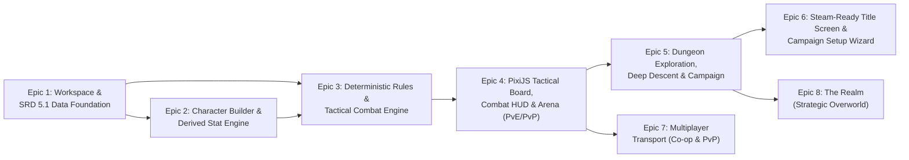

# SRD 5.1 Tactical Dungeon Crawler — Implementation Backlog

This backlog breaks down the [Master Specification](file:///home/jwesterl/ai/srd5-game/SPEC.md) and modular specs ([01](file:///home/jwesterl/ai/srd5-game/docs/spec/01-srd-data-schema.md), [02](file:///home/jwesterl/ai/srd5-game/docs/spec/02-character-builder.md), [03](file:///home/jwesterl/ai/srd5-game/docs/spec/03-combat-and-rules-engine.md), [04](file:///home/jwesterl/ai/srd5-game/docs/spec/04-dungeon-and-ai.md), [05](file:///home/jwesterl/ai/srd5-game/docs/spec/05-multiplayer-and-ui.md), [06](file:///home/jwesterl/ai/srd5-game/docs/spec/06-game-modes-and-progression.md), [07](file:///home/jwesterl/ai/srd5-game/docs/spec/07-main-menu-and-campaign-launcher.md)) into granular, dependency-ordered engineering tickets.

## Status Legend
- `[ ]` Todo
- `[~]` In Progress
- `[x]` Done

---

## Dependency Graph Overview

---

## Epic 1: Monorepo Scaffolding & SRD 5.1 Data Foundation
**Spec Reference**: [SPEC.md](file:///home/jwesterl/ai/srd5-game/SPEC.md), [01-srd-data-schema.md](file:///home/jwesterl/ai/srd5-game/docs/spec/01-srd-data-schema.md)

| ID | Status | Title | Package | Depends On |
| :--- | :---: | :--- | :--- | :--- |
| **SRD-101** | `[x]` | Initialize `pnpm` monorepo, TypeScript configs, Vitest, and CC-BY-4.0 legal notice | `root` | — |
| **SRD-102** | `[x]` | Define core SRD 5.1 enumerations, ChoiceSpec, and Declarative Effect/Modifier DSL Zod schemas | `@srd5/data` | SRD-101 |
| **SRD-103** | `[x]` | Define Zod schemas for Races, Subraces, Classes (L1–20), Subclasses, Backgrounds, and Feats | `@srd5/data` | SRD-102 |
| **SRD-104** | `[x]` | Define Zod schemas for Equipment, Weapons, Armor, Magic Items, Spells, and Monsters | `@srd5/data` | SRD-102 |
| **SRD-105** | `[x]` | Build SRD 5.1 ingestion, normalization, and Effect DSL overlay scripts | `@srd5/data` | SRD-103, SRD-104 |
| **SRD-106** | `[x]` | Bundle normalized SRD 5.1 JSON files and implement referential integrity validation suite | `@srd5/data` | SRD-105 |
| **SRD-107** | `[x]` | Implement typed Compendium lookup API and search/filter indices | `@srd5/data` | SRD-106 |
| **SRD-108** | `[x]` | Implement deterministic seeded PRNG (`Mulberry32`) and 5e Dice & Formula AST evaluator | `@srd5/engine` | SRD-102 |
| **SRD-109** | `[x]` | Scaffold Vite + React 19 + Tailwind client and build the SRD 5.1 Compendium Browser UI | `@srd5/client` | SRD-107 |

### Epic 1 Acceptance Criteria Details
- [x] **SRD-101**: `pnpm install`, `pnpm build`, `pnpm typecheck`, and `pnpm test` run cleanly across `packages/data`, `packages/engine`, `packages/transport`, and `packages/client`. Includes `LEGAL.md` with exact WotC CC-BY-4.0 attribution.
- [x] **SRD-102..106**: 100% of bundled JSON records in `packages/data/src/srd/*.json` pass Zod parsing, cross-reference checks (every spell, item, feature, and monster trait resolves), and SRD 5.1 Product Identity allowlist verification.
- [x] **SRD-108**: Unit tests verify deterministic PRNG replay, `2d20kh1` (Advantage), `2d20kl1` (Disadvantage), Advantage+Disadvantage cancellation, `4d6kh3`, Halfling *Lucky* rerolls, *Great Weapon Fighting* rerolls, critical hit dice doubling, and variable substitution (`@strMod`, `@prof`, `@slotLevel`).
- [x] **SRD-109**: Players can browse, search, and filter all SRD 5.1 Races, Classes, Spells, Equipment, Magic Items, and Monsters in the web UI.

---

## Epic 2: Character Builder & Derived Stat Engine
**Spec Reference**: [02-character-builder.md](file:///home/jwesterl/ai/srd5-game/docs/spec/02-character-builder.md)

| ID | Status | Title | Package | Depends On |
| :--- | :---: | :--- | :--- | :--- |
| **SRD-201** | `[x]` | Define `CharacterBuildState` and `DerivedCharacterSheet` schemas | `@srd5/engine` | SRD-106 |
| **SRD-202** | `[x]` | Implement Ability Score generation validators (Standard Array, 27-Point Buy, Seeded `4d6kh3`) | `@srd5/engine` | SRD-108, SRD-201 |
| **SRD-203** | `[x]` | Implement Choice Tree validator and SRD duplicate proficiency replacement rule | `@srd5/engine` | SRD-201 |
| **SRD-204** | `[x]` | Implement 10-stage `computeDerivedCharacter()` pipeline (Abilities, Saves, Skills, HP, AC, Attacks, Spells) | `@srd5/engine` | SRD-202, SRD-203 |
| **SRD-205** | `[x]` | Implement Level-Up progression engine (Levels 1–20, Subclass unlocks, ASI/Feat, Multiclass spell slots) | `@srd5/engine` | SRD-204 |
| **SRD-206** | `[x]` | Create 4 pre-generated SRD iconic party members (Level 1 Fighter, Wizard, Cleric, Rogue) | `@srd5/data` | SRD-204 |
| **SRD-207** | `[x]` | Build 7-step Character Builder Wizard UI (Origin, Class, Abilities, Background, Equipment, Spells, Review) | `@srd5/client` | SRD-109, SRD-204 |
| **SRD-208** | `[x]` | Build interactive Character Sheet Drawer, Level-Up Modal, and IndexedDB / `.srd5.json` Roster Persistence | `@srd5/client` | SRD-205, SRD-207 |

### Epic 2 Acceptance Criteria Details
- [x] **SRD-204**: Unit tests verify competing AC calculation formulas (Unarmored Defense Barbarian/Monk, Draconic Resilience, Mage Armor, Light/Medium/Heavy Armor + Shield + Defense Fighting Style) always select the highest valid base formula and stack additive bonuses properly.
- [x] **SRD-204**: Weapon attack profile tests verify Finesse (`max(STR, DEX)`), Two-Weapon Fighting off-hand damage modifier omission/inclusion, Archery (`+2` to hit), and Dueling (`+2` damage).
- [x] **SRD-207..208**: Users can create any SRD 5.1 character from scratch, inspect full derived stats and formula tooltips, export/import `.srd5.json` character files, and assemble a 1–4 hero Party Roster.

---

## Epic 3: Headless Tactical Combat & Rules Engine
**Spec Reference**: [03-combat-and-rules-engine.md](file:///home/jwesterl/ai/srd5-game/docs/spec/03-combat-and-rules-engine.md)

| ID | Status | Title | Package | Depends On |
| :--- | :---: | :--- | :--- | :--- |
| **SRD-301** | `[x]` | Implement 5-ft Grid model, Creature Footprints (`1x1`..`4x4`), and A* Pathfinding with Difficult Terrain | `@srd5/engine` | SRD-108 |
| **SRD-302** | `[x]` | Implement Corner-to-Corner Line of Sight, Cover (`+2`/`+5`/Total), and Lighting/Vision (`Darkvision`) | `@srd5/engine` | SRD-301 |
| **SRD-303** | `[x]` | Implement AOE template grid rasterizers (`sphere`, `cube`, `cone`, `line`, `cylinder`) | `@srd5/engine` | SRD-301 |
| **SRD-304** | `[x]` | Implement Initiative tracker, Surprise round handling, and Turn Budget state machine | `@srd5/engine` | SRD-204, SRD-301 |
| **SRD-305** | `[x]` | Implement Weapon Attack, Unarmed Strike, Two-Weapon Fighting, Grapple, and Shove resolution | `@srd5/engine` | SRD-302, SRD-304 |
| **SRD-306** | `[x]` | Implement Spellcasting execution engine (Slots, Bonus Action spell rule, Scaling, Saving Throws, Attack Rolls) | `@srd5/engine` | SRD-303, SRD-304 |
| **SRD-307** | `[x]` | Implement Damage pipeline (Immunity/Resistance/Vulnerability, Temp HP), Instant Death, and Death Saving Throws | `@srd5/engine` | SRD-305, SRD-306 |
| **SRD-308** | `[x]` | Implement Concentration tracking (`DC = max(10, floor(dmg/2))`), Hazard Zones, and all 15 SRD Conditions | `@srd5/engine` | SRD-307 |
| **SRD-309** | `[x]` | Implement Reaction Interrupt pause/resume architecture (`Opportunity Attack`, `Shield`, `Counterspell`, `Protection`, `Uncanny Dodge`) | `@srd5/engine` | SRD-305, SRD-306, SRD-308 |
| **SRD-310** | `[x]` | Author Combat Tier A executable Effect DSL definitions (All L0–L3 combat spells, L1–L5 class features, CR 0–5 monsters) | `@srd5/data`, `@srd5/engine` | SRD-308, SRD-309 |
| **SRD-311** | `[x]` | Implement `LocalTransport` and `projectPlayerView()` Fog-of-War state filter | `@srd5/transport` | SRD-302, SRD-309 |

### Epic 3 Acceptance Criteria Details
- [x] **SRD-301..303**: Pathfinding respects allied traversal (difficult terrain cost), blocks ending a move on occupied cells, blocks moving through hostile spaces (unless 2 sizes different or Halfling), and detects exact steps that exit enemy melee reach.
- [x] **SRD-306**: Enforces the SRD Bonus Action spellcasting restriction (casting a bonus action spell restricts main action spells to 1-action cantrips on the same turn).
- [x] **SRD-307..309**: Automated headless combat tests verify *Shield* reaction turning a hit into a miss, Concentration breaking on failed CON saves, automatic Critical Hits on melee hits within 5 ft against `paralyzed`/`unconscious` targets, and Death Save outcomes (`Nat 1` = 2 fails, `Nat 20` = 1 HP recovery).
- [x] **SRD-310**: Automated headless tests verify executable Effect DSL definitions for all Level 0–3 spells, Level 1–5 activated class features, and CR 0–5 monster attacks, saving throws, and multiattack sequences.
- [x] **SRD-311**: Automated tests verify `LocalTransport` command/event subscription pipeline and `projectPlayerView()` Fog-of-War state projection (marking unexplored/remembered/visible cells, stripping unspotted traps and hidden monsters, and redacting authoritative RNG seed).

---

## Epic 4: PixiJS Tactical Board UI, Combat HUD & The Arena (PvE & PvP)
**Spec Reference**: [04-dungeon-and-ai.md](file:///home/jwesterl/ai/srd5-game/docs/spec/04-dungeon-and-ai.md), [05-multiplayer-and-ui.md](file:///home/jwesterl/ai/srd5-game/docs/spec/05-multiplayer-and-ui.md), [06-game-modes-and-progression.md](file:///home/jwesterl/ai/srd5-game/docs/spec/06-game-modes-and-progression.md)

| ID | Status | Title | Package | Depends On |
| :--- | :---: | :--- | :--- | :--- |
| **SRD-401** | `[x]` | Implement Tactical Monster AI utility planner (`brute`, `skirmisher`, `artillery`, `controller`, `support`) with dynamic team/faction hostility evaluation | `@srd5/engine` | SRD-310 |
| **SRD-402** | `[x]` | Build PixiJS v8 `<TacticalCanvasViewport />` with pan/zoom camera, terrain tile layer, and 5-ft grid overlay | `@srd5/client` | SRD-311 |
| **SRD-403** | `[x]` | Build PixiJS Creature Token layer (HP arcs, condition badges, facing, move animations, floating combat text) | `@srd5/client` | SRD-402 |
| **SRD-404** | `[x]` | Build interactive PixiJS overlays: A* path preview with Opportunity Attack warnings, LoS/Cover rays, and AOE templates | `@srd5/client` | SRD-303, SRD-403 |
| **SRD-405** | `[x]` | Build PixiJS dynamic Lighting & Fog-of-War mask layer (`unexplored`, `remembered`, `dim`, `bright`, `darkvision`) | `@srd5/client` | SRD-311, SRD-402 |
| **SRD-406** | `[x]` | Build React Tactical Combat HUD (Initiative ribbon, Party portraits, Action/Spell/Item hotbar, Turn budget indicator) | `@srd5/client` | SRD-403 |
| **SRD-407** | `[x]` | Build Reaction Interrupt Modal, Animated Dice Tray, and Combat Log with hover formula breakdown tooltips | `@srd5/client` | SRD-309, SRD-406 |
| **SRD-408** | `[x]` | Build The Arena Mode (PvE Custom Skirmish/Endless Waves + Hot-Seat PvP 1v1 Party Duels on PixiJS canvas with dynamic teamId slots) | `@srd5/client` | SRD-401, SRD-404, SRD-407 |
| **SRD-409** | `[x]` | Implement Open Game Asset pipeline (Kenney CC0 spritesheet integration, game-icons.net SVG set, 3-tier AssetRegistry with procedural fallback) | `@srd5/client` | SRD-403, SRD-408 |

### Epic 4 Acceptance Criteria Details
- [x] **SRD-401**: AI unit tests verify Goblins use *Nimble Escape*, Wolves position for *Pack Tactics*, Artillery monsters seek cover and avoid melee, and AoE casters place *Fireball*/*Breath Weapon* templates to maximize enemy hits while avoiding allies using `areHostile()` and `areAllied()` from Spec 06 Section 2.3. Supports multi-way brawls (monsters fighting other hostile monster teams).
- [x] **SRD-408**: Players can launch Arena Mode in the browser: run PvE skirmishes against AI monsters, survive consecutive waves with breathers, or play hot-seat 1v1 PvP where each player commands their chosen party on the tactical grid using dynamic `teamId` slots (`team_red` vs `team_blue`).
- [x] **SRD-409**: Load bundled CC0/CC-BY tiles and tokens from sprite atlas with NEAREST scaling; render game-icons.net SVG icons for action buttons, spells, and conditions; and seamlessly fall back to procedural tabletop tokens when no sprite is assigned, ensuring zero broken textures across all SRD monsters.

---

## Epic 5: Dungeon Exploration, The Deep Descent (NetHack Roguelite) & Campaign
**Spec Reference**: [04-dungeon-and-ai.md](file:///home/jwesterl/ai/srd5-game/docs/spec/04-dungeon-and-ai.md), [06-game-modes-and-progression.md](file:///home/jwesterl/ai/srd5-game/docs/spec/06-game-modes-and-progression.md)

| ID | Status | Title | Package | Depends On |
| :--- | :---: | :--- | :--- | :--- |
| **SRD-501** | `[x]` | Implement `DungeonFloorSpec` schema, multi-room state, and Party Marching Order movement in Exploration Mode | `@srd5/engine` | SRD-311 |
| **SRD-502** | `[x]` | Implement Interactive Props: Doors, Locked Chests, Secret Doors, and Traps (Passive Perception, Search, Pick Lock, Disarm) | `@srd5/engine` | SRD-501 |
| **SRD-503** | `[x]` | Implement Exploration-to-Combat transition and Stealth/Surprise checks when spotting monster groups | `@srd5/engine` | SRD-304, SRD-501 |
| **SRD-504** | `[x]` | Implement Short Rest (Hit Dice spending, *Song of Rest*, *Arcane Recovery*) and Long Rest (HP/Slot/Hit Dice reset, ambush check) | `@srd5/engine` | SRD-501 |
| **SRD-505** | `[x]` | Implement Loot tables, Magic Item Attunement (max 3), XP awards, and between-combat Level-Up flow | `@srd5/engine`, `@srd5/client` | SRD-208, SRD-504 |
| **SRD-506** | `[x]` | Author 3-floor starter campaign module: *"The Sunken Crypt of Kaelen"* (Levels 1–4) | `@srd5/data` | SRD-502, SRD-503, SRD-505 |
| **SRD-507** | `[x]` | Build Dungeon Exploration HUD (Stealth toggle, Marching Order, Rest Camp modal, Loot & Inventory modal, Save/Load slots) | `@srd5/client` | SRD-408, SRD-506 |
| **SRD-508** | `[x]` | Implement `DungeonGenerator` procedural floor algorithm (BSP rooms, corridors, stairs down/up, guaranteed BFS connectivity) | `@srd5/engine` | SRD-501, SRD-502 |
| **SRD-509** | `[x]` | Implement The Deep Descent Roguelite Engine (Biome tiers 1–13+, Depth scaling, Supply/Exhaustion tension, Shrines, Run Scoring) | `@srd5/engine`, `@srd5/client` | SRD-507, SRD-508 |

### Epic 5 Acceptance Criteria Details
- [x] **SRD-501..507**: A player party can enter Floor 1 of *"The Sunken Crypt of Kaelen"*, explore rooms under fog of war, detect and disarm traps, pick locks, fight multiple monster encounters, take Short and Long Rests, equip and attune discovered SRD magic items, level up from Level 1 to Level 4, and defeat the Floor 3 boss.
- [x] **SRD-508..509**: Players can embark on an endless **Deep Descent Roguelite Run**: descend through procedurally generated floors, encounter depth-scaled monsters and themed biomes (Catacombs, Sunken Tombs, Magma Caverns, Deep Vaults), manage rations and exhaustion during rests, use Shrines of Fate, and view final run score and graveyard stats on run completion or party death.

---

## Epic 6: Steam-Ready Title Screen & "New Game" Campaign Setup Wizard
**Spec Reference**: [07-main-menu-and-campaign-launcher.md](file:///home/jwesterl/ai/srd5-game/docs/spec/07-main-menu-and-campaign-launcher.md)

| ID | Status | Title | Package | Depends On |
| :--- | :---: | :--- | :--- | :--- |
| **SRD-601** | `[x]` | Build Steam-ready Title Screen & Main Menu (`TitleMenuView.tsx`) with dark fantasy styling, continue/load detection, and responsive handheld/desktop layout | `@srd5/client` | SRD-507, SRD-509 |
| **SRD-602** | `[x]` | Build 4-Stage "New Game" Campaign Launcher Wizard (`CampaignSetupWizard.tsx`) with Mode Selection, Difficulty presets, and Narrative Prologue | `@srd5/client` | SRD-601 |
| **SRD-603** | `[x]` | Build 4-Slot Campfire Party Assembly & Recruitment UI (Pregen quick-picks, Character Vault import, `.srd5.json` file drop, "Roll New Hero" builder return callback, and multiplayer seat assignment hook) | `@srd5/client` | SRD-208, SRD-602 |
| **SRD-604** | `[x]` | Build Universal In-Game Pause / System Menu (`PauseMenuModal.tsx`) with `Esc` toggle, Quicksave/Load, Settings, and Exit to Title | `@srd5/client` | SRD-507, SRD-601 |
| **SRD-605** | `[x]` | Build automated Playwright E2E suite verifying the complete New Game creation & launch flow across all 3 game modes at 1280×800 resolution | `@srd5/client` | SRD-602, SRD-603, SRD-604 |
| **SRD-606** | `[ ]` | Implement Configurable Friendly Fire Ruleset & AOE Targeting Filter (`friendlyFireEnabled`) | `@srd5/engine`, `@srd5/client` | SRD-306, SRD-602 |

### Epic 6 Acceptance Criteria Details
- [x] **SRD-601**: App launch defaults to `TitleMenuView` with CRPG dark-fantasy aesthetic, animated torchlight/vignette styling, active save detection ("Continue" enabled with floor/party info), Character Vault, Compendium, Settings, and statutory CC-BY-4.0 attribution modal.
- [x] **SRD-602**: Players can walk through Stage 1 (Mode Selection: Crypt of Kaelen / Deep Descent / The Arena) &rarr; Stage 2 (Difficulty: Explorer / Standard / Tactician with custom toggles) &rarr; Stage 4 (Narrative Prologue with thematic story briefing and launch CTA).
- [x] **SRD-603**: Players can configure a 1–4 member party in Stage 3: one-click populate with 4 SRD pregens (Valeros, Merisiel, Kyra, Ezren), select heroes from the Character Vault, drag-and-drop `.srd5.json` files, or launch the 7-step builder and automatically return the created hero to the chosen slot. Displays party balance synergy badges.
- [x] **SRD-604**: Pressing `Esc` or clicking the system gear icon in any gameplay mode opens `PauseMenuModal` to resume, quicksave to IndexedDB, load a saved slot, inspect party sheets, or return to the main menu with unsaved progress confirmation.
- [x] **SRD-605**: Playwright automated suite runs headlessly, navigates from Title Screen through New Game wizard, populates party, launches each game mode (Campaign, Deep Descent, Arena), and verifies zero UI clipping or console errors at 1280×800 (Steam Deck) resolution.
- [ ] **SRD-606**: Unit tests in `@srd5/engine` verify that casting offensive AOE spells (*Fireball*, *Burning Hands*) with `friendlyFireEnabled: false` only damages hostile enemies and excludes party allies from saving throws and damage. Campaign setup wizard and difficulty presets correctly configure `friendlyFireEnabled` (false for Explorer, true for Standard/Tactician) with toggle in custom rules drawer.

---

## Epic 7: Cooperative & Competitive Multiplayer Extension
**Spec Reference**: [05-multiplayer-and-ui.md](file:///home/jwesterl/ai/srd5-game/docs/spec/05-multiplayer-and-ui.md), [06-game-modes-and-progression.md](file:///home/jwesterl/ai/srd5-game/docs/spec/06-game-modes-and-progression.md)

| ID | Status | Title | Package | Depends On |
| :--- | :---: | :--- | :--- | :--- |
| **SRD-701** | `[ ]` | Implement authoritative WebSocket Room Server (`@srd5/server`) wrapping `@srd5/engine` | `@srd5/server` | SRD-311, SRD-504 |
| **SRD-702** | `[ ]` | Implement `WebSocketTransport` client adapter, Lobby room codes, and Player-to-Character slot assignment (Co-op & PvP) | `@srd5/transport`, `@srd5/client` | SRD-701 |
| **SRD-703** | `[ ]` | Implement multiplayer Reaction prompt timers and per-player Fog-of-War state synchronization | `@srd5/server`, `@srd5/client` | SRD-702 |
| **SRD-704** | `[ ]` | Expand Combat Tier B & C Effect DSL coverage (Levels 6–20 spells, features, and CR 6–20 monsters) | `@srd5/data`, `@srd5/engine` | SRD-310 |

---

## Epic 8: The Realm (Strategic Overworld / Master of Magic Style)
**Spec Reference**: [06-game-modes-and-progression.md](file:///home/jwesterl/ai/srd5-game/docs/spec/06-game-modes-and-progression.md)

| ID | Status | Title | Package | Depends On |
| :--- | :---: | :--- | :--- | :--- |
| **SRD-801** | `[ ]` | Implement `OverworldMap` procedural generator (macro hex/tile grid, biomes, rivers, roads, elevation) | `@srd5/engine` | SRD-508 |
| **SRD-802** | `[ ]` | Implement Overworld Party Travel loop (daily movement pace, foraging, weather, camping, day/night cycles) | `@srd5/engine` | SRD-504, SRD-801 |
| **SRD-803** | `[ ]` | Implement Faction reputation engine (-100 to +100), procedural settlements, shops, and quest boards | `@srd5/engine` | SRD-801 |
| **SRD-804** | `[ ]` | Implement Seamless Overworld-to-Tactical Grid battle generator (Wilderness encounters and Dungeon POI entries) | `@srd5/engine` | SRD-301, SRD-802 |
| **SRD-805** | `[ ]` | Build PixiJS Overworld Viewport & Strategic Settlement HUD (World navigation, town services, quest journal) | `@srd5/client` | SRD-402, SRD-803, SRD-804 |

### Epic 8 Acceptance Criteria Details
- [ ] **SRD-801..805**: Players can generate an expansive procedural world map, travel between towns and factions across biomes, accept bounty and dungeon quests, recruit or buy gear in settlements, and engage wandering enemies or enter dungeon POIs with seamless transition into tactical turn-based combat on the 5-ft grid.
