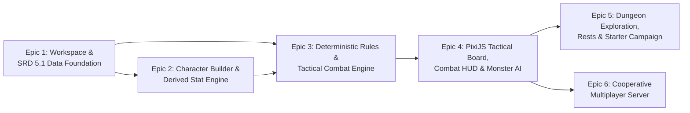

# SRD 5.1 Tactical Dungeon Crawler — Implementation Backlog

This backlog breaks down the [Master Specification](file:///home/jwesterl/ai/srd5-game/SPEC.md) and modular specs ([01](file:///home/jwesterl/ai/srd5-game/docs/spec/01-srd-data-schema.md), [02](file:///home/jwesterl/ai/srd5-game/docs/spec/02-character-builder.md), [03](file:///home/jwesterl/ai/srd5-game/docs/spec/03-combat-and-rules-engine.md), [04](file:///home/jwesterl/ai/srd5-game/docs/spec/04-dungeon-and-ai.md), [05](file:///home/jwesterl/ai/srd5-game/docs/spec/05-multiplayer-and-ui.md)) into granular, dependency-ordered engineering tickets.

## Status Legend
- `[ ]` Todo
- `[~]` In Progress
- `[x]` Done

---

## Dependency Graph Overview

---

## Epic 1: Monorepo Scaffolding & SRD 5.1 Data Foundation
**Spec Reference**: [SPEC.md](file:///home/jwesterl/ai/srd5-game/SPEC.md), [01-srd-data-schema.md](file:///home/jwesterl/ai/srd5-game/docs/spec/01-srd-data-schema.md)

| ID | Status | Title | Package | Depends On |
| :--- | :---: | :--- | :--- | :--- |
| **SRD-101** | `[x]` | Initialize `pnpm` monorepo, TypeScript configs, Vitest, and CC-BY-4.0 legal notice | `root` | — |
| **SRD-102** | `[x]` | Define core SRD 5.1 enumerations, ChoiceSpec, and Declarative Effect/Modifier DSL Zod schemas | `@srd5/data` | SRD-101 |
| **SRD-103** | `[x]` | Define Zod schemas for Races, Subraces, Classes (L1–20), Subclasses, Backgrounds, and Feats | `@srd5/data` | SRD-102 |
| **SRD-104** | `[x]` | Define Zod schemas for Equipment, Weapons, Armor, Magic Items, Spells, and Monsters | `@srd5/data` | SRD-102 |
| **SRD-105** | `[x]` | Build SRD 5.1 ingestion, normalization, and Effect DSL overlay scripts | `@srd5/data` | SRD-103, SRD-104 |
| **SRD-106** | `[x]` | Bundle normalized SRD 5.1 JSON files and implement referential integrity validation suite | `@srd5/data` | SRD-105 |
| **SRD-107** | `[x]` | Implement typed Compendium lookup API and search/filter indices | `@srd5/data` | SRD-106 |
| **SRD-108** | `[x]` | Implement deterministic seeded PRNG (`Mulberry32`) and 5e Dice & Formula AST evaluator | `@srd5/engine` | SRD-102 |
| **SRD-109** | `[x]` | Scaffold Vite + React 19 + Tailwind client and build the SRD 5.1 Compendium Browser UI | `@srd5/client` | SRD-107 |

### Epic 1 Acceptance Criteria Details
- [x] **SRD-101**: `pnpm install`, `pnpm build`, `pnpm typecheck`, and `pnpm test` run cleanly across `packages/data`, `packages/engine`, `packages/transport`, and `packages/client`. Includes `LEGAL.md` with exact WotC CC-BY-4.0 attribution.
- [x] **SRD-102..106**: 100% of bundled JSON records in `packages/data/src/srd/*.json` pass Zod parsing, cross-reference checks (every spell, item, feature, and monster trait resolves), and SRD 5.1 Product Identity allowlist verification.
- [x] **SRD-108**: Unit tests verify deterministic PRNG replay, `2d20kh1` (Advantage), `2d20kl1` (Disadvantage), Advantage+Disadvantage cancellation, `4d6kh3`, Halfling *Lucky* rerolls, *Great Weapon Fighting* rerolls, critical hit dice doubling, and variable substitution (`@strMod`, `@prof`, `@slotLevel`).
- [x] **SRD-109**: Players can browse, search, and filter all SRD 5.1 Races, Classes, Spells, Equipment, Magic Items, and Monsters in the web UI.

---

## Epic 2: Character Builder & Derived Stat Engine
**Spec Reference**: [02-character-builder.md](file:///home/jwesterl/ai/srd5-game/docs/spec/02-character-builder.md)

| ID | Status | Title | Package | Depends On |
| :--- | :---: | :--- | :--- | :--- |
| **SRD-201** | `[x]` | Define `CharacterBuildState` and `DerivedCharacterSheet` schemas | `@srd5/engine` | SRD-106 |
| **SRD-202** | `[x]` | Implement Ability Score generation validators (Standard Array, 27-Point Buy, Seeded `4d6kh3`) | `@srd5/engine` | SRD-108, SRD-201 |
| **SRD-203** | `[x]` | Implement Choice Tree validator and SRD duplicate proficiency replacement rule | `@srd5/engine` | SRD-201 |
| **SRD-204** | `[x]` | Implement 10-stage `computeDerivedCharacter()` pipeline (Abilities, Saves, Skills, HP, AC, Attacks, Spells) | `@srd5/engine` | SRD-202, SRD-203 |
| **SRD-205** | `[x]` | Implement Level-Up progression engine (Levels 1–20, Subclass unlocks, ASI/Feat, Multiclass spell slots) | `@srd5/engine` | SRD-204 |
| **SRD-206** | `[ ]` | Create 4 pre-generated SRD iconic party members (Level 1 Fighter, Wizard, Cleric, Rogue) | `@srd5/data` | SRD-204 |
| **SRD-207** | `[ ]` | Build 7-step Character Builder Wizard UI (Origin, Class, Abilities, Background, Equipment, Spells, Review) | `@srd5/client` | SRD-109, SRD-204 |
| **SRD-208** | `[ ]` | Build interactive Character Sheet Drawer, Level-Up Modal, and IndexedDB / `.srd5.json` Roster Persistence | `@srd5/client` | SRD-205, SRD-207 |

### Epic 2 Acceptance Criteria Details
- [x] **SRD-204**: Unit tests verify competing AC calculation formulas (Unarmored Defense Barbarian/Monk, Draconic Resilience, Mage Armor, Light/Medium/Heavy Armor + Shield + Defense Fighting Style) always select the highest valid base formula and stack additive bonuses properly.
- [x] **SRD-204**: Weapon attack profile tests verify Finesse (`max(STR, DEX)`), Two-Weapon Fighting off-hand damage modifier omission/inclusion, Archery (`+2` to hit), and Dueling (`+2` damage).
- [ ] **SRD-207..208**: Users can create any SRD 5.1 character from scratch, inspect full derived stats and formula tooltips, export/import `.srd5.json` character files, and assemble a 1–4 hero Party Roster.

---

## Epic 3: Headless Tactical Combat & Rules Engine
**Spec Reference**: [03-combat-and-rules-engine.md](file:///home/jwesterl/ai/srd5-game/docs/spec/03-combat-and-rules-engine.md)

| ID | Status | Title | Package | Depends On |
| :--- | :---: | :--- | :--- | :--- |
| **SRD-301** | `[ ]` | Implement 5-ft Grid model, Creature Footprints (`1x1`..`4x4`), and A* Pathfinding with Difficult Terrain | `@srd5/engine` | SRD-108 |
| **SRD-302** | `[ ]` | Implement Corner-to-Corner Line of Sight, Cover (`+2`/`+5`/Total), and Lighting/Vision (`Darkvision`) | `@srd5/engine` | SRD-301 |
| **SRD-303** | `[ ]` | Implement AOE template grid rasterizers (`sphere`, `cube`, `cone`, `line`, `cylinder`) | `@srd5/engine` | SRD-301 |
| **SRD-304** | `[ ]` | Implement Initiative tracker, Surprise round handling, and Turn Budget state machine | `@srd5/engine` | SRD-204, SRD-301 |
| **SRD-305** | `[ ]` | Implement Weapon Attack, Unarmed Strike, Two-Weapon Fighting, Grapple, and Shove resolution | `@srd5/engine` | SRD-302, SRD-304 |
| **SRD-306** | `[ ]` | Implement Spellcasting execution engine (Slots, Bonus Action spell rule, Scaling, Saving Throws, Attack Rolls) | `@srd5/engine` | SRD-303, SRD-304 |
| **SRD-307** | `[ ]` | Implement Damage pipeline (Immunity/Resistance/Vulnerability, Temp HP), Instant Death, and Death Saving Throws | `@srd5/engine` | SRD-305, SRD-306 |
| **SRD-308** | `[ ]` | Implement Concentration tracking (`DC = max(10, floor(dmg/2))`), Hazard Zones, and all 15 SRD Conditions | `@srd5/engine` | SRD-307 |
| **SRD-309** | `[ ]` | Implement Reaction Interrupt pause/resume architecture (`Opportunity Attack`, `Shield`, `Counterspell`, `Protection`, `Uncanny Dodge`) | `@srd5/engine` | SRD-305, SRD-306, SRD-308 |
| **SRD-310** | `[ ]` | Author Combat Tier A executable Effect DSL definitions (All L0–L3 combat spells, L1–L5 class features, CR 0–5 monsters) | `@srd5/data`, `@srd5/engine` | SRD-308, SRD-309 |
| **SRD-311** | `[ ]` | Implement `LocalTransport` and `projectPlayerView()` Fog-of-War state filter | `@srd5/transport` | SRD-302, SRD-309 |

### Epic 3 Acceptance Criteria Details
- [ ] **SRD-301..303**: Pathfinding respects allied traversal (difficult terrain cost), blocks ending a move on occupied cells, blocks moving through hostile spaces (unless 2 sizes different or Halfling), and detects exact steps that exit enemy melee reach.
- [ ] **SRD-306**: Enforces the SRD Bonus Action spellcasting restriction (casting a bonus action spell restricts main action spells to 1-action cantrips on the same turn).
- [ ] **SRD-307..309**: Automated headless combat tests verify *Shield* reaction turning a hit into a miss, Concentration breaking on failed CON saves, automatic Critical Hits on melee hits within 5 ft against `paralyzed`/`unconscious` targets, and Death Save outcomes (`Nat 1` = 2 fails, `Nat 20` = 1 HP recovery).

---

## Epic 4: PixiJS Tactical Board UI, Combat HUD & Monster AI
**Spec Reference**: [04-dungeon-and-ai.md](file:///home/jwesterl/ai/srd5-game/docs/spec/04-dungeon-and-ai.md), [05-multiplayer-and-ui.md](file:///home/jwesterl/ai/srd5-game/docs/spec/05-multiplayer-and-ui.md)

| ID | Status | Title | Package | Depends On |
| :--- | :---: | :--- | :--- | :--- |
| **SRD-401** | `[ ]` | Implement Tactical Monster AI utility planner (`brute`, `skirmisher`, `artillery`, `controller`, `support`) | `@srd5/engine` | SRD-310 |
| **SRD-402** | `[ ]` | Build PixiJS v8 `<TacticalCanvasViewport />` with pan/zoom camera, terrain tile layer, and 5-ft grid overlay | `@srd5/client` | SRD-311 |
| **SRD-403** | `[ ]` | Build PixiJS Creature Token layer (HP arcs, condition badges, facing, move animations, floating combat text) | `@srd5/client` | SRD-402 |
| **SRD-404** | `[ ]` | Build interactive PixiJS overlays: A* path preview with Opportunity Attack warnings, LoS/Cover rays, and AOE templates | `@srd5/client` | SRD-303, SRD-403 |
| **SRD-405** | `[ ]` | Build PixiJS dynamic Lighting & Fog-of-War mask layer (`unexplored`, `remembered`, `dim`, `bright`, `darkvision`) | `@srd5/client` | SRD-311, SRD-402 |
| **SRD-406** | `[ ]` | Build React Tactical Combat HUD (Initiative ribbon, Party portraits, Action/Spell/Item hotbar, Turn budget indicator) | `@srd5/client` | SRD-403 |
| **SRD-407** | `[ ]` | Build Reaction Interrupt Modal, Animated Dice Tray, and Combat Log with hover formula breakdown tooltips | `@srd5/client` | SRD-309, SRD-406 |
| **SRD-408** | `[ ]` | Build Arena Skirmish Mode (Select party + map + SRD monster encounter preset and play full tactical combat) | `@srd5/client` | SRD-401, SRD-404, SRD-407 |

### Epic 4 Acceptance Criteria Details
- [ ] **SRD-401**: AI unit tests verify Goblins use *Nimble Escape*, Wolves position for *Pack Tactics*, Artillery monsters seek cover and avoid melee, and AoE casters place *Fireball*/*Breath Weapon* templates to maximize hero hits while avoiding allies.
- [ ] **SRD-408**: Players can launch Arena Skirmish Mode in the browser, control a 4-hero party on the PixiJS tactical grid against AI monsters, use weapons, spells, and reactions, and complete encounters from start to finish.

---

## Epic 5: Dungeon Exploration Loop, Rests & Starter Campaign
**Spec Reference**: [04-dungeon-and-ai.md](file:///home/jwesterl/ai/srd5-game/docs/spec/04-dungeon-and-ai.md)

| ID | Status | Title | Package | Depends On |
| :--- | :---: | :--- | :--- | :--- |
| **SRD-501** | `[ ]` | Implement `DungeonFloorSpec` schema, multi-room state, and Party Marching Order movement in Exploration Mode | `@srd5/engine` | SRD-311 |
| **SRD-502** | `[ ]` | Implement Interactive Props: Doors, Locked Chests, Secret Doors, and Traps (Passive Perception, Search, Pick Lock, Disarm) | `@srd5/engine` | SRD-501 |
| **SRD-503** | `[ ]` | Implement Exploration-to-Combat transition and Stealth/Surprise checks when spotting monster groups | `@srd5/engine` | SRD-304, SRD-501 |
| **SRD-504** | `[ ]` | Implement Short Rest (Hit Dice spending, *Song of Rest*, *Arcane Recovery*) and Long Rest (HP/Slot/Hit Dice reset, ambush check) | `@srd5/engine` | SRD-501 |
| **SRD-505** | `[ ]` | Implement Loot tables, Magic Item Attunement (max 3), XP awards, and between-combat Level-Up flow | `@srd5/engine`, `@srd5/client` | SRD-208, SRD-504 |
| **SRD-506** | `[ ]` | Author 3-floor starter campaign module: *"The Sunken Crypt of Kaelen"* (Levels 1–4) | `@srd5/data` | SRD-502, SRD-503, SRD-505 |
| **SRD-507** | `[ ]` | Build Dungeon Exploration HUD (Stealth toggle, Marching Order, Rest Camp modal, Loot & Inventory modal, Save/Load slots) | `@srd5/client` | SRD-408, SRD-506 |

### Epic 5 Acceptance Criteria Details
- [ ] **SRD-501..507**: A player party can enter Floor 1 of *"The Sunken Crypt of Kaelen"*, explore rooms under fog of war, detect and disarm traps, pick locks, fight multiple monster encounters, take Short and Long Rests, equip and attune discovered SRD magic items, level up from Level 1 to Level 4, and defeat the Floor 3 boss.

---

## Epic 6: Cooperative Multiplayer Extension & High-Level Content
**Spec Reference**: [05-multiplayer-and-ui.md](file:///home/jwesterl/ai/srd5-game/docs/spec/05-multiplayer-and-ui.md)

| ID | Status | Title | Package | Depends On |
| :--- | :---: | :--- | :--- | :--- |
| **SRD-601** | `[ ]` | Implement authoritative WebSocket Room Server (`@srd5/server`) wrapping `@srd5/engine` | `@srd5/server` | SRD-311, SRD-504 |
| **SRD-602** | `[ ]` | Implement `WebSocketTransport` client adapter, Lobby room codes, and Player-to-Character slot assignment | `@srd5/transport`, `@srd5/client` | SRD-601 |
| **SRD-603** | `[ ]` | Implement multiplayer Reaction prompt timers and per-player Fog-of-War state synchronization | `@srd5/server`, `@srd5/client` | SRD-602 |
| **SRD-604** | `[ ]` | Expand Combat Tier B & C Effect DSL coverage (Levels 6–20 spells, features, and CR 6–20 monsters) | `@srd5/data`, `@srd5/engine` | SRD-310 |
