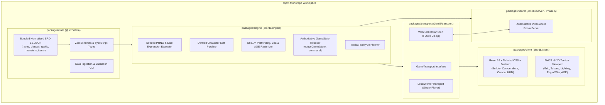

# SRD 5.1 Tactical Turn-Based Dungeon Crawler — Master Specification

## 1. Executive Summary

**SRD5 Tactical Dungeon Crawler** is a web-based, turn-based tactical roleplaying game built on the rules of the **System Reference Document 5.1 (SRD 5.1)** released under Creative Commons Attribution 4.0 International (CC-BY-4.0).

Players create and manage a party of 1–4 custom heroes (or select pre-generated heroes) using a complete SRD 5.1 Character Builder, explore multi-room grid dungeons, interact with doors, traps, chests, and shrines, and fight tactical turn-based encounters on a 5-foot square grid against AI-controlled SRD monsters.

While the initial release targets **single-player party control in the browser**, the entire engine is architected around a **deterministic, command/event-driven state machine** with strict separation between the headless rules engine (`@srd5/engine`) and the PixiJS/React presentation client (`@srd5/client`). This enables seamless transition to **cooperative multiplayer** over WebSockets in a future milestone without rewriting rules or UI logic.

---

## 2. Specification Index

This repository's specification is organized into modular engineering documents under `docs/spec/`:

| Document | Scope & Contents |
| :--- | :--- |
| **[01-srd-data-schema.md](file:///home/jwesterl/ai/srd5-game/docs/spec/01-srd-data-schema.md)** | Complete SRD 5.1 normalized JSON schemas (Zod/TypeScript), offline data bundling & ingestion scripts, and the declarative **Effect & Modifier DSL** bridging static SRD data to executable rules. |
| **[02-character-builder.md](file:///home/jwesterl/ai/srd5-game/docs/spec/02-character-builder.md)** | Character Creation state machine, choice-tree resolution (races, classes L1–20, backgrounds, point buy/standard array/4d6kh3, equipment, spellbooks), and the pure **Derived Stat Calculation Pipeline**. |
| **[03-combat-and-rules-engine.md](file:///home/jwesterl/ai/srd5-game/docs/spec/03-combat-and-rules-engine.md)** | Seeded deterministic PRNG & dice engine, 5e turn lifecycle, action economy, reaction interrupts (`Opportunity Attack`, `Shield`, `Counterspell`), 5-ft grid geometry, A* pathfinding, Bresenham/shadowcasting Line of Sight, cover, lighting, conditions, concentration, and death saves. |
| **[04-dungeon-and-ai.md](file:///home/jwesterl/ai/srd5-game/docs/spec/04-dungeon-and-ai.md)** | Multi-room dungeon format, exploration-to-combat transition, interactive props (locked/trapped doors, chests), Short & Long Rest mechanics, loot/XP progression, and utility-based Tactical Monster AI archetypes. |
| **[05-multiplayer-and-ui.md](file:///home/jwesterl/ai/srd5-game/docs/spec/05-multiplayer-and-ui.md)** | Multiplayer-ready Command/Event transport layer, per-player Fog-of-War state projection (`PlayerViewState`), PixiJS 2D canvas rendering pipeline, and React HUD/Compendium/Builder UI architecture. |

---

## 3. Legal & Licensing Compliance (CC-BY-4.0)

### 3.1 Attribution Requirement
Every build, character export, and the in-app Credits/About screen MUST include the exact statutory attribution required by SRD 5.1 CC-BY-4.0:

> This work includes material taken from the System Reference Document 5.1 ("SRD 5.1") by Wizards of the Coast LLC and available at https://dnd.wizards.com/resources/systems-reference-document. The SRD 5.1 is licensed under the Creative Commons Attribution 4.0 International License available at https://creativecommons.org/licenses/by/4.0/legalcode.

### 3.2 Content Boundary Guardrails
- **Included**: All 9 SRD races (+ subraces), 12 SRD classes (+ 1 SRD subclass each), 1 SRD background (Acolyte) + custom SRD-compliant background builder, SRD feats (Grappler) + custom ASI/Feat framework, ~320 SRD monsters, ~319 SRD spells, SRD equipment & magic items, conditions, and rules text.
- **Excluded (Product Identity)**: Non-SRD monsters (e.g., Beholder, Mind Flayer, Displacer Beast, Carrion Crawler, Umber Hulk, Yuan-ti), non-SRD spells/subclasses, and trademarked setting names. The data validation pipeline enforces an allowlist matching the official SRD 5.1 index.

---

## 4. System Architecture & Monorepo Layout



### 4.1 Directory Structure

```text
srd5-game/
├── SPEC.md
├── docs/
│   └── spec/
│       ├── 01-srd-data-schema.md
│       ├── 02-character-builder.md
│       ├── 03-combat-and-rules-engine.md
│       ├── 04-dungeon-and-ai.md
│       └── 05-multiplayer-and-ui.md
├── package.json
├── pnpm-workspace.yaml
├── tsconfig.base.json
└── packages/
    ├── data/                  # @srd5/data: Bundled SRD 5.1 JSON, Zod schemas, lookup indices
    │   ├── scripts/           # Ingestion, normalization, and validation scripts
    │   ├── src/
    │   │   ├── schemas/       # Zod schemas for every SRD entity & Effect DSL
    │   │   ├── srd/           # Bundled normalized JSON datasets (offline-ready)
    │   │   └── index.ts       # Typed compendium lookup API
    ├── engine/                # @srd5/engine: Pure TS deterministic rules & combat engine
    │   ├── src/
    │   │   ├── dice/          # Seeded PRNG (Mulberry32/PCG) & dice parser
    │   │   ├── character/     # Character builder validator & derived stat calculator
    │   │   ├── grid/          # 5ft grid, A* pathfinder, shadowcasting LoS, AOE shapes
    │   │   ├── combat/        # Initiative, action economy, attacks, spells, reactions
    │   │   ├── effects/       # Declarative modifier, condition & concentration engine
    │   │   ├── dungeon/       # Exploration mode, doors, traps, rests, loot
    │   │   ├── ai/            # Tactical monster AI evaluator
    │   │   └── state/         # Serializable GameState, GameCommand, GameEvent
    ├── transport/             # @srd5/transport: Client-Engine communication abstraction
    │   └── src/
    │       ├── types.ts       # GameTransport interface & PlayerViewState filter
    │       ├── local.ts       # In-memory / Web Worker transport for single-player
    │       └── websocket.ts   # Multiplayer WebSocket adapter stub/implementation
    ├── client/                # @srd5/client: Vite + React + PixiJS web application
    │   └── src/
    │       ├── canvas/        # PixiJS v8 viewport, token sprites, fog shader, AOE overlays
    │       ├── components/    # Character builder, Compendium, Combat HUD, Dice tray
    │       ├── store/         # Zustand client store synced with GameTransport
    │       └── persistence/   # IndexedDB / LocalStorage save games & character roster
    └── server/                # @srd5/server: Phase 6 multiplayer room host
```

---

## 5. Technology Stack

| Layer | Technology | Rationale |
| :--- | :--- | :--- |
| **Language** | TypeScript 5.x (Strict mode) | End-to-end type safety across SRD data, rules engine, transport, and UI. |
| **Package Manager** | `pnpm` workspaces | Fast, strict dependency isolation across `@srd5/*` packages. |
| **Schema & Validation** | `zod` | Validates bundled SRD 5.1 JSON at build/test time and validates network commands at runtime. |
| **2D Tactical Renderer** | `pixi.js` (v8) + HTML5 Canvas | Hardware-accelerated WebGL/WebGPU 2D rendering for grid tiles, dynamic lighting/fog-of-war masks, smooth camera pan/zoom, and particle effects. |
| **UI Framework** | `react` (v19) + `tailwindcss` | Ideal for complex data-heavy interfaces (Character Builder, Spell Compendium, Inventory, Initiative Tracker, Combat Log). |
| **State Management** | `zustand` + `immer` | Lightweight reactive store on the client; immutable structural updates in the engine. |
| **Persistence** | `idb-keyval` (IndexedDB) + JSON export | Local save slots for characters, parties, and in-progress dungeon runs, plus portable `.srd5.json` file export/import. |
| **Testing** | `vitest` + `@testing-library/react` | Fast unit and property-based testing for deterministic rules engine, stat derivation, and UI flows. |

---

## 6. Two-Tier SRD 5.1 Capability Model

Because SRD 5.1 contains 12 classes across 20 levels, ~319 spells, and ~320 monsters, the engine separates **Data & Sheet Completeness** from **Tactical Combat Automation**:

1. **Tier 1 — Full Compendium & Character Builder Coverage (100% SRD 5.1)**:
   - Every SRD race, subrace, class (levels 1–20), subclass, background, equipment item, spell, monster, and condition is present in `@srd5/data`, browsable in the Compendium, and usable in the Character Builder with accurate stat derivation.
2. **Tier 2 — Composable Combat Effect Primitives**:
   - Combat execution uses a declarative **Effect & Modifier DSL** (defined in [01-srd-data-schema.md](file:///home/jwesterl/ai/srd5-game/docs/spec/01-srd-data-schema.md)) composed of ~25 atomic primitives (`melee_weapon_attack`, `ranged_spell_attack`, `saving_throw`, `deal_damage`, `heal`, `grant_temp_hp`, `apply_condition`, `create_zone`, `summon`, `modify_stat`, `restore_resource`, `teleport`, etc.).
   - **Milestone Coverage Targets**:
     - **Combat Tier A (Levels 1–5 Core)**: 100% automated execution for all Level 0–3 combat spells, all base class/subclass features for levels 1–5, and all CR 0–5 monsters.
     - **Combat Tier B (Levels 6–10 Mid-Tier)**: Automated execution for Level 4–5 spells, Level 6–10 class features, and CR 6–10 monsters.
     - **Combat Tier C (Levels 11–20 High-Tier & Utility Fallback)**: High-level spells/features and narrative/utility spells (e.g., *Speak with Dead*, *Legend Lore*) execute via structured effect blocks or a graceful "Manual/Adjudicated Resolution" fallback card so no spell or feature ever crashes or soft-locks a game.

---

## 7. Phased Implementation Roadmap

### Phase 1: Monorepo Scaffolding & SRD 5.1 Data Foundation
- Initialize `pnpm` workspace (`@srd5/data`, `@srd5/engine`, `@srd5/transport`, `@srd5/client`).
- Implement Zod schemas for all SRD 5.1 entities and Effect DSL (`packages/data/src/schemas/`).
- Build data ingestion/normalization scripts and bundle the validated SRD 5.1 JSON files in `packages/data/src/srd/`.
- Implement deterministic seeded PRNG (`Mulberry32`) and full 5e dice notation parser (`2d6+3`, `4d6kh3`, `2d20kl1`, crit doubling) in `@srd5/engine`.
- Build the searchable **SRD 5.1 Compendium UI** in `@srd5/client` to inspect races, classes, spells, equipment, and monsters.

### Phase 2: Full Character Builder & Derived Stat Engine
- Implement `computeDerivedCharacter()` in `@srd5/engine` covering ability scores, modifiers, proficiency bonus, saving throws, skills, AC calculation (armor, shields, Unarmored Defense, Mage Armor), weapon attack profiles, and spellcasting stats.
- Build the multi-step **Character Builder Wizard** (Race -> Class & Level -> Ability Scores -> Background & Skills -> Equipment/Shop -> Spells -> Summary).
- Implement Level-Up progression workflow (HP roll/fixed, subclass pick, ASI/Feat, spell learning) and Party Roster management with IndexedDB persistence and JSON import/export.

### Phase 3: Headless Tactical Combat & Rules Engine
- Implement the 5-ft square grid representation, A* pathfinding (difficult terrain, creature footprint sizes, allied traversal), Bresenham/shadowcasting Line of Sight, cover calculation (+2/+5/Total), and AOE shape rasterizers (`sphere`, `cube`, `cone`, `line`).
- Implement `reduceGame(state, command)` state machine:
  - Initiative tracker & turn lifecycle.
  - Action Economy (`Action`, `Bonus Action`, `Reaction`, `Movement`, `Free Interaction`).
  - Weapon & Spell resolution, Saving Throws, Damage Resistance/Immunity/Vulnerability, Temporary HP.
  - Concentration tracking (`DC = max(10, floor(damage / 2))`) and SRD Conditions (`Blinded`, `Charmed`, `Frightened`, `Grappled`, `Incapacitated`, `Invisible`, `Paralyzed`, `Petrified`, `Poisoned`, `Prone`, `Restrained`, `Stunned`, `Unconscious`, `Exhaustion`).
  - Reaction interrupt system (`Opportunity Attack`, `Shield`, `Counterspell`, `Readied Action`).
  - Unconscious & Death Saving Throw rules.

### Phase 4: PixiJS Tactical Board UI & Monster AI
- Build the PixiJS v8 2D viewport (`packages/client/src/canvas/`):
  - Tilemap rendering (floors, walls, doors, difficult terrain, hazards).
  - Creature tokens with HP bars, condition badges, facing/selection rings, and movement path previews (highlighting opportunity attack threat zones).
  - Dynamic lighting & Fog-of-War overlay (Bright light, Dim light, Darkness, Darkvision monochrome rendering).
  - Interactive AOE targeting templates for spells and abilities.
- Build the React **Tactical Combat HUD**: Initiative ribbon, active character sheet drawer, Action/Bonus Action/Spell/Item hotbar, Reaction prompt modal, 3D/animated Dice Roll log, and detailed Combat Log.
- Implement the **Tactical Monster AI** in `@srd5/engine` and ship an **Arena Skirmish Mode** allowing players to test any custom party against any SRD encounter preset.

### Phase 5: Dungeon Exploration Loop, Rests & Adventure Module
- Implement multi-room dungeon state and Exploration Mode:
  - Party movement & marching order, room reveal on door opening, Perception/Investigation checks for hidden traps and secret doors, Thief's Tools lockpicking/disarming.
  - Seamless transition from Exploration Mode into Initiative/Combat Mode when hostile monsters establish Line of Sight.
- Implement **Short Rest** (Hit Dice spending, short-rest feature recharge) and **Long Rest** (full HP, spell slots, half Hit Dice recovery, camp ambush risk).
- Implement loot chests, inventory equipping/attunement (max 3 attuned magic items), XP awards, and Level-Up between encounters.
- Author a complete multi-floor starter dungeon module (*"The Sunken Crypt of Kaelen"*, Levels 1–4) using 100% SRD 5.1 monsters, traps, and magic items.

### Phase 6: Cooperative Multiplayer Extension
- Implement `@srd5/server` (Node.js/WebSocket room server hosting authoritative `@srd5/engine` instances).
- Implement `WebSocketTransport` in `@srd5/transport` with `PlayerViewState` per-player fog-of-war filtering and character ownership assignment (e.g., 2 players controlling 2 heroes each, or 4 players controlling 1 hero each).
