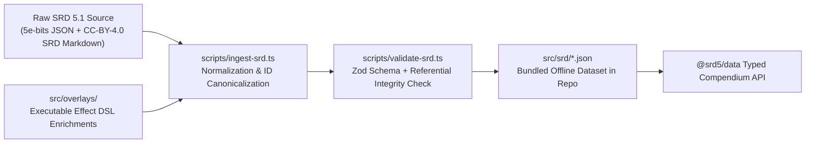

# 01 — SRD 5.1 Data Foundation & Effect DSL Specification

## 1. Overview

The `@srd5/data` package provides the complete, offline-bundled **System Reference Document 5.1 (SRD 5.1)** dataset normalized into strict, cross-referenced TypeScript/Zod schemas.

To prevent the rules engine from becoming a tangle of thousands of hardcoded `if (spell.id === 'fireball')` branches, every SRD entity combines:
1. **Descriptive & Compendium Metadata**: Human-readable descriptions, SRD page/section references, tags, and lore text.
2. **Structured Mechanical Properties**: Normalized numbers, enums, proficiencies, and scaling tables.
3. **Executable Effect & Modifier Definitions**: A composable, declarative **Effect & Modifier DSL** evaluated by `@srd5/engine`.

---

## 2. Offline Data Bundling & Ingestion Pipeline

### 2.1 Pipeline Architecture


### 2.2 Canonical Identifiers
Every SRD record uses a deterministic, lowercase kebab-case `id` scoped by collection:
- Ability Scores: `str`, `dex`, `con`, `int`, `wis`, `cha`
- Skills: `acrobatics`, `animal-handling`, `arcana`, `athletics`, `deception`, `history`, `insight`, `intimidation`, `investigation`, `medicine`, `nature`, `perception`, `performance`, `persuasion`, `religion`, `sleight-of-hand`, `stealth`, `survival`
- Races: `dwarf`, `elf`, `halfling`, `human`, `dragonborn`, `gnome`, `half-elf`, `half-orc`, `tiefling`
- Subraces: `hill-dwarf`, `high-elf`, `lightfoot-halfling`, `rock-gnome`
- Classes: `barbarian`, `bard`, `cleric`, `druid`, `fighter`, `monk`, `paladin`, `ranger`, `rogue`, `sorcerer`, `warlock`, `wizard`
- Subclasses (SRD 5.1): `berserker`, `lore`, `life`, `land`, `champion`, `open-hand`, `devotion`, `hunter`, `thief`, `draconic`, `fiend`, `evocation`

### 2.3 Bundled Dataset Files (`packages/data/src/srd/`)
All files are committed directly to the repository so the project builds, tests, and runs offline with zero external network calls:
- `abilities-and-skills.json`
- `conditions.json`
- `damage-types.json`
- `proficiencies-and-languages.json`
- `races.json`
- `classes.json`
- `subclasses.json`
- `features.json`
- `backgrounds.json`
- `feats.json`
- `equipment.json`
- `magic-items.json`
- `spells.json`
- `monsters.json`

---

## 3. Core Enumerations & Primitives

```ts
export type AbilityId = 'str' | 'dex' | 'con' | 'int' | 'wis' | 'cha';

export type SkillId =
  | 'acrobatics' | 'animal-handling' | 'arcana' | 'athletics'
  | 'deception' | 'history' | 'insight' | 'intimidation'
  | 'investigation' | 'medicine' | 'nature' | 'perception'
  | 'performance' | 'persuasion' | 'religion' | 'sleight-of-hand'
  | 'stealth' | 'survival';

export type DamageType =
  | 'acid' | 'bludgeoning' | 'cold' | 'fire' | 'force'
  | 'lightning' | 'necrotic' | 'piercing' | 'poison'
  | 'psychic' | 'radiant' | 'slashing' | 'thunder';

export type ConditionId =
  | 'blinded' | 'charmed' | 'deafened' | 'exhaustion'
  | 'frightened' | 'grappled' | 'incapacitated' | 'invisible'
  | 'paralyzed' | 'petrified' | 'poisoned' | 'prone'
  | 'restrained' | 'stunned' | 'unconscious';

export type CreatureSize = 'tiny' | 'small' | 'medium' | 'large' | 'huge' | 'gargantuan';

export type CreatureType =
  | 'aberration' | 'beast' | 'celestial' | 'construct' | 'dragon'
  | 'elemental' | 'fey' | 'fiend' | 'giant' | 'humanoid'
  | 'monstrosity' | 'ooze' | 'plant' | 'undead';

export type MagicSchool =
  | 'abjuration' | 'conjuration' | 'divination' | 'enchantment'
  | 'evocation' | 'illusion' | 'necromancy' | 'transmutation';

export type RestType = 'turn' | 'round' | 'short_rest' | 'long_rest' | 'dawn';

export type ActionCost =
  | 'action'
  | 'bonus_action'
  | 'reaction'
  | 'movement'
  | 'free'
  | 'special';
```

---

## 4. Choice Tree Schema (Character Creation & Progression)

SRD 5.1 races, classes, and backgrounds frequently grant structured choices (e.g., *"Choose any two skills"*, *"Choose 1 cantrip from the Wizard spell list"*, *"Choose a Fighting Style"*). All choices across all entities use a unified `ChoiceSpec` schema:

```ts
export type ChoiceSpec =
  | {
      id: string;
      label: string;
      count: number;
      type: 'proficiency' | 'skill' | 'language' | 'tool';
      from: { mode: 'explicit'; options: string[] } | { mode: 'category'; category: string };
    }
  | {
      id: string;
      label: string;
      count: number;
      type: 'ability_score_bonus';
      bonus: number;
      excludeAbilities?: AbilityId[];
      distinct?: boolean; // e.g., Half-Elf: +1 to two different abilities other than CHA
    }
  | {
      id: string;
      label: string;
      count: number;
      type: 'spell';
      classList: string;
      maxSpellLevel: number; // 0 for cantrips
      schoolRestriction?: MagicSchool[];
    }
  | {
      id: string;
      label: string;
      count: number;
      type: 'feature_option'; // e.g., Fighting Style, Totem Spirit, Land Circle terrain, Eldritch Invocation
      featureGroup: string;
      options: string[];
    }
  | {
      id: string;
      label: string;
      count: number;
      type: 'equipment_bundle';
      options: EquipmentOptionBranch[];
    };

export interface EquipmentOptionBranch {
  id: string;
  label: string;
  items: Array<
    | { kind: 'item'; itemId: string; quantity: number }
    | { kind: 'category_choice'; category: string; count: number } // e.g., "Any martial weapon"
  >;
}
```

---

## 5. Entity Schemas

### 5.1 Races & Subraces (`RaceSchema`, `SubraceSchema`)

```ts
export interface RaceData {
  id: string;
  name: string;
  size: CreatureSize; // 'small' | 'medium'
  speedFeet: number;  // 25 or 30
  abilityBonuses: Partial<Record<AbilityId, number>>;
  choices: ChoiceSpec[];
  senses: {
    darkvisionFeet?: number;
  };
  proficiencies: string[]; // Weapon/armor/tool/skill IDs
  languages: string[];
  traits: RacialTraitData[];
  subraceIds: string[];
  description: string;
}

export interface SubraceData {
  id: string;
  parentRaceId: string;
  name: string;
  abilityBonuses: Partial<Record<AbilityId, number>>;
  choices: ChoiceSpec[];
  senses?: { darkvisionFeet?: number };
  proficiencies: string[];
  traits: RacialTraitData[];
  description: string;
}

export interface RacialTraitData {
  id: string;
  name: string;
  description: string;
  modifiers: ModifierSpec[];
  activatedAbilities?: ActivatedAbilitySpec[];
}
```

### 5.2 Classes, Subclasses & Level Progression (`ClassSchema`, `SubclassSchema`)

```ts
export interface ClassData {
  id: string;
  name: string;
  hitDie: 6 | 8 | 10 | 12;
  primaryAbilities: AbilityId[];
  savingThrowProficiencies: [AbilityId, AbilityId];
  armorProficiencies: string[];
  weaponProficiencies: string[];
  toolProficiencies: string[];
  skillChoices: ChoiceSpec;
  startingEquipmentChoices: ChoiceSpec[];
  startingGoldFormula: string; // e.g., "5d4 * 10"
  subclassLevel: 1 | 2 | 3;    // L1: Cleric/Sorcerer/Warlock, L2: Druid/Wizard, L3: Others
  subclassTitle: string;       // e.g., "Martial Archetype", "Arcane Tradition"
  spellcasting?: {
    ability: AbilityId;
    progression: 'full' | 'half' | 'third' | 'pact';
    preparationMode: 'known' | 'prepared_full_list' | 'spellbook';
    cantripsKnownByLevel: number[]; // length 20
    spellsKnownByLevel?: number[];  // length 20 for 'known' casters
    ritualCasting: boolean;
    spellcastingFocusType?: string;
  };
  levels: ClassLevelProgression[]; // 20 entries (levels 1..20)
}

export interface ClassLevelProgression {
  level: number; // 1..20
  proficiencyBonus: number; // +2..+6
  featureIds: string[];
  classSpecific: Record<string, number | string>; // e.g., rage_count, sneak_attack_dice, martial_arts_die, ki_points, sorcery_points
  spellSlots?: {
    level1: number;
    level2: number;
    level3: number;
    level4: number;
    level5: number;
    level6: number;
    level7: number;
    level8: number;
    level9: number;
    pactSlots?: number;
    pactSlotLevel?: number;
  };
}
```

### 5.3 Equipment & Magic Items (`EquipmentSchema`, `MagicItemSchema`)

```ts
export type WeaponProperty =
  | 'ammunition' | 'finesse' | 'heavy' | 'light' | 'loading'
  | 'range' | 'reach' | 'special' | 'thrown' | 'two-handed' | 'versatile';

export interface WeaponData {
  id: string;
  kind: 'weapon';
  name: string;
  category: 'simple' | 'martial';
  rangeType: 'melee' | 'ranged';
  costCopper: number;
  weightLb: number;
  damageDice: string;        // e.g., "1d8", "2d6"
  damageType: DamageType;
  versatileDamageDice?: string; // e.g., "1d10"
  properties: WeaponProperty[];
  rangeFeet?: { normal: number; long: number };
}

export interface ArmorData {
  id: string;
  kind: 'armor';
  name: string;
  category: 'light' | 'medium' | 'heavy' | 'shield';
  costCopper: number;
  weightLb: number;
  baseAc: number;
  addDexModifier: boolean;
  maxDexBonus?: number; // 2 for Medium armor
  strengthRequirement?: number;
  stealthDisadvantage: boolean;
}

export interface MagicItemData {
  id: string;
  name: string;
  category: 'armor' | 'potion' | 'ring' | 'rod' | 'scroll' | 'staff' | 'wand' | 'weapon' | 'wondrous';
  rarity: 'common' | 'uncommon' | 'rare' | 'very_rare' | 'legendary' | 'artifact';
  requiresAttunement: boolean;
  attunementRestriction?: string;
  baseEquipmentId?: string;
  modifiers: ModifierSpec[];
  activatedAbilities?: ActivatedAbilitySpec[];
  description: string;
}
```

### 5.4 Spells (`SpellSchema`)

```ts
export type AoeShapeType = 'sphere' | 'cube' | 'cone' | 'line' | 'cylinder';

export interface SpellTargetSpec {
  type: 'self' | 'touch' | 'single' | 'multiple' | 'point_aoe' | 'self_aoe';
  rangeFeet: number; // 0 for self, 5 for touch
  requiresSight?: boolean;
  targetFilter?: 'creature' | 'ally' | 'enemy' | 'willing' | 'corpse' | 'object_or_creature';
  maxTargets?: number | FormulaString; // e.g., 3 for Scorching Ray, or "3 + (slotLevel - 1)" for Magic Missile
  aoe?: {
    shape: AoeShapeType;
    sizeFeet: number;      // radius for sphere/cylinder, length for cone/line, side for cube
    widthFeet?: number;    // default 5 for line
  };
}

export interface SpellData {
  id: string;
  name: string;
  level: 0 | 1 | 2 | 3 | 4 | 5 | 6 | 7 | 8 | 9;
  school: MagicSchool;
  castingTime: ActionCost | '1_minute' | '10_minutes' | '1_hour' | '8_hours' | '24_hours';
  reactionTrigger?: ReactionTriggerSpec; // for Shield, Counterspell, Feather Fall, Hellish Rebuke
  ritual: boolean;
  concentration: boolean;
  duration:
    | { type: 'instantaneous' }
    | { type: 'rounds'; rounds: number } // e.g., 10 rounds = 1 minute, 100 rounds = 10 minutes
    | { type: 'minutes' | 'hours' | 'days'; amount: number }
    | { type: 'until_dispelled' };
  components: {
    verbal: boolean;
    somatic: boolean;
    material: boolean;
    materialDescription?: string;
    materialCostGold?: number;
    materialConsumed?: boolean;
  };
  classes: string[]; // Class IDs that have this spell on their spell list
  targeting: SpellTargetSpec;
  effects: EffectStepSpec[]; // Declarative execution pipeline
  higherLevelScaling?: {
    mode: 'slot_level' | 'character_level'; // slot_level for leveled spells, character_level for cantrips
    overrides: Record<number, Partial<EffectStepSpec>>; // or formula scaling
  };
  description: string;
  higherLevelDescription?: string;
}
```

### 5.5 Monsters (`MonsterSchema`)

```ts
export interface MonsterData {
  id: string;
  name: string;
  size: CreatureSize;
  type: CreatureType;
  subtype?: string;
  alignment: string;
  armorClass: {
    value: number;
    type: 'natural' | 'armor' | 'mage_armor' | 'unarmored';
    armorIds?: string[];
  };
  hitPoints: {
    average: number;
    rollFormula: string; // e.g., "2d6", "18d10+36"
  };
  speed: {
    walk: number;
    fly?: number;
    hover?: boolean;
    swim?: number;
    climb?: number;
    burrow?: number;
  };
  abilities: Record<AbilityId, number>;
  savingThrows: Partial<Record<AbilityId, number>>;
  skills: Partial<Record<SkillId, number>>;
  damageVulnerabilities: DamageType[];
  damageResistances: DamageType[];
  damageImmunities: DamageType[];
  conditionImmunities: ConditionId[];
  senses: {
    darkvisionFeet?: number;
    blindsightFeet?: number;
    tremorsenseFeet?: number;
    truesightFeet?: number;
    passivePerception: number;
  };
  languages: string[];
  challengeRating: number; // 0, 0.125, 0.25, 0.5, 1..30
  xp: number;
  aiArchetype: 'brute' | 'skirmisher' | 'artillery' | 'controller' | 'support';
  traits: MonsterTraitSpec[];
  actions: MonsterActionSpec[];
  reactions?: MonsterActionSpec[];
  legendaryActions?: {
    perRound: number;
    actions: MonsterActionSpec[];
  };
}

export interface MonsterActionSpec {
  id: string;
  name: string;
  description: string;
  actionCost: ActionCost;
  recharge?: { minRoll: 4 | 5 | 6; die: 6 } | { perDay: number }; // e.g., Dragon Breath (Recharge 5-6)
  multiattack?: {
    sequence: Array<{ actionId: string; count: number }>;
  };
  targeting?: SpellTargetSpec;
  effects: EffectStepSpec[];
}
```

---

## 6. Declarative Effect & Modifier DSL

The **Effect & Modifier DSL** allows static JSON records in `@srd5/data` to drive both passive character sheet calculations and active combat resolution in `@srd5/engine`.

### 6.1 Formula Expressions (`FormulaString`)
Formulas are restricted, safe arithmetic/dice expressions evaluated against an execution context (`actor`, `target`, `slotLevel`, `classLevel`):
- Variables: `@strMod`, `@dexMod`, `@conMod`, `@intMod`, `@wisMod`, `@chaMod`, `@prof`, `@charLevel`, `@classLevel`, `@slotLevel`, `@spellMod`, `@spellSaveDC`
- Functions: `max(a, b)`, `min(a, b)`, `floor(x)`, `ceil(x)`
- Dice: `1d8 + @strMod`, `(@slotLevel + 5)d6`, `1d10 + @classLevel` (Second Wind)

### 6.2 Passive Modifiers (`ModifierSpec`)
Applied by racial traits, class features, equipped items, and active buffs/conditions:

```ts
export type ModifierSpec =
  | {
      type: 'ability_score';
      ability: AbilityId;
      bonus: number;
      maxCap?: number; // Default 20 (24 for Barbarian Primal Champion, 30 for belt/manual)
    }
  | {
      type: 'ac_calculation';
      id: string; // e.g., 'unarmored_barbarian', 'unarmored_monk', 'draconic_resilience', 'mage_armor'
      formula: string; // e.g., "10 + @dexMod + @conMod"
      allowsShield: boolean;
      requiresNoArmor: boolean;
    }
  | {
      type: 'flat_bonus';
      target:
        | 'ac'
        | 'initiative'
        | 'speed'
        | 'melee_attack'
        | 'ranged_attack'
        | 'spell_attack'
        | 'spell_save_dc'
        | 'melee_damage'
        | 'ranged_damage'
        | 'all_saving_throws'
        | `save:${AbilityId}`
        | `skill:${SkillId}`
        | 'hp_per_level'; // e.g., Hill Dwarf Dwarven Toughness (+1 HP/level)
      value: number | string;
      condition?: PredicateSpec; // e.g., "wielding_ranged_weapon" (Archery), "one_handed_melee_no_other_weapon" (Dueling)
    }
  | {
      type: 'roll_mode';
      mode: 'advantage' | 'disadvantage';
      target:
        | 'attack_rolls'
        | 'attacks_against_self'
        | 'initiative'
        | 'concentration_saves'
        | `save:${AbilityId}`
        | `skill:${SkillId}`;
      condition?: PredicateSpec; // e.g., "save_against_poison", "save_against_magic" (Gnome Cunning)
    }
  | {
      type: 'damage_mitigation';
      mitigation: 'resistance' | 'immunity' | 'vulnerability';
      damageTypes: DamageType[];
      bypassedBy?: 'magical' | 'silvered' | 'adamantine';
    }
  | {
      type: 'condition_immunity';
      conditions: ConditionId[];
    }
  | {
      type: 'die_manipulation';
      rule: 'halfling_lucky' | 'great_weapon_fighting' | 'brutal_critical' | 'expanded_crit_range';
      params?: Record<string, number>; // e.g., { minCritRoll: 19 } for Champion Improved Critical
    }
  | {
      type: 'extra_attack';
      attacksPerAction: 2 | 3 | 4; // Stacks by taking the highest (non-additive per 5e multiclass rules)
    }
  | {
      type: 'grant_resource';
      resourceId: string; // e.g., 'ki', 'rage', 'bardic_inspiration', 'action_surge', 'second_wind', 'channel_divinity', 'lay_on_hands'
      name: string;
      maxFormula: string;
      recovery: RestType;
      recoveryAmountFormula?: string; // default "max"
    };
```

### 6.3 Active Effect Steps (`EffectStepSpec`)
Used by Spells, Weapon Attacks, Class Activated Features, Magic Items, and Monster Actions:

```ts
export type EffectStepSpec =
  | {
      step: 'attack_roll';
      attackType: 'melee_weapon' | 'ranged_weapon' | 'melee_spell' | 'ranged_spell';
      attackBonusOverride?: number; // used by Monsters
      critRange?: number;           // default 20
      onHit: EffectStepSpec[];
      onMiss?: EffectStepSpec[];    // e.g., Acid Arrow half damage on miss
    }
  | {
      step: 'saving_throw';
      ability: AbilityId;
      dcFormula: string;            // "@spellSaveDC" or fixed monster DC
      onFail: EffectStepSpec[];
      onSuccess?: EffectStepSpec[]; // e.g., half_damage
    }
  | {
      step: 'deal_damage';
      diceFormula: string;          // e.g., "8d6", "1d8 + @strMod"
      damageType: DamageType;
      halfOnSaveSuccess?: boolean;
      isMagical?: boolean;
    }
  | {
      step: 'heal';
      diceFormula: string;          // e.g., "1d8 + @spellMod"
    }
  | {
      step: 'grant_temp_hp';
      amountFormula: string;        // e.g., "1d4 + 4" (False Life)
    }
  | {
      step: 'apply_condition';
      conditionId: ConditionId;
      durationRounds?: number;
      requiresConcentration?: boolean;
      repeatSaveAtTurnEnd?: {
        ability: AbilityId;
        dcFormula: string;
      };
    }
  | {
      step: 'apply_active_effect';  // Buffs/Debuffs like Bless, Bane, Shield of Faith, Haste, Rage
      effectId: string;
      name: string;
      durationRounds: number;
      requiresConcentration: boolean;
      modifiers: ModifierSpec[];
    }
  | {
      step: 'forced_movement';
      direction: 'push_from_actor' | 'pull_to_actor';
      distanceFeet: number;
    }
  | {
      step: 'teleport';
      maxDistanceFeet: number;      // e.g., Misty Step (30 ft)
    }
  | {
      step: 'create_hazard_zone';   // e.g., Web, Grease, Cloud of Daggers, Spirit Guardians
      zoneId: string;
      shape: AoeShapeType;
      sizeFeet: number;
      durationRounds: number;
      requiresConcentration: boolean;
      difficultTerrain: boolean;
      obscurement?: 'light' | 'heavy';
      onEnterOrStartTurn: EffectStepSpec[];
    }
  | {
      step: 'spend_resource';
      resourceId: string;
      amount: number;
    };
```

---

## 7. Data Validation & Referential Integrity Rules

The `packages/data/scripts/validate-srd.ts` script runs in CI and `pnpm test` to guarantee:
1. **100% Schema Conformance**: Every record in `src/srd/*.json` parses cleanly through its Zod schema.
2. **Cross-Reference Integrity**:
   - Every `featureId` referenced in `classes.json` or `subclasses.json` exists in `features.json`.
   - Every `spellId` referenced in racial traits, monster spellcasting traits, or subclass bonus spell lists exists in `spells.json`.
   - Every `itemId` referenced in starting equipment bundles or monster armor/weapon arrays exists in `equipment.json`.
3. **Formula Syntax Check**: Every `FormulaString` and `diceFormula` in the dataset parses cleanly via `@srd5/engine`'s expression AST parser without undefined variables.
4. **SRD 5.1 Allowlist Check**: Verifies no non-SRD Product Identity monsters, spells, or subclasses exist in the bundle.
