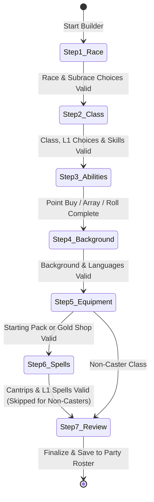

# 02 — Character Builder & Derived Stat Engine Specification

## 1. Overview

The Character System consists of two strictly separated layers inside `@srd5/engine`:
1. **`CharacterBuildState` (Persisted Source of Truth)**: A compact, serializable JSON document storing all player choices made during character creation, level-up progression (levels 1–20), inventory management, and current runtime state (current HP, expended spell slots, resource charges, active conditions).
2. **`DerivedCharacterSheet` (Computed Output)**: A deterministic, pure projection computed by `computeDerivedCharacter(buildState, compendium)` that resolves all modifiers, ability scores, AC formulas, attack profiles, saving throws, skills, and spellcasting capabilities.

---

## 2. Character Build State Schema (`CharacterBuildState`)

```ts
export type AbilityGenerationMethod = 'standard_array' | 'point_buy' | 'rolled' | 'manual';

export interface CharacterBuildState {
  id: string;
  version: 1;
  name: string;
  playerId?: string; // Assigned player owner (for single-player or co-op multiplayer)
  portraitId: string;
  tokenSpriteId: string;
  alignment:
    | 'lawful_good' | 'neutral_good' | 'chaotic_good'
    | 'lawful_neutral' | 'true_neutral' | 'chaotic_neutral'
    | 'lawful_evil' | 'neutral_evil' | 'chaotic_evil';

  // 1. Origin (Race & Subrace)
  raceId: string;
  subraceId?: string;
  racialChoices: Record<string, string[]>; // choiceId -> selected option IDs

  // 2. Background
  backgroundId: string; // 'acolyte' or custom SRD background template
  backgroundChoices: Record<string, string[]>;

  // 3. Base Ability Scores (before racial bonuses & ASIs)
  abilityMethod: AbilityGenerationMethod;
  baseAbilities: Record<AbilityId, number>;
  abilityRollSeed?: number; // Recorded if abilityMethod === 'rolled'

  // 4. Class & Level Progression (Supports Single-Class L1-20 and optional Multiclassing)
  classes: CharacterClassEntry[];

  // 5. Inventory, Equipment & Currency
  currency: {
    cp: number;
    sp: number;
    ep: number;
    gp: number;
    pp: number;
  };
  inventory: InventoryItemInstance[];
  equippedSlots: {
    armorInstanceId?: string;
    shieldInstanceId?: string;
    mainHandInstanceId?: string;
    offHandInstanceId?: string;
    rangedInstanceId?: string;
  };
  attunedItemInstanceIds: string[]; // Max 3 per SRD 5.1 rules

  // 6. Spellcasting Selection
  spellcasting: {
    knownCantripIds: string[];
    knownSpellIds: string[];      // Bard, Ranger, Sorcerer, Warlock
    spellbookSpellIds: string[];  // Wizard (6 at L1 + 2 per level + transcribed scrolls)
    preparedSpellIds: string[];   // Cleric, Druid, Paladin, Wizard
  };

  // 7. Live Runtime State (Mutated during Dungeon/Combat)
  runtime: {
    xp: number;
    currentHp: number;
    tempHp: number;
    hitDiceSpent: Record<number, number>; // dieSize (6|8|10|12) -> count spent
    deathSaves: { successes: 0 | 1 | 2 | 3; failures: 0 | 1 | 2 | 3 };
    exhaustionLevel: 0 | 1 | 2 | 3 | 4 | 5 | 6;
    expendedSpellSlots: Record<1 | 2 | 3 | 4 | 5 | 6 | 7 | 8 | 9, number>;
    expendedPactSlots: number;
    resourceChargesSpent: Record<string, number>; // resourceId -> spent count
    activeConditions: ActiveConditionInstance[];
    activeEffects: ActiveEffectInstance[];
    concentratingOn?: {
      sourceId: string; // spellId or featureId
      targetEntityIds: string[];
      remainingRounds: number;
    };
  };
}

export interface CharacterClassEntry {
  classId: string;
  subclassId?: string;
  level: number; // 1..20
  hpRollsByLevel: number[]; // Level 1 is always max hitDie; L2+ stores fixed average or rolled value
  choiceSelectionsByLevel: Record<number, Record<string, string[]>>;
  asiOrFeatByLevel: Record<
    number, // Typically levels 4, 8, 12, 16, 19 (+ 6, 14 for Fighter; + 10 for Rogue)
    | { type: 'asi'; bonuses: Partial<Record<AbilityId, 1 | 2>> } // Total +2 across 1 or 2 abilities
    | { type: 'feat'; featId: string; choices?: Record<string, string[]> }
  >;
}
```

---

## 3. Character Builder Wizard State Machine

The UI Character Builder guides the player through 7 validated steps. A step is marked **Valid** when all mandatory fields and `ChoiceSpec` requirements for that step are satisfied without duplicate proficiency collisions.



### 3.1 Step Validation Rules

#### Step 1: Race & Subrace
- If the selected race has subraces in SRD 5.1 (`dwarf` -> `hill-dwarf`, `elf` -> `high-elf`, `halfling` -> `lightfoot-halfling`, `gnome` -> `rock-gnome`), selecting the subrace is required.
- Resolve racial `ChoiceSpec` items:
  - **Dragonborn**: Select Draconic Ancestry (`black`, `blue`, `brass`, `bronze`, `copper`, `gold`, `green`, `red`, `silver`, `white`), which determines Breath Weapon damage type, AOE shape (`5x30 ft line` vs `15 ft cone`), saving throw (`DEX` vs `CON`), and Damage Resistance.
  - **Half-Elf**: Select two distinct abilities other than `cha` to receive `+1` each; select any two skills; select one extra language.
  - **High Elf**: Select 1 cantrip from the `wizard` spell list (cast using `INT`) and 1 extra language.
  - **Human**: Standard SRD Human (`+1` to all 6 abilities + 1 extra language).

#### Step 2: Class, Level & Class Choices
- Choose starting character level (default `1`, configurable `1..20` for high-level skirmishes).
- Choose Class (`barbarian`..`wizard`).
- If `level >= class.subclassLevel`, require selecting the SRD subclass (e.g., Level 1 Cleric must choose `life` Domain; Level 1 Sorcerer must choose `draconic` Bloodline; Level 1 Warlock must choose `fiend` Patron).
- Select class skill proficiencies (`count` from `class.skillChoices`).
- Resolve class feature choices at each unlocked level:
  - **Fighter**: Fighting Style at L1 (`archery`, `defense`, `dueling`, `great-weapon-fighting`, `protection`, `two-weapon-fighting`).
  - **Rogue / Bard**: Expertise (select 2 proficient skills or thieves' tools to double proficiency bonus).
  - **Ranger**: Favored Enemy, Natural Explorer, Fighting Style (L2), Hunter's Prey (L3: `colossus-slayer`, `giant-killer`, `horde-breaker`).
  - **Druid (Circle of the Land)**: Bonus cantrip (L2) and Circle terrain (`arctic`, `coast`, `desert`, `forest`, `grassland`, `mountain`, `swamp`, `underdark`).
  - **Sorcerer**: Metamagic options (L3: choose 2 from `careful`, `distant`, `empowered`, `extended`, `heightened`, `quickened`, `subtle`, `twinned`).
  - **Warlock**: Eldritch Invocations (L2+) and Pact Boon (L3: `pact-of-the-chain`, `pact-of-the-blade`, `pact-of-the-tome`).

#### Step 3: Ability Score Generation
Supports three SRD-compliant modes:
1. **Standard Array**: Assign permutations of `[15, 14, 13, 12, 10, 8]` to the 6 abilities.
2. **Point Buy (27 Points)**:
   - All abilities start at `8` (min `8`, max `15` before racial modifiers).
   - Point cost table:
     | Score | 8 | 9 | 10 | 11 | 12 | 13 | 14 | 15 |
     | :--- | :-: | :-: | :-: | :-: | :-: | :-: | :-: | :-: |
     | **Cost** | 0 | 1 | 2 | 3 | 4 | 5 | 7 | 9 |
   - Validation: $\sum \text{cost}(\text{score}_i) = 27$.
3. **Rolled (`4d6kh3`)**:
   - Generates 6 values using the seeded PRNG (`4d6 drop lowest` six times), which the player assigns to the 6 abilities.

#### Step 4: Background & Proficiency Collision Rule
- Select SRD `acolyte` background or create a **Custom SRD Background** (2 skills + 2 languages/tool proficiencies + starting equipment).
- **SRD Duplicate Proficiency Rule**: If a character receives the same skill, tool, or language proficiency from two sources (e.g., Race + Background), the builder automatically prompts the player to replace the duplicate with any other proficiency of the same category (`skill`, `tool`, or `language`).

#### Step 5: Starting Equipment vs. Gold Shop
- **Mode A (Equipment Bundles)**: Resolve each branch in `class.startingEquipmentChoices` plus background starting equipment.
- **Mode B (Starting Gold)**: Roll or take average of `class.startingGoldFormula` and purchase items directly from the SRD Equipment Catalog (`packages/data/src/srd/equipment.json`).

#### Step 6: Spellcasting Selection
For spellcasting classes (or High Elf / Tiefling racial spellcasters):
- **Cantrips**: Pick `cantripsKnownByLevel[level - 1]` cantrips from the class spell list.
- **Known Casters (`bard`, `ranger`, `sorcerer`, `warlock`)**: Pick `spellsKnownByLevel[level - 1]` spells of valid spell slot levels.
- **Wizard (`spellbook`)**: Pick 6 Level-1 spells at L1 + 2 spells per additional Wizard level for the Spellbook; then select $\max(1, \text{INT}_{\text{mod}} + \text{level})$ spells from the Spellbook to prepare.
- **Prepared Casters (`cleric`, `druid`, `paladin`)**: Automatically know the full class spell list; select $\max(1, \text{Ability}_{\text{mod}} + \lfloor \text{level} / \text{divisor} \rfloor)$ prepared spells (plus always-prepared Domain/Circle/Oath spells, which do not count against the preparation limit).

---

## 4. Derived Character Stat Calculation Pipeline

`computeDerivedCharacter(state: CharacterBuildState, data: CompendiumData): DerivedCharacterSheet` executes in a strict, deterministic 10-stage pipeline so modifiers never suffer from circular dependencies:

```mermaid
flowchart LR
    S1["1. Total Level &\nProficiency Bonus"] --> S2["2. Final Ability Scores\n& Ability Modifiers"]
    S2 --> S3["3. Collect Active\nModifierSpecs"]
    S3 --> S4["4. Saving Throws &\nSkill Modifiers"]
    S4 --> S5["5. Max HP &\nHit Dice Pool"]
    S5 --> S6["6. Armor Class (AC)\nResolution"]
    S6 --> S7["7. Speed, Senses &\nInitiative"]
    S7 --> S8["8. Weapon Attack\nProfiles"]
    S8 --> S9["9. Spellcasting DC,\nAttack & Slots"]
    S9 --> S10["10. Action Economy &\nResource Pools"]
```



### 4.1 Stage Formulas & Exact SRD 5.1 Rules

#### Stage 1: Total Level & Proficiency Bonus
$$\text{TotalLevel} = \sum_{c \in \text{classes}} c.\text{level}$$
$$\text{ProficiencyBonus} = 2 + \left\lfloor \frac{\text{TotalLevel} - 1}{4} \right\rfloor \quad (\text{ranges from } +2 \text{ to } +6)$$

#### Stage 2: Final Ability Scores & Modifiers
1. Start with `baseAbilities[ab]`.
2. Add Race `abilityBonuses[ab]` + Subrace `abilityBonuses[ab]` + Racial choice bonuses.
3. Add all ASI bonuses from `asiOrFeatByLevel` and Feat ability bonuses.
4. Cap at `20` (or `24` for `str`/`con` if Level 20 Barbarian *Primal Champion* is active).
5. Apply any `set_ability_minimum` magic item modifiers (e.g., *Gauntlets of Ogre Power* sets `STR = max(STR, 19)`).
6. Compute Ability Modifier:
   $$\text{Mod}(\text{score}) = \left\lfloor \frac{\text{score} - 10}{2} \right\rfloor$$

#### Stage 4: Saving Throws & Skills
- **Saving Throw Bonus**:
  $$\text{Save}(ab) = \text{Mod}(ab) + (\text{isProficient}(ab) \ ? \ \text{ProficiencyBonus} : 0) + \sum \text{SaveBonuses}(ab)$$
  *(Includes Paladin L6 Aura of Protection $+\max(1, \text{CHA}_{\text{mod}})$ and Cloak/Ring of Protection $+1$).*
- **Skill Bonus**:
  - Not proficient: $\text{Mod}(ab) + (\text{hasJackOfAllTrades} \ ? \ \lfloor \text{ProficiencyBonus} / 2 \rfloor : 0)$
  - Proficient: $\text{Mod}(ab) + \text{ProficiencyBonus}$
  - Expertise: $\text{Mod}(ab) + (2 \times \text{ProficiencyBonus})$
- **Passive Perception**:
  $$\text{PassivePerception} = 10 + \text{Skill}(\text{perception}) + (\text{hasAdvantage} \ ? \ 5 : 0) - (\text{hasDisadvantage} \ ? \ 5 : 0)$$

#### Stage 5: Maximum Hit Points
For each class level $i \in [1..\text{TotalLevel}]$:
- Level 1: $\text{HP}_1 = \text{HitDie}_{\max} + \text{CON}_{\text{mod}}$
- Level $i > 1$: $\text{HP}_i = \max\left(1, \text{RollOrFixed}_i + \text{CON}_{\text{mod}}\right)$, where $\text{Fixed} = \frac{\text{HitDie}_{\max}}{2} + 1$.
- Add per-level HP modifiers:
  - Hill Dwarf *Dwarven Toughness*: $+1 \times \text{TotalLevel}$
  - Draconic Bloodline Sorcerer *Draconic Resilience*: $+1 \times \text{SorcererLevel}$

#### Stage 6: Armor Class (AC) Competing Formula Resolution
Per SRD 5.1, **base AC calculation methods do not stack**; if a character has multiple base AC calculations available, the engine evaluates all valid candidate formulas and selects the **highest**:
1. **Unarmored Default**: $10 + \text{DEX}_{\text{mod}}$
2. **Barbarian Unarmored Defense** (when wearing no armor): $10 + \text{DEX}_{\text{mod}} + \text{CON}_{\text{mod}}$ (Shield allowed)
3. **Monk Unarmored Defense** (when wearing no armor and no shield): $10 + \text{DEX}_{\text{mod}} + \text{WIS}_{\text{mod}}$
4. **Draconic Resilience** (when wearing no armor): $13 + \text{DEX}_{\text{mod}}$ (Shield allowed)
5. **Mage Armor** (when active and wearing no armor): $13 + \text{DEX}_{\text{mod}}$ (Shield allowed)
6. **Barkskin** (when active): Guarantees final AC is at least $16$.
7. **Equipped Armor**:
   - Light Armor: $\text{armor.baseAc} + \text{DEX}_{\text{mod}}$
   - Medium Armor: $\text{armor.baseAc} + \min(2, \text{DEX}_{\text{mod}})$
   - Heavy Armor: $\text{armor.baseAc}$
8. **Additive AC Bonuses** (stack on top of the winning base AC):
   - Equipped Shield: $+2$ (+ magic shield bonus)
   - Fighting Style *Defense* (while wearing armor): $+1$
   - *Shield of Faith* / *Haste*: $+2$
   - *Shield* spell reaction: $+5$ until start of next turn

#### Stage 8: Weapon Attack Profiles
For each equipped weapon (plus always-available *Unarmed Strike* / Monk *Martial Arts*):
- **Ability Used**:
  - Melee weapon: `STR` (or $\max(\text{STR}, \text{DEX})$ if weapon has `finesse` or Monk `martial-arts` applies).
  - Ranged weapon: `DEX` (or `STR`/`DEX` if `thrown`).
- **To-Hit Bonus**:
  $$\text{ToHit} = \text{AbilityMod} + (\text{isProficient} \ ? \ \text{ProficiencyBonus} : 0) + \text{MagicBonus} + \text{FightingStyleAttackBonus}$$
  *(Note: Archery Fighting Style adds $+2$ to ranged weapon attack rolls).*
- **Damage Formula**:
  $$\text{Damage} = \text{WeaponDice} + \text{AbilityMod} + \text{MagicBonus} + \text{FightingStyleDamageBonus} + \text{RageDamageBonus}$$
  *(Note: Off-hand Two-Weapon Fighting bonus action attacks omit positive $\text{AbilityMod}$ from damage unless the character has the `two-weapon-fighting` Fighting Style).*

#### Stage 9: Spellcasting Stats
For each spellcasting class:
$$\text{SpellSaveDC} = 8 + \text{ProficiencyBonus} + \text{SpellAbilityMod} + \text{ItemFocusBonus}$$
$$\text{SpellAttackBonus} = \text{ProficiencyBonus} + \text{SpellAbilityMod} + \text{ItemFocusBonus}$$
If a character is multiclassed across multiple non-Pact spellcasting classes, spell slots are computed using the SRD 5.1 **Multiclass Spellcaster Table** where:
$$\text{EffectiveCasterLevel} = \sum \text{FullCasterLevels} + \left\lfloor \frac{\sum \text{HalfCasterLevels}}{2} \right\rfloor + \left\lfloor \frac{\sum \text{ThirdCasterLevels}}{3} \right\rfloor$$
Warlock *Pact Magic* slots are tracked separately and recharge on a Short Rest.
