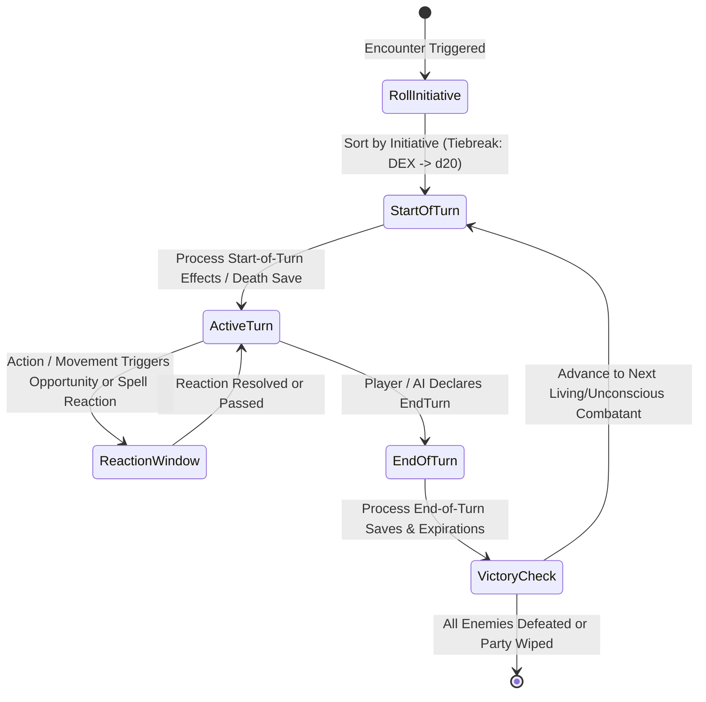

# 03 — Deterministic Rules Engine, Action Economy & Tactical Combat Specification

## 1. Overview

`@srd5/engine` implements a headless, deterministic, turn-based tactical combat engine conforming to SRD 5.1. It operates strictly on serializable state (`CombatState`) via pure command transitions (`reduceCombat(state, command, compendium)`), emitting an ordered array of `CombatEvent` objects that drive client animations, dice trays, and combat logs.

---

## 2. Deterministic Seeded PRNG & Dice Engine

To support multiplayer synchronization, combat replays, and deterministic unit tests, `Math.random()` is **never called** inside `@srd5/engine`.

### 2.1 Seeded PRNG (`Mulberry32`)
The `GameState` carries a `rngState: number` (uint32). Every random roll advances `rngState` purely:

```ts
export function nextRandomUint32(state: number): { value: number; nextState: number };
export function rollDie(state: number, faces: 4 | 6 | 8 | 10 | 12 | 20 | 100): {
  roll: number;
  nextState: number;
};
```

### 2.2 Dice Expression AST & Roll Modifiers
The dice parser supports full 5e notation and emits detailed `DiceRollRecord` metadata:
- Standard expressions: `1d20+5`, `2d6+3`, `8d6`, `1d4+1`
- Keep Highest / Lowest: `2d20kh1` (Advantage), `2d20kl1` (Disadvantage), `4d6kh3` (Ability roll)
- **SRD Advantage/Disadvantage Cancellation Rule**:
  - If an actor has $\ge 1$ source of Advantage and $\ge 1$ source of Disadvantage on a `d20` roll (regardless of count, e.g., 3 Advantage sources vs. 1 Disadvantage source), they **cancel out completely** to a normal `1d20` roll.
- **Halfling Lucky**: When a Halfling rolls a natural `1` on the active `d20` of an attack roll, ability check, or saving throw, the engine automatically rolls a replacement `1d20` and records both in `DiceRollRecord`.
- **Great Weapon Fighting**: When rolling damage for a two-handed/versatile melee weapon held in two hands, any damage die showing `1` or `2` is rerolled once.
- **Critical Hits**:
  - Natural `20` on an attack roll (or `19–20` with Champion *Improved Critical*, `18–20` with *Superior Critical*) is an automatic hit and a Critical Hit.
  - Natural `1` on an attack roll is an automatic miss regardless of bonuses.
  - On a Critical Hit, **all damage dice** of the attack (including weapon dice, Rogue *Sneak Attack* dice, Paladin *Divine Smite* dice, and spell attack dice) are **doubled** (rolled twice), while flat modifiers (`+ @strMod`, `+2` magic bonus) are added once. Plus any additional *Brutal Critical* (Barbarian) or *Savage Attacks* (Half-Orc) weapon dice.

---

## 3. Tactical Grid, Geometry, Line of Sight & Cover

### 3.1 Coordinate System & Creature Footprints
- The tactical board is a 2D Cartesian grid `(x: number, y: number)` where **1 grid cell = 5 feet × 5 feet**.
- Creature footprint sizes on the grid:
  | Size | Footprint (Cells) | Space (Feet) | Notes |
  | :--- | :---: | :---: | :--- |
  | `tiny` | $1 \times 1$ | 2.5 × 2.5 ft | Up to 4 Tiny creatures can share 1 cell |
  | `small` | $1 \times 1$ | 5 × 5 ft | Occupies 1 cell |
  | `medium` | $1 \times 1$ | 5 × 5 ft | Occupies 1 cell |
  | `large` | $2 \times 2$ | 10 × 10 ft | Anchored by top-left `(x, y)` |
  | `huge` | $3 \times 3$ | 15 × 15 ft | Anchored by top-left `(x, y)` |
  | `gargantuan` | $4 \times 4$ | 20 × 20 ft | Anchored by top-left `(x, y)` |

### 3.2 Distance & Movement Cost (`5e Standard Grid Metric`)
- By default, moving 1 cell orthogonally or diagonally costs **5 feet** of movement (standard 5e grid rule), with an optional campaign toggle for the `5-10-5` tactical variant.
- **Difficult Terrain**: Entering a cell marked as difficult terrain (rubble, shallow water, *Web*, *Entangle*, or another creature's space) costs **+5 extra feet** per cell.
- **Moving Through Creature Spaces**:
  - A creature can move through a **nonhostile** creature's space (costs difficult terrain) provided it does not end its movement in an occupied space.
  - A creature **cannot** move through a **hostile** creature's space unless the hostile creature is at least two size categories larger or smaller (or the actor is a Halfling using *Halfling Nimbleness*).
- **Prone Movement**:
  - Standing up from `prone` costs an amount of movement equal to **half of the creature's maximum speed** ($\lfloor \text{Speed} / 2 \rfloor$). If remaining movement is less than half speed, or speed is `0`, the creature cannot stand up.
  - Crawling while `prone` costs **+5 extra feet** per cell (+10 extra feet in difficult terrain).

### 3.3 Line of Sight (LoS), Cover & Lighting
- **Line of Sight & Cover Algorithm (SRD 5.1 Corner-to-Corner Rule)**:
  1. Choose the optimal corner of the attacker's occupied square.
  2. Trace rays from that corner to all 4 corners of the target square.
  3. **Total Cover**: All 4 rays are blocked by solid walls/closed doors -> Target cannot be directly targeted.
  4. **Three-Quarters Cover (`+5 AC`, `+5 DEX saves`)**: 3 of 4 rays are blocked by obstacles/walls.
  5. **Half Cover (`+2 AC`, `+2 DEX saves`)**: 1 or 2 rays are blocked by obstacles, low walls, or intervening creatures (allied or hostile).
- **Lighting & Vision**:
  - Each grid cell has a computed illumination level: `bright`, `dim` (Lightly Obscured), or `darkness` (Heavily Obscured).
  - **Lightly Obscured** (`dim` light, patchy fog): Disadvantage on `WIS (Perception)` checks relying on sight.
  - **Heavily Obscured** (`darkness`, opaque fog, *Darkness* spell): Creature effectively suffers the `blinded` condition when trying to see into/within that area (attacks have Disadvantage; attacks from unseen attackers have Advantage).
  - **Darkvision**: Within its radius (typically 60 ft), a creature treats non-magical `darkness` as `dim` light and `dim` light as `bright` light.

### 3.4 Area of Effect (AOE) Grid Rasterization
Every AOE shape (`sphere`, `cylinder`, `cube`, `cone`, `line`) is rasterized onto grid cells using the standard 5e template rule (a square is included if its center point falls within the geometric shape, or $\ge 50\%$ of its area is covered):
- **Sphere / Cylinder**: Centered on a grid intersection `(ix, iy)`; includes cells whose center distance $d \le \text{radiusFeet}$.
- **Cube**: Anchored to a grid intersection and oriented along one of 4 cardinal facings.
- **Cone**: Originates from a corner/edge adjacent to the caster along a directional vector $\vec{v}$; width at distance $d$ from origin equals $d$, with total length $L$.
- **Line**: Ray of length $L$ and width $W$ (default 5 ft) from the caster's boundary toward target point.

#### 3.4.1 Configurable Friendly Fire AOE Filtering
Under official SRD 5.1 Rules As Written (RAW), offensive area-of-effect spells (*Fireball*, *Burning Hands*, *Shatter*, etc.) affect every creature occupying the rasterized footprint regardless of allegiance.
- **When `friendlyFireEnabled === true`** (Default for Standard 5e RAW and Tactician rulesets): All creatures overlapping the rasterized cells are included in `aoeTargetIds`.
- **When `friendlyFireEnabled === false`** (Default for Explorer / Story ruleset, or toggled via Custom Ruleset): Offensive AOE spells and hazard zones filter out friendly allies (`areAllied(caster, combatant) === true`), targeting only hostile enemies. This prevents accidental party wipes on relaxed difficulty while preserving tactical spellcasting positioning.

---

## 4. Combat Turn Lifecycle & Action Economy



### 4.1 Per-Turn Action Budget
At the start of a combatant's turn (unless `incapacitated`, `paralyzed`, `petrified`, `stunned`, or `unconscious`):
```ts
export interface TurnBudget {
  action: number;                // 1 (increments +1 on Fighter Action Surge)
  bonusAction: number;           // 1
  reactionAvailable: boolean;    // Refreshes to true at start of combatant's turn
  movementRemainingFeet: number; // Equal to computed Speed (0 if Grappled/Restrained)
  freeObjectInteraction: number; // 1 (draw/sheathe weapon, open unlocked door)
  bonusActionSpellCast: boolean; // Enforces the SRD Bonus Action Spellcasting rule
  attackActionTaken: boolean;
  extraAttacksRemaining: number; // Set when Attack Action is initiated
}
```

### 4.2 SRD 5.1 Bonus Action Spellcasting Rule
Per SRD 5.1: If a combatant casts **any spell** (cantrip or leveled) with a casting time of `1 bonus action` during their turn, the combatant **cannot cast another spell during the same turn, except for a cantrip with a casting time of `1 action`**.
- Corollary: If a combatant has already cast a leveled `1 action` spell (or a `1 reaction` spell on their own turn), `bonus_action` spells are disabled for the remainder of that turn.

### 4.3 Standard Combat Actions Available to All Creatures
In addition to class/racial features and spells, every creature has access to the standard SRD combat actions:
1. **Attack**: Make 1 weapon/unarmed attack (plus `extra_attack` attacks if the character has *Extra Attack*).
   - Enables **Two-Weapon Fighting** (`bonus_action` off-hand light melee attack) if the main-hand attack used a `light` melee weapon.
2. **Cast a Spell**: Cast a known/prepared spell with available slot and components.
3. **Dash**: Gain extra movement for the current turn equal to current Speed (after modifiers).
4. **Disengage**: The combatant's movement does not provoke Opportunity Attacks for the rest of the turn.
5. **Dodge**: Until the start of the combatant's next turn, any attack roll made against it has **Disadvantage** (if it can see the attacker), and it makes `DEX` saving throws with **Advantage** (lost if `incapacitated` or speed drops to `0`).
6. **Help**: Grant an ally Advantage on their next ability check or next attack roll against a target within 5 ft of the helper.
7. **Hide**: Make a `DEX (Stealth)` check contested by hostile creatures' Passive Perception (requires Heavy Obscurement or Three-Quarters/Total Cover and not being clearly seen); grants the `hidden` tactical state (unseen attacker).
8. **Ready**: Choose a perceivable trigger (`"Enemy enters my reach"`, `"Enemy casts a spell"`) and ready an Action or movement to execute using `reaction` when the trigger occurs (note: readying a spell expends the slot immediately and requires Concentration until released).
9. **Search**: Make a `WIS (Perception)` or `INT (Investigation)` check.
10. **Use an Object**: Drink/administer a *Potion of Healing*, use an item, or interact with a second object.
11. **Grapple / Shove** (Special Melee Attack replacing 1 attack of the Attack action):
    - Target must be no more than one size larger and within reach.
    - Contest: Attacker's `STR (Athletics)` vs. Target's $\max(\text{STR (Athletics)}, \text{DEX (Acrobatics)})$.
    - **Grapple Success**: Target gains `grappled` condition (speed `0` until grappler is incapacitated or moved out of reach).
    - **Shove Success**: Attacker chooses to knock target `prone` OR push target 5 feet away.

---

## 5. Reaction Interrupt Architecture

When an action or movement step occurs during `ActiveTurn`, the engine checks if any hostile or allied creature has a valid **Reaction Trigger**.

### 5.1 Supported Reaction Triggers
| Trigger Event | Candidate Reactions |
| :--- | :--- |
| Hostile creature voluntarily moves out of actor's melee reach without `Disengage` (and is visible to actor) | **Opportunity Attack** (1 melee weapon attack before the mover leaves reach), Fighter *Protection* (when attacked), *War Caster* (if feat enabled) |
| Actor is hit by an attack roll (after seeing the roll result, before damage is applied) | ***Shield* Spell** (`+5 AC` until start of next turn, potentially turning the hit into a miss) |
| Creature within 60 ft casts a spell | ***Counterspell*** (auto-cancels $\le$ L3 spell, or ability check `DC = 10 + spellLevel`) |
| Creature within 5 ft of an ally is targeted by an attack while actor wields a shield | **Fighting Style: *Protection*** (impose Disadvantage on the attack roll) |
| Actor takes damage from a creature it can see within 60 ft | ***Hellish Rebuke***, Rogue L5 ***Uncanny Dodge*** (halve attack damage) |
| Creature starts falling | ***Feather Fall*** |

### 5.2 Interrupt Pause & Resume Flow
1. If an **AI monster** has a valid reaction, the AI evaluator decides synchronously inside `reduceCombat` whether to spend its reaction.
2. If a **player-controlled hero** has a valid reaction (e.g., *Shield* spell would turn an incoming attack from a hit into a miss, or an enemy steps out of reach), `reduceCombat` pauses execution at the interrupt checkpoint and sets `state.pendingReactionPrompt`:
   ```ts
   export interface PendingReactionPrompt {
     promptId: string;
     reactorEntityId: string;
     triggerDescription: string; // e.g., "Goblin Boss hits Wizard (Roll 16 vs AC 15). Cast Shield (+5 AC)?"
     availableReactions: Array<{ id: string; label: string; command: GameCommand }>;
     timeoutMs?: number; // Used in multiplayer
   }
   ```
3. The player submits either `ExecuteReactionCommand` or `PassReactionCommand`, and the engine resumes the interrupted action pipeline.

---

## 6. Damage, Health, Concentration & Death Saves

### 6.1 Damage Application Order (SRD 5.1)
For each damage instance $(D_{\text{raw}}, \text{type})$:
1. **Immunity**: If target is immune to `type`, $D = 0$.
2. **Resistance**: If target is resistant to `type` (after checking `magical`/`silvered`/`adamantine` bypasses), $D = \lfloor D_{\text{raw}} / 2 \rfloor$.
3. **Vulnerability**: If target is vulnerable to `type`, $D = D_{\text{raw}} \times 2$.
4. **Temporary HP Absorption**:
   - Subtract $D$ from `tempHp` first: $\Delta_{\text{temp}} = \min(\text{tempHp}, D)$.
   - Remaining damage $D_{\text{rem}} = D - \Delta_{\text{temp}}$ is subtracted from `currentHp`.
   - *(Note: Temporary HP never stacks; gaining new Temp HP sets $\text{tempHp} = \max(\text{tempHp}_{\text{old}}, \text{tempHp}_{\text{new}})$).*

### 6.2 Concentration Rule
- A spellcaster can concentrate on **at most 1 effect** at a time. Casting a new concentration spell immediately ends any previous concentration effect.
- Whenever a concentrating creature takes damage $D > 0$ (including damage absorbed by Temporary HP):
  - Required `CON` Saving Throw:
    $$\text{DC} = \max\left(10, \left\lfloor \frac{D}{2} \right\rfloor\right)$$
  - On failure (or if the caster becomes `incapacitated` or dies), concentration ends immediately and all linked buffs/debuffs/zones are removed from the board.

### 6.3 Zero Hit Points, Instant Death & Death Saving Throws
- **Monsters**: Normally die at `0 HP`.
- **Player Characters**:
  1. **Instant Death**: If remaining damage after reaching `0 HP` is $\ge \text{MaxHP}$, the character dies instantly.
  2. **Falling Unconscious**: Otherwise, if $D_{\text{rem}} \ge \text{currentHp}$, `currentHp` becomes `0`, the character gains `unconscious` and `prone`, drops concentration, and resets `deathSaves` to `{ successes: 0, failures: 0 }`.
  3. **Start-of-Turn Death Save**: At the start of a `0 HP` character's turn, roll `1d20` (affected by all-save modifiers like *Aura of Protection* or *Bless*):
     - **Roll 1**: `failures += 2`
     - **Roll 2–9**: `failures += 1`
     - **Roll 10–19**: `successes += 1`
     - **Roll 20**: Regain `1 HP` immediately, clear `unconscious` and `deathSaves`, and take the turn normally!
     - At `3 successes`: Character becomes **Stable** (`0 HP`, unconscious, no longer rolls death saves).
     - At `3 failures`: Character **Dies**.
  4. **Taking Damage at 0 HP**:
     - Any damage taken at `0 HP` causes `1` death save failure (`2` failures if the damage was from a Critical Hit).
     - Note that melee attacks within 5 ft against an `unconscious` creature that hit are automatic Critical Hits (`2` failures).
  5. **Healing from 0 HP**: Any healing $> 0$ restores consciousness, clears `unconscious`, and resets `deathSaves` to `0/0`.

---

## 7. Complete SRD 5.1 Condition Mechanical Matrix

Every condition in `ConditionId` has exact mechanical hooks inside `@srd5/engine`:

| Condition | Mechanical Enforcement in Engine |
| :--- | :--- |
| **`blinded`** | Fails sight-based checks; attack rolls have Disadvantage; attacks against creature have Advantage; cannot target spells requiring `"a target you can see"`. |
| **`charmed`** | Cannot attack the charmer or target the charmer with harmful abilities/magical effects; charmer has Advantage on social ability checks with creature. |
| **`deafened`** | Fails hearing-based checks. |
| **`frightened`** | Disadvantage on ability checks and attack rolls while source of fear is within Line of Sight; cannot willingly move closer to the source of fear. |
| **`grappled`** | Speed becomes `0` and cannot benefit from bonuses to speed; ends if grappler is `incapacitated` or forced movement separates them beyond reach. |
| **`incapacitated`** | Cannot take Actions, Bonus Actions, or Reactions; loses Concentration. |
| **`invisible`** | Impossible to see without special sense; treated as Heavily Obscured for hiding; attack rolls have Advantage; attacks against creature have Disadvantage. |
| **`paralyzed`** | `incapacitated`, cannot move or speak; auto-fails `STR` and `DEX` saves; attacks against have Advantage; any attack that hits from within 5 ft is an automatic **Critical Hit**. |
| **`petrified`** | Transformed to stone; `incapacitated`, cannot move/speak; attacks against have Advantage; auto-fails `STR`/`DEX` saves; Resistance to all damage; Immune to `poison` and `disease`. |
| **`poisoned`** | Disadvantage on attack rolls and ability checks. |
| **`prone`** | Only movement option is crawl (costs 2x) unless standing up (costs half speed); Disadvantage on attack rolls; attacks against from within 5 ft have Advantage, attacks from $> 5$ ft have Disadvantage. |
| **`restrained`** | Speed becomes `0`; attack rolls have Disadvantage; attacks against have Advantage; Disadvantage on `DEX` saving throws. |
| **`stunned`** | `incapacitated`, cannot move; auto-fails `STR` and `DEX` saves; attacks against have Advantage. |
| **`unconscious`** | `incapacitated`, cannot move/speak, unaware of surroundings; drops held items and falls `prone`; auto-fails `STR`/`DEX` saves; attacks against have Advantage; hits from within 5 ft are automatic **Critical Hits**. |
| **`exhaustion`** | Cumulative levels `1..6`: L1 Disadvantage on ability checks; L2 Speed halved; L3 Disadvantage on attacks & saves; L4 Max HP halved; L5 Speed `0`; L6 Death. |
