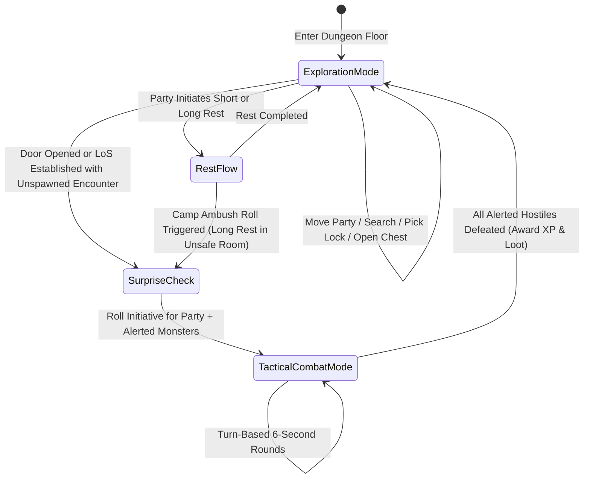

# 04 — Dungeon Exploration, Encounters, Rests & Tactical AI Specification

## 1. Overview

Beyond standalone Arena skirmishes, the game features a **Multi-Room Dungeon Crawler Mode** where a party of 1–4 heroes explores interconnected rooms and corridors, interacts with doors, traps, chests, and shrines, manages dwindling resources across encounters using **Short and Long Rests**, and fights encounters controlled by a **Tactical Utility AI**.

---

## 2. Dungeon Map & Adventure Module Schema (`DungeonMapSpec`)

A dungeon floor is represented as a single continuous 5-foot square coordinate grid partitioned into logical **Rooms** and **Corridors** connected by **Portals (Doors / Archways / Stairs)**. This unified grid allows combat to spill naturally across open doorways without loading screens.

```ts
export type TileTerrainType =
  | 'void'
  | 'floor_stone'
  | 'floor_wood'
  | 'wall_solid'
  | 'chasm'            // Blocks walking, allows flying & Line of Sight
  | 'water_shallow'    // Difficult terrain
  | 'water_deep'       // Requires swimming
  | 'rubble'           // Difficult terrain + Half Cover
  | 'lava';            // Hazard damage on enter / start of turn

export interface DungeonCellSpec {
  x: number;
  y: number;
  roomId?: string;
  terrain: TileTerrainType;
  baseLight: 'bright' | 'dim' | 'darkness';
  elevationFeet?: number; // Default 0
}

export interface InteractivePropSpec {
  id: string;
  x: number;
  y: number;
  kind: 'door' | 'secret_door' | 'chest' | 'trap' | 'lever' | 'shrine' | 'stairs_down' | 'stairs_up';
  state: 'closed' | 'open' | 'locked' | 'destroyed' | 'disarmed' | 'triggered';
  blocksMovement: boolean;
  blocksSight: boolean;
  lockDc?: number;               // DEX (Thieves' Tools) or STR (Athletics) DC to force
  detectionDc?: number;          // Passive Perception or active WIS (Perception) / INT (Investigation) DC
  disarmDc?: number;             // DEX (Thieves' Tools) DC to disarm trap
  trapEffect?: EffectStepSpec[]; // Triggered on stepping onto cell or opening without disarming
  lootTable?: LootBundleSpec;
  ac?: number;                   // Object AC (SRD: Wood 15, Stone 17, Iron 19)
  hp?: number;                   // Object HP
}

export interface EncounterSpawnGroup {
  id: string;
  roomId: string;
  triggered: boolean;
  monsters: Array<{
    monsterId: string;
    spawnX: number;
    spawnY: number;
    patrolWaypoints?: Array<{ x: number; y: number }>;
  }>;
  surpriseCondition?: {
    monstersStealthedDc?: number;
  };
}

export interface DungeonFloorSpec {
  id: string;
  name: string;
  width: number;
  height: number;
  partySpawnCells: Array<{ x: number; y: number }>;
  cells: DungeonCellSpec[];
  props: InteractivePropSpec[];
  encounters: EncounterSpawnGroup[];
}
```

---

## 3. Exploration Mode vs. Tactical Combat Mode

The game transitions seamlessly between two movement/time modes on the same grid:



### 3.1 Exploration Mode Mechanics
- **Party Movement & Marching Order**:
  - The player selects a **Lead Explorer** (or moves individual party members freely). When the Lead Explorer moves in Exploration Mode, the other 3 party members automatically follow in their configured $2 \times 2$ or single-file **Marching Order** using A* pathfinding.
- **Passive vs. Active Detection**:
  - Whenever a hero moves within 15 feet of a hidden `trap` or `secret_door` with Line of Sight, the engine automatically compares the hero's **Passive Perception** against `prop.detectionDc`. If `PassivePerception >= detectionDc`, the prop is revealed and highlighted on the board, and party movement automatically halts so the player doesn't walk into a spotted trap.
  - The player can also trigger an active **Search** action (`WIS (Perception)` or `INT (Investigation)` roll) to scan the current room.
- **Unlocking & Disarming**:
  - **Locked Doors / Chests**: A character adjacent to the prop can attempt **Pick Lock** (`DEX + Thieves' Tools Proficiency` vs. `lockDc`), cast *Knock*, or attempt **Force Open** (`STR (Athletics)` vs. `lockDc + 2`, or attack the object directly against its Object AC/HP, which alerts monsters in adjacent rooms).
  - **Traps**: Once detected, a character can attempt **Disarm Trap** (`DEX + Thieves' Tools Proficiency` vs. `disarmDc`). Rolling 5 or more below `disarmDc` triggers the trap.
- **Encounter Trigger & Surprise**:
  - Opening a door or moving into Line of Sight of an `EncounterSpawnGroup` immediately transitions `state.mode` from `'exploration'` to `'combat'`.
  - **Surprise Determination (SRD 5.1)**:
    - If the party was moving in **Stealth Mode**, each party member's `DEX (Stealth)` check is compared against the monsters' `PassivePerception`. If all monsters fail to notice the party, the monsters gain the `surprised` state for Round 1 (cannot move or take an action on their first turn, and cannot take a reaction until that first turn ends).
    - Conversely, hidden/ambushing monsters compare their Stealth against each hero's `PassivePerception`; only the specific heroes whose Passive Perception is lower than the monsters' Stealth are `surprised`.

### 3.2 Click-to-Inspect Prop Interaction, Listening & Furniture

Replaces the proximity auto-panel with an inspect-then-act loop. Awareness stays
automatic (a badge marks nearby features on the board and in the HUD), but every
action runs through a focused interaction card for one prop at a time.

- **Indicator, not panel**: when the party is within interaction reach of a prop
  (Chebyshev $\le 1.5$ tiles), the prop sprite gains a highlight ring and the HUD
  shows a compact `hud-adjacent-props-panel` row (`🚪 Door — closed`, `📦 Chest — locked`,
  …). No action buttons are shown until the player inspects.
- **Click to inspect**: clicking the prop sprite on the tactical canvas *or* its
  HUD row opens the interaction card. `Esc`, clicking elsewhere, or resolving an
  action dismisses it. The card shows kind, state, and only the actions valid for
  that state: closed door → **Open / Listen / Search**; locked → **Pick Lock /
  Force Open / Listen**; known trap → **Disarm / Search**; chest → **Open /
  Search**; lever → **Pull**; shrine → existing shrine flow. Each action previews
  its check (`DEX + Thieves' Tools vs lockDc`, …) before the player commits.
- **Listen at door** (new exploration interaction, engine `listenAtDoor()` helper
  + targeted `CHECK_RESOLVED`): an adjacent hero makes a `WIS (Perception)` check
  against `prop.listenDc ?? 12`. The hint is derived deterministically from
  unspawned encounters in rooms adjacent to the prop's room — no new event types:
  - fail by $\ge 5$: "Stillness. Nothing stirs beyond."
  - fail: "Faint, undecipherable sounds."
  - success: presence band + character ("guttural voices", "measured patrol steps").
  - success by $\ge 5$: approximate numbers ("three or more movers, one heavy").
  Listening never triggers encounters and costs no resources.
- **Furniture** (new placeable content): `kind: 'furniture'` with a
  `furnitureType` tag (`desk`, `throne`, `bookshelf`, `wardrobe`, `altar`,
  `table`, `crate`, `bed`, `curtains`, …) plus existing fields (`detectionDc`
  for hidden compartments, `lootTable`, `ac`/`hp` for smashable pieces).
  - **Search** a furniture piece for hidden compartments/papers (targeted search).
  - **Read / Use** documents, holy symbols, and levers-in-disguise (flavor text
    or scripted effects via `manual_adjudication`).
  - **Hide** within 1 tile of a hide-capable piece (`wardrobe`, `curtains`,
    `alcove`, `throne` dais): the Hide action is rolled with advantage once.
  - Renderer draws per-type procedural icons (atlas frames later); the
    procedural generator sprinkles cosmetic, non-blocking furniture in large
    rooms (never on doors, stairs, or encounter spawn cells).
- **Non-goals**: no live in-game map editor or DM placement mode — "placing" a
  desk or throne means authoring it in module JSON or generator tables. No
  faction/territory systems (see Realm mode).

```ts
export interface InteractivePropSpec {
  // ...existing fields...
  kind:
    | 'door' | 'secret_door' | 'chest' | 'trap' | 'lever' | 'shrine'
    | 'stairs_down' | 'stairs_up'
    | 'furniture';                       // NEW: placeable set dressing
  furnitureType?:                        // NEW, required when kind === 'furniture'
    | 'desk' | 'throne' | 'bookshelf' | 'wardrobe' | 'altar'
    | 'table' | 'crate' | 'bed' | 'curtains' | 'alcove';
  hideSpot?: boolean;                   // NEW: Hide action nearby rolls with advantage
  listenDc?: number;                    // NEW: WIS (Perception) DC to hear beyond (doors)
}
```

---

## 4. Rests, Recovery & Progression

### 4.1 Short Rest (1 In-Game Hour)
Can be initiated anytime in `ExplorationMode` when no hostile creatures are alerted:
1. **Spending Hit Dice**:
   - Each character can spend `0..N` unspent Hit Dice from their pool (`runtime.hitDiceSpent`).
   - For each Hit Die spent, roll `1d(HitDie) + CON_mod` (minimum 0 HP restored per SRD) and add to `currentHp` (capped at `maxHp`).
   - If a Bard is in the party with *Song of Rest* (L2+), any ally who regains HP via Hit Dice during the Short Rest regains an extra `1d6` HP (`1d8` at L9, `1d10` at L13, `1d12` at L17).
2. **Short Rest Feature Recharge**:
   - Restores all resources with `recovery === 'short_rest'`:
     - Fighter: *Second Wind*, *Action Surge*, *Indomitable* (at higher levels)
     - Monk: All *Ki Points*
     - Warlock: All *Pact Magic* spell slots
     - Cleric / Paladin: *Channel Divinity*
     - Bard (L5+ *Font of Inspiration*): All *Bardic Inspiration* dice
     - Druid: *Wild Shape* uses
   - Wizards can optionally activate **Arcane Recovery** (once per day) to recover spell slots with a combined level $\le \lceil \text{WizardLevel} / 2 \rceil$ (none of slot level $\ge 6$).

### 4.2 Long Rest (8 In-Game Hours)
Requires either a cleared Safe Room (e.g., Dungeon Entrance Camp or Sanctified Shrine) or passing an Ambush Check (`1d20` roll; on `1–4` in an unsecured room, a wandering monster patrol interrupts the rest):
1. **Full HP & Resource Reset**:
   - `currentHp = maxHp`, `tempHp = 0`, `deathSaves = { 0, 0 }`.
   - All expended spell slots (levels 1–9 and Pact slots) and all `short_rest`, `long_rest`, and `dawn` resources are fully restored.
2. **Hit Dice Recovery (SRD 5.1 Rule)**:
   - A character regains spent Hit Dice up to **half of their total number of Hit Dice** (minimum of 1 Hit Die):
     $$\text{RecoveredHitDice} = \max\left(1, \left\lfloor \frac{\text{TotalLevel}}{2} \right\rfloor\right)$$
3. **Exhaustion Reduction**:
   - Reduces `exhaustionLevel` by `1` (if $> 0$).
4. **Spell Preparation Update**:
   - Prepared casters (`Cleric`, `Druid`, `Paladin`, `Wizard`) can swap their `preparedSpellIds` list at the end of a Long Rest.

### 4.3 Experience Points (XP) & Leveling Up
- Defeating an encounter awards $\frac{\sum \text{MonsterXP}}{\text{PartySize}}$ XP to each surviving/stabilized party member.
- Standard SRD 5.1 XP Threshold Table:
  | Level | XP Required | Proficiency Bonus | Level | XP Required | Proficiency Bonus |
  | :---: | :---: | :---: | :---: | :---: | :---: |
  | **1** | 0 | +2 | **11** | 85,000 | +4 |
  | **2** | 300 | +2 | **12** | 100,000 | +4 |
  | **3** | 900 | +2 | **13** | 120,000 | +5 |
  | **4** | 2,700 | +2 | **14** | 140,000 | +5 |
  | **5** | 6,500 | +3 | **15** | 165,000 | +5 |
  | **6** | 14,000 | +3 | **16** | 195,000 | +5 |
  | **7** | 23,000 | +3 | **17** | 225,000 | +6 |
  | **8** | 34,000 | +3 | **18** | 265,000 | +6 |
  | **9** | 48,000 | +4 | **19** | 305,000 | +6 |
  | **10** | 64,000 | +4 | **20** | 355,000 | +6 |

---

## 5. Tactical Monster AI Architecture

Monster turns are executed deterministically by `@srd5/engine/src/ai/planner.ts`. Given `(state: CombatState, activeMonsterId: string)`, the AI planner generates a sequence of `GameCommand`s for that monster's turn.

### 5.1 Utility Scoring Model
The AI evaluates candidate `(MovementPath, Action, BonusAction, Target)` tuples using a weighted utility score:

$$\text{Score}(T) = w_{\text{dmg}} \cdot E[\text{Damage}] + w_{\text{kill}} \cdot P(\text{DownTarget}) + w_{\text{cc}} \cdot V(\text{Control}) + w_{\text{pos}} \cdot V(\text{Position}) - w_{\text{risk}} \cdot E[\text{OpportunityAttackDmg}]$$

Where:
- $E[\text{Damage}]$ accounts for hit probability against target's known AC (or save probability) and avoids Damage Immunities/Resistances the monster is aware of.
- $P(\text{DownTarget})$ gives a high priority bonus to finishing off low-HP conscious heroes (action economy advantage) or breaking an enemy caster's active **Concentration**.
- $E[\text{OpportunityAttackDmg}]$ penalizes paths that provoke Opportunity Attacks unless the monster uses *Nimble Escape* / *Disengage* or the tactical gain outweighs the risk.

### 5.2 AI Archetype Behaviors

| Archetype | Example SRD Monsters | Tactical Behavior Rules |
| :--- | :--- | :--- |
| **`brute`** | Ogre, Owlbear, Zombie, Minotaur, Hill Giant | Closes distance along shortest path to nearest reachable frontliner; uses *Dash* if out of melee reach; uses *Multiattack* or highest-damage melee slam; rarely retreats. |
| **`skirmisher`** | Goblin, Kobold, Wolf, Bugbear, Giant Spider | Exploits *Pack Tactics* (positions adjacent to an ally for Advantage) or *Nimble Escape* (Bonus Action *Disengage* or *Hide* after attacking); prioritizes lightly armored backline targets if a flank path is open. |
| **`artillery`** | Skeleton (Shortbow), Manticore, Mage (Evocation) | Maintains optimal standoff distance (30–80 ft); avoids ending turn adjacent to melee heroes; seeks Half or Three-Quarters Cover (`+2`/`+5` AC); positions AOE cones/spheres (*Fireball*, *Burning Hands*, *Breath Weapon*) to hit $\ge 2$ heroes while avoiding friendly fire. |
| **`controller`** | Gelatinous Cube,Harpy, Wight, Medusas, Mind-affecting casters | Prioritizes debilitating conditions (*Hold Person*, *Web*, *Entangle*, *Paralyzing Touch*, *Grapple*) on high-threat targets who haven't acted yet in the round. |
| **`support`** | Acolyte, Priest, Cult Fanatic, Hobgoblin Captain | Casts *Bless*, *Shield of Faith*, or leadership aura on strongest melee allies; casts *Cure Wounds* / *Healing Word* when an elite ally drops below 40% HP. |

---

## 6. Starter Adventure Module: *"The Sunken Crypt of Kaelen"*

To provide an immediately playable campaign alongside the Arena Skirmish mode, the repository will bundle a curated 3-floor SRD 5.1 dungeon module:
- **Floor 1 — The Ruined Watchtower (Party Level 1 -> 2)**:
  - Bandits, Kobolds, Giant Rats, a locked armory chest (`DC 12`), a pressure-plate poison dart trap (`DC 13`), and a Goblin Boss mini-boss guarding the crypt stairs.
- **Floor 2 — The Ossuary Halls (Party Level 2 -> 3)**:
  - Skeletons, Zombies, Ghoul pack, a Sanctified Shrine (Safe Room for Long Rest + *Bless* shrine buff), a secret wall door (`DC 14` Perception) leading to a * +1 Longsword* and *Scroll of Fireball*, and a Wight + Skeleton archers encounter.
- **Floor 3 — The Submerged Sanctum (Party Level 3 -> 4)**:
  - Shallow water difficult terrain, Gelatinous Cube in a narrow corridor, Cult Fanatics + Cultists, and the final boss chamber featuring a Young Black Dragon (or Ogre Chieftain + Priest for lower difficulty).
