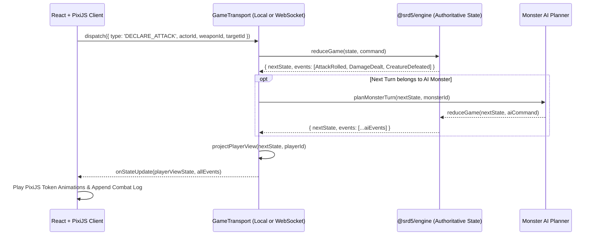
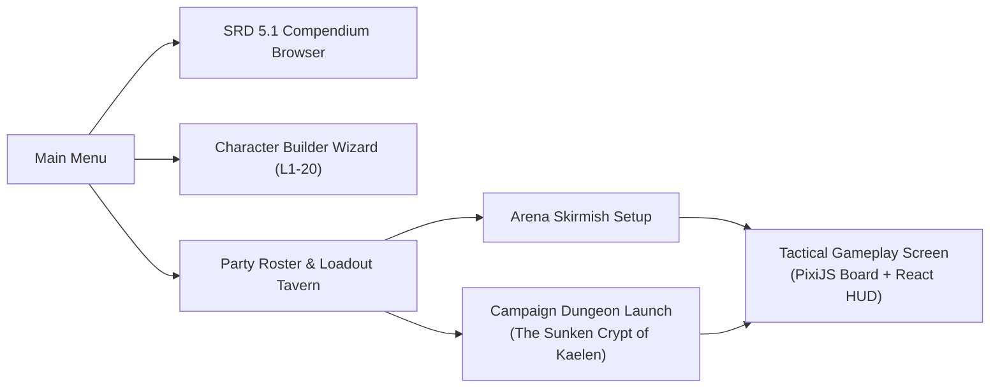

# 05 — Multiplayer-Ready Transport Protocol & PixiJS/React UI Specification

## 1. Overview

The user interface and networking boundary are designed around one core invariant:
> **The client UI never mutates game state directly.** All player actions—whether in a local single-player browser session or a future multi-player WebSocket room—are dispatched as serializable `GameCommand` envelopes through a `GameTransport` interface, which returns `GameEvent[]` and a projected `PlayerViewState`.

---

## 2. Command / Event Transport Layer (`@srd5/transport`)



### 2.1 `GameCommand` Union Schema

```ts
export type GameCommand =
  // Exploration Commands
  | { type: 'EXPLORE_MOVE'; actorId: string; path: Array<{ x: number; y: number }> }
  | { type: 'INTERACT_PROP'; actorId: string; propId: string; interaction: 'open' | 'close' | 'pick_lock' | 'disarm_trap' | 'force_open' | 'search' }
  | { type: 'START_REST'; restType: 'short' | 'long'; hitDiceToSpend?: Record<string, Record<number, number>> }

  // Tactical Combat Commands
  | { type: 'COMBAT_MOVE'; actorId: string; path: Array<{ x: number; y: number }> }
  | { type: 'DECLARE_ATTACK'; actorId: string; weaponInstanceId: string; targetId: string; twoHanded?: boolean; reckless?: boolean }
  | { type: 'DECLARE_CAST_SPELL'; actorId: string; spellId: string; slotLevel: number; targetIds?: string[]; targetCell?: { x: number; y: number }; directionRad?: number }
  | { type: 'USE_CLASS_FEATURE'; actorId: string; featureId: string; optionId?: string; targetIds?: string[]; targetCell?: { x: number; y: number } }
  | { type: 'USE_STANDARD_ACTION'; actorId: string; action: 'dash' | 'disengage' | 'dodge' | 'help' | 'hide' | 'search' | 'stand_up' | 'drop_concentration'; targetId?: string }
  | { type: 'USE_GRAPPLE_OR_SHOVE'; actorId: string; mode: 'grapple' | 'shove_prone' | 'shove_push'; targetId: string }
  | { type: 'USE_ITEM'; actorId: string; itemInstanceId: string; targetId?: string }
  | { type: 'RESOLVE_REACTION_PROMPT'; promptId: string; reactorId: string; decision: { execute: false } | { execute: true; reactionId: string; slotLevel?: number } }
  | { type: 'END_TURN'; actorId: string }

  // Inventory & Progression Commands
  | { type: 'EQUIP_LOADOUT'; characterId: string; equippedSlots: CharacterBuildState['equippedSlots'] }
  | { type: 'UPDATE_PREPARED_SPELLS'; characterId: string; preparedSpellIds: string[] }
  | { type: 'LEVEL_UP_CHARACTER'; characterId: string; classEntryUpdate: CharacterClassEntry };
```

### 2.2 `GameEvent` Stream (Drives Animations & Combat Log)

Every state transition emits fine-grained domain events so the PixiJS canvas can sequence animations (e.g., walk along path -> play sword swing -> show floating `-9 Slashing` text -> play death animation) before unlocking the next turn:

```ts
export type GameEvent =
  | { type: 'ENTITY_MOVED'; entityId: string; path: Array<{ x: number; y: number }>; mode: 'walk' | 'dash' | 'teleport' | 'forced' }
  | { type: 'DICE_ROLLED'; actorId: string; rollPurpose: string; notation: string; rolls: number[]; kept: number[]; modifier: number; total: number; mode: 'normal' | 'advantage' | 'disadvantage'; naturalCrit?: boolean; naturalFumble?: boolean }
  | { type: 'ATTACK_RESOLVED'; attackerId: string; targetId: string; weaponOrSpellName: string; roll: number; totalToHit: number; targetAc: number; outcome: 'miss' | 'hit' | 'critical_hit' }
  | { type: 'SAVING_THROW_RESOLVED'; entityId: string; ability: AbilityId; roll: number; total: number; dc: number; success: boolean; sourceName: string }
  | { type: 'DAMAGE_APPLIED'; targetId: string; rawAmount: number; finalAmount: number; damageType: DamageType; mitigationApplied?: 'resistance' | 'immunity' | 'vulnerability'; tempHpAbsorbed: number; hpRemaining: number }
  | { type: 'HEALING_APPLIED'; targetId: string; amount: number; hpRemaining: number }
  | { type: 'CONDITION_ADDED' | 'CONDITION_REMOVED'; targetId: string; conditionId: ConditionId; sourceName?: string }
  | { type: 'CONCENTRATION_CHECK'; entityId: string; spellName: string; dc: number; rollTotal: number; maintained: boolean }
  | { type: 'REACTION_PROMPTED'; prompt: PendingReactionPrompt }
  | { type: 'COMBAT_STARTED'; initiativeOrder: Array<{ entityId: string; initiative: number }> }
  | { type: 'TURN_STARTED' | 'TURN_ENDED'; entityId: string; round: number }
  | { type: 'PROP_STATE_CHANGED'; propId: string; prevState: string; nextState: string }
  | { type: 'ENCOUNTER_VICTORY'; xpAwarded: number; lootUnlocked: InventoryItemInstance[] };
```

### 2.3 Single-Player vs. Multiplayer Ownership & Fog Projection

```ts
export interface PlayerSlotAssignment {
  playerId: string;
  displayName: string;
  controlledCharacterIds: string[]; // In Single-Player, 1 player controls all 1..4 party characterIds
}
```

- **State Projection (`projectPlayerView(fullState, playerId)`)**:
  - Computes the union of visible grid cells across all characters in `controlledCharacterIds` (or the whole party if shared vision is enabled).
  - Cells never seen are marked `'unexplored'` (black fog).
  - Cells previously seen but currently outside party Line of Sight are marked `'remembered'` (dimmed static terrain/walls; enemy tokens in `'remembered'` cells are stripped from the payload).
  - Hidden traps with `detectionDc` not yet discovered by the party are stripped from `PlayerViewState` so even inspecting network packets in multiplayer cannot reveal unspotted traps or hidden monsters.

---

## 3. PixiJS v8 2D Tactical Canvas Architecture (`@srd5/client/src/canvas`)

The tactical board is rendered using **PixiJS v8** inside a responsive `<TacticalCanvasViewport />` component, layered underneath the React HUD overlays.

### 3.1 Scene Graph Layer Hierarchy (Bottom to Top)

```text
Application.stage
└── ViewportContainer (Pan / Zoom / Camera Tracking)
    ├── 1. TerrainTileLayer      # Floor tiles, walls, water, rubble, grid lines (5ft squares)
    ├── 2. HazardZoneLayer       # Active ground effects (Web, Grease, Darkness, Spirit Guardians)
    ├── 3. PropLayer             # Doors (open/closed/locked icons), chests, levers, stairs
    ├── 4. PathAndAoeLayer       # Hover movement path preview, reach rings, AOE spell templates
    ├── 5. CreatureTokenLayer    # Circular framed character/monster sprites, HP arc, condition icons
    ├── 6. LightingAndFogLayer   # Dynamic visibility polygon mask (Unexplored black, Explored shroud)
    └── 7. FloatingTextLayer     # Animated floating combat text ("-12 Fire", "CRITICAL!", "MISS", "+8 HP")
```

### 3.2 Interactive Canvas Tools & Overlays
1. **Movement & Threat Preview**:
   - Hovering over a destination cell during a hero's turn runs A* pathfinding in real time and draws a segmented path line:
     - **Green segments**: Within normal remaining movement (`movementRemainingFeet`).
     - **Amber segments**: Reachable if the hero takes the `Dash` action.
     - **Red warning chevrons**: Highlights exact steps along the path that exit an enemy's melee reach and will provoke an **Opportunity Attack**.
2. **AOE Spell & Ability Targeting Templates**:
   - Selecting an AOE spell (e.g., *Fireball* 20-ft sphere, *Burning Hands* 15-ft cone, *Lightning Bolt* 100x5-ft line, *Thunderwave* 15-ft cube) activates an interactive translucent template attached to the cursor:
     - **Spheres/Cubes**: Snaps to grid intersections within spell range; highlights all affected cells and draws a pulsing target ring around every creature inside the template.
     - **Cones/Lines**: Anchored to the caster's grid footprint and rotates smoothly toward the mouse cursor, highlighting rasterized grid squares in real time.
3. **Line of Sight & Cover Indicator**:
   - Hovering an enemy while a ranged weapon or targeted spell is selected draws a targeting ray showing hit probability (e.g., `65% to hit`) and any active cover badge (`Half Cover +2 AC`, `3/4 Cover +5 AC`, or `Blocked`).

---

## 4. React UI Views & Tactical HUD (`@srd5/client/src/components`)



### 4.1 Tactical Gameplay HUD Layout

```text
+-----------------------------------------------------------------------------------+
| [Menu] Floor 1: Ruined Watchtower     [Initiative Ribbon: Hero1 > Gob1 > Hero2]   |
|                                                                                   |
| +----------+                                                       +------------+ |
| | Party    |                                                       | Combat Log | |
| | Portraits|                                                       | & Dice     | |
| | - Hero 1 |            PixiJS 2D Tactical Dungeon Canvas          | Inspector  | |
| | - Hero 2 |             (5-ft Grid, Tokens, LoS, AOE)             | (Hover any | |
| | - Hero 3 |                                                       |  roll for  | |
| | - Hero 4 |                                                       |  breakdown)| |
| +----------+                                                       +------------+ |
|                                                                                   |
| +-------------------------------------------------------------------------------+ |
| | Active Hero Portrait | HP 24/24 | AC 18 | [Action ●] [Bonus ●] [React ●] 30ft | |
| | [Attack] [Spells] [Class Features] [Standard Actions] [Items]   [ End Turn >> ]| |
| +-------------------------------------------------------------------------------+ |
+-----------------------------------------------------------------------------------+
```

### 4.2 Key UX Features
- **Transparent Dice & Modifier Breakdown Tooltips**:
  - Hovering over any entry in the Combat Log or Character Sheet shows the exact SRD 5.1 formula breakdown (e.g., `Attack Roll: 1d20 (14) + STR (+3) + Proficiency (+2) + Bless (1d4 = 3) = 22 vs AC 15 (Chain Shirt 13 + Shield 2)`).
- **Reaction Interrupt Banner**:
  - When a player reaction is triggered (such as an enemy provoking an Opportunity Attack or hitting a Wizard who has *Shield* prepared and a 1st-level slot available), a prominent **Reaction Interrupt Modal** slides down with a clear preview of the trigger and one-click buttons (`[Cast Shield (+5 AC -> Turns Hit into Miss)]` vs. `[Pass Reaction]`).
- **Character Sheet & Inventory Drawer**:
  - Pressing `C` or `I` opens a slide-over Character Sheet showing full ability scores, skills, active conditions, equipment paperdoll, attunement slots, and spellbook preparation manager.

---

## 5. Verification & Testing Matrix

### 5.1 Automated Test Suites (`vitest`)
1. **`@srd5/data` Integrity Suite**:
   - Validates 100% of bundled SRD 5.1 JSON files against Zod schemas.
   - Verifies referential integrity across races, classes, subclasses, features, spells, items, and monsters.
2. **`@srd5/engine` Unit & Rules Compliance Suite**:
   - **Dice & PRNG**: Seeded determinism, Advantage/Disadvantage cancellation, Halfling Lucky, Great Weapon Fighting, Critical Hit dice doubling.
   - **Character Stat Derivation**: Point Buy math, AC competing formula selection (Barbarian/Monk/Mage Armor/Heavy Armor + Shield), Multiclass spell slot calculation, Proficiency & Expertise scaling.
   - **Grid & Geometry**: A* pathfinding around difficult terrain and hostile footprints, Corner-to-Corner cover calculation, AOE rasterization for spheres/cones/lines/cubes.
   - **Combat & Conditions**: Action economy enforcement, Bonus Action spell restriction, Opportunity Attack interrupts, *Shield* reaction turning hits into misses, Concentration save DC math, Temp HP non-stacking, Unconscious & Death Saving Throw edge cases.
3. **Headless End-to-End Encounter Simulation**:
   - Simulates a 4-hero Level 1 party (Fighter, Wizard, Cleric, Rogue) fighting a Goblin ambush from initiative roll to victory using the Tactical AI, verifying zero invalid state transitions and full JSON serializability at every step.
