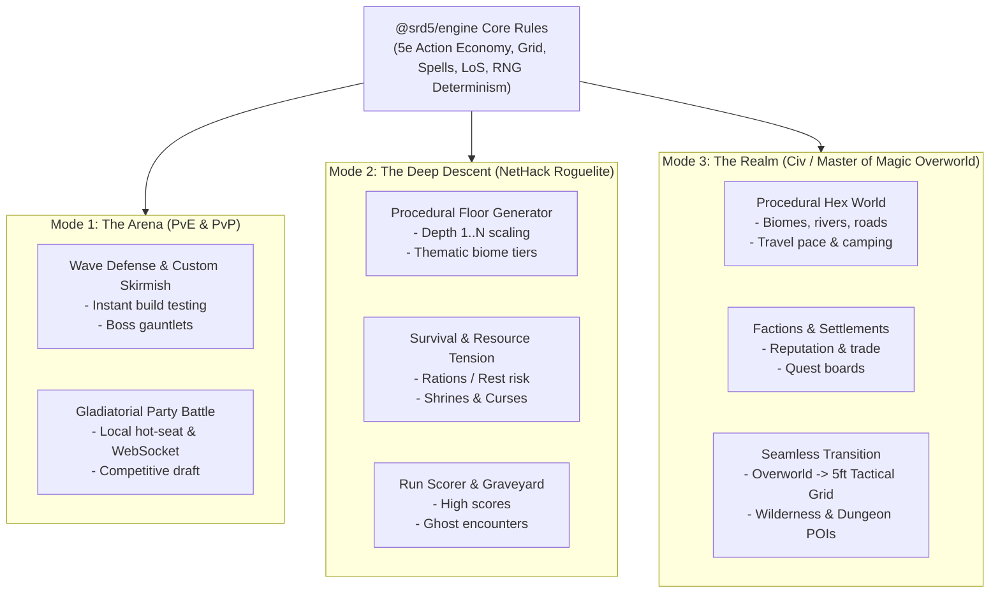

# 06 — Game Modes, Deep Descent Roguelite & Overworld Specification

## 1. Executive Summary & Design Philosophy

The **SRD 5.1 Tactical Engine** powers three distinct game modes designed for maximum engagement, player agency, and replayability:



1. **The Arena (Immediate Fun & Combat Mastery)**: Quick-start tactical battles. Perfect for testing character builds, mastering spell interactions, surviving monster wave gauntlets, and challenging friends in 1v1 party battles.
2. **The Deep Descent (High-Replayability Roguelite)**: A NetHack-inspired procedural dungeon crawl where players descend through ever-deepening floors. Features resource exhaustion, risk-reward shrines, randomized SRD magic item drops, and run scoring.
3. **The Realm (Grand Strategic Overworld)**: A procedural world map (Civilization / Master of Magic style) with settlements, factions, and wild territories. The party travels across hexes in macro-turns and drops seamlessly into the 5-ft tactical grid for combat and dungeon delves.

---

## 2. Mode 1: The Arena Specification (PvE & PvP)

### 2.1 Arena Architecture Schema

```ts
export type ArenaSubMode = 'custom_skirmish' | 'endless_waves' | 'pvp_duel';

export interface ArenaConfig {
  id: string;
  name: string;
  mode: ArenaSubMode;
  mapId: string;
  gridWidth: number;
  gridHeight: number;
  environmentObstacles: 'pillars' | 'chasm_bridge' | 'hazards_lava' | 'open_sands';
  
  // PvE Configuration
  pveSettings?: {
    difficultyTier: 'easy' | 'medium' | 'hard' | 'deadly';
    waveCount?: number;          // 0 for infinite endless waves
    restFrequencyWaves?: number; // e.g. Short Rest every 3 waves
    monsterPoolFilter?: {
      minCr?: number;
      maxCr?: number;
      creatureTypes?: CreatureType[];
    };
  };

  // PvP Configuration
  pvpSettings?: {
    teamA: {
      playerId: string;
      teamName: string;
      color: string;
      roster: CharacterBuildState[];
    };
    teamB: {
      playerId: string;
      teamName: string;
      color: string;
      roster: CharacterBuildState[];
    };
    turnTimerSeconds?: number;   // e.g. 60s per turn for competitive speed
    fogOfWar: 'none' | 'symmetric_los';
  };
}
```

### 2.2 PvP Slot Protocol & Turn Enforcement
- **Player-Team Mapping**:
  ```ts
  slots: [
    { playerId: 'player_red', displayName: 'Team Phoenix', controlledCharacterIds: ['p1_f', 'p1_w'] },
    { playerId: 'player_blue', displayName: 'Team Wyvern', controlledCharacterIds: ['p2_c', 'p2_r'] }
  ]
  ```
- **Command Guardrails**: When a combatant acts, `@srd5/engine` checks that the dispatching player owns the combatant:
  ```ts
  if (activeCombatant.playerId && activeCombatant.playerId !== command.playerId) {
    throw new InvalidCommandError(`Player ${command.playerId} cannot issue commands for entity ${activeCombatant.id}`);
  }
  ```
- **Victory Condition**: An arena match ends when all members of one team have `currentHp === 0` and are either dead or unconscious.

### 2.3 Generalized Allegiance: Dynamic Teams, Factions & Disposition Matrix

To power PvP Arena, multi-faction dungeon brawls, summoned allies, and Civilization-style world maps without hardcoding a binary `'party' | 'monster'` split, the engine generalizes combatant allegiance into **dynamic Team and Faction IDs** evaluated via a pure **Disposition Matrix**:

```ts
export type Disposition = 'allied' | 'hostile' | 'neutral';

export type DispositionMatrix = Record<string, Record<string, Disposition>>;

export interface CombatantAllegiance {
  teamId: string;       // e.g. 'party', 'team_red', 'team_blue', 'goblins', 'cultists'
  factionId?: string;   // Optional macro-faction ID for Overworld reputation (e.g. 'iron_guild', 'sun_order')
}

export function getDisposition(
  a: { teamId: string; factionId?: string; id?: string },
  b: { teamId: string; factionId?: string; id?: string },
  matrix?: DispositionMatrix
): Disposition {
  // Same creature or same tactical team are always allied
  if (a.id && b.id && a.id === b.id) return 'allied';
  if (a.teamId === b.teamId) return 'allied';

  // Check explicit faction relationship if matrix provided
  if (matrix && a.factionId && b.factionId) {
    const relation = matrix[a.factionId]?.[b.factionId];
    if (relation) return relation;
  }

  // Default: Different teams in active combat are hostile
  return 'hostile';
}

export const areAllied = (a: CombatantState, b: CombatantState, matrix?: DispositionMatrix): boolean =>
  getDisposition(a, b, matrix) === 'allied';

export const areHostile = (a: CombatantState, b: CombatantState, matrix?: DispositionMatrix): boolean =>
  getDisposition(a, b, matrix) === 'hostile';
```

#### Multi-Mode Allegiance Matrix
| Game Mode | Combatants Present | Teams & Factions | Friend / Foe Resolution |
| :--- | :--- | :--- | :--- |
| **Standard Dungeon** | 4 Heroes + Summoned Wolf vs 6 Skeletons | Heroes & Wolf: `teamId: 'party'`<br>Skeletons: `teamId: 'dungeon_undead'` | Wolf is allied with heroes; Skeletons are hostile to both. |
| **Arena PvP** | Red Team (2 Heroes) vs Blue Team (2 Heroes) | Red: `teamId: 'team_red'`<br>Blue: `teamId: 'team_blue'` | Each team acts against the other; no "monsters" required. |
| **Three-Way Skirmish** | Party vs Goblins vs Giant Spiders | Party: `teamId: 'party'`<br>Goblins: `teamId: 'goblins'`<br>Spiders: `teamId: 'wild_beasts'` | Goblins and Spiders attack each other as well as the party. |
| **Overworld / Civ Realm** | Party + Town Guard vs Orc Warband | Party: `factionId: 'player_guild'`<br>Guards: `factionId: 'crown_loyalists'`<br>Orcs: `factionId: 'blood_clan'` | Matrix determines that Crown Loyalists fight alongside the party against the Blood Clan. |

All rules engine subroutines (AOE target filters, Opportunity Attacks, Cover calculation against intervening creatures, Help action, and Victory checks) evaluate `areHostile()` and `areAllied()` rather than static side strings.

---

## 3. Mode 2: The Deep Descent (NetHack Roguelite Specification)

### 3.1 Procedural Dungeon Generator Algorithm (`DungeonGenerator`)

```ts
export interface DeepDescentRunState {
  runId: string;
  seed: number;
  currentDepth: number;
  maxDepthReached: number;
  party: Record<string, Combatant>;
  suppliesRemaining: number;     // Rations used for Long Rests
  goldCollected: number;
  monstersSlain: number;
  shrineBlessings: string[];
  activeCurses: string[];
  restCount: { short: number; long: number };
  score: number;
  isComplete: boolean;
  deathCause?: string;
}

export interface ProceduralFloorConfig {
  depth: number;
  seed: number;
  width: number;
  height: number;
  biome: BiomeTier;
  targetRoomCount: number;
  chasmProbability: number;
  trapDensity: number;
  shrineProbability: number;
}
```

#### Biome Tiers by Depth
| Depths | Biome Name | Aesthetic & Hazards | Featured SRD Monsters |
| :---: | :--- | :--- | :--- |
| **1–3** | **The Catacombs** | Stone corridors, low light, pit traps, pressure darts | Kobolds, Goblins, Giant Rats, Skeletons, Zombies |
| **4–6** | **The Sunken Tombs** | Flooded shallow water, submerged ruins, poisoned air | Ghouls, Specters, Wights, Gelatinous Cubes, Giant Spiders |
| **7–9** | **The Magma Caverns** | Lava tiles (hazard damage), crumbling stone bridges, smoke | Fire Elementals, Hell Hounds, Salamanders, Red Dragon Wyrmling |
| **10–12**| **The Deep Vaults** | Ancient adamantine masonry, arcane suppression zones | Stone Golems, Mages, Medusas, Chimeras |
| **13+**  | **The Abyssal Rift** | Void tiles, planar rifts, darkness | Fiends, Young Dragons, High-CR Horrors |

#### Guaranteed Path Connectivity & Room Placement
1. **Binary Space Partitioning (BSP) / Room-Corridor Mesh**:
   - Subdivide floor rectangle into $N$ regions ($12 \times 12$ to $24 \times 24$ tiles each).
   - Place rooms with random dimensions ($5 \times 5$ to $12 \times 12$).
   - Connect centers of rooms with orthogonal L-shaped corridors (width 1 cell = 5 ft).
2. **Portal & Prop Placement**:
   - `stairs_up`: Positioned in Room 0 (Party Entrance).
   - `stairs_down`: Positioned in Room $N-1$ (Furthest Room by topological distance).
   - **Key & Door Gate**: If depth $\ge 3$, the door to the `stairs_down` room is locked (`locked`), and the Boss monster in Room $k$ holds the key (`iron_dungeon_key`).
   - Breadth-First Search (BFS) validates that `stairs_up` and `stairs_down` are 100% pathable before the floor is emitted.

### 3.2 Roguelite Tension & Mechanics
- **Supply / Rations System**:
  - The party starts with **10 Rations**.
  - A **Long Rest** consumes **4 Rations** (1 per living party member).
  - If the party rests with insufficient rations, each member suffers **1 level of Exhaustion** instead of recovering HP/slots!
  - Slain beasts and raided supply crates restore rations.
- **Shrines of Fate (Risk & Reward)**:
  - Shrines spawn on special dais tiles:
    - *Shrine of the Blood God*: Gain `+2` to attack rolls for 3 floors; permanently reduce Max HP by 15%.
    - *Shrine of the Arcane Weave*: Instantly restore all spell slots; spawns a hostile CR+2 Astral Specter ambush.
    - *Fountain of Restoration*: Remove all conditions, poison, and exhaustion; one use per floor.
- **Run Scoring Formula**:
  $$\text{FinalScore} = (\text{Depth} \times 1,000) + \text{TotalXP} + (\text{Gold} \times 2) + (\text{UnusedRations} \times 100) - (\text{LongRests} \times 200) - (\text{TurnsTaken} \times 2)$$

---

## 4. Mode 3: The Realm Specification (Civ / Master of Magic Overworld)

### 4.1 Overworld World Map Model (`OverworldMapSpec`)

```ts
export type OverworldTerrainType =
  | 'plains'
  | 'forest'
  | 'hills'
  | 'mountains'
  | 'swamp'
  | 'desert'
  | 'tundra'
  | 'coast'
  | 'ocean';

export interface OverworldTile {
  q: number; // Hex axial coordinate (or orthogonal x)
  r: number; // Hex axial coordinate (or orthogonal y)
  terrain: OverworldTerrainType;
  movementCost: number;       // Plains: 1, Hills: 2, Swamp: 2, Mountain: 3, Forest: 1.5
  elevation: number;          // 0.0 (sea) to 1.0 (peaks)
  riverEdges?: number[];
  roadThrough?: boolean;
  poiId?: string;             // References a settlement, dungeon, or shrine
  factionControlId?: string;  // Faction owning this territory
}

export interface FactionData {
  id: string;
  name: string;
  bannerColor: string;
  alignment: 'good' | 'neutral' | 'evil';
  relationshipWithParty: number; // -100 (Hostile/Kill on sight) to +100 (Exalted Allies)
  capitalPoiId: string;
  townPoiIds: string[];
}

export interface OverworldPOI {
  id: string;
  name: string;
  kind: 'capital' | 'town' | 'village' | 'dungeon_entrance' | 'ancient_shrine' | 'monster_lair';
  q: number;
  r: number;
  factionId?: string;
  dungeonSeed?: number;       // Launches Deep Descent or Handcrafted Dungeon on enter
  services?: Array<'inn' | 'blacksmith' | 'magic_shop' | 'temple' | 'quest_board'>;
}

export interface OverworldState {
  worldSeed: number;
  worldName: string;
  width: number;
  height: number;
  currentDay: number;
  timeOfDay: 'dawn' | 'noon' | 'dusk' | 'night';
  partyPosition: { q: number; r: number };
  travelPointsRemaining: number; // e.g. 24 miles / 6 movement points per day
  tiles: Record<string, OverworldTile>;
  factions: Record<string, FactionData>;
  pois: Record<string, OverworldPOI>;
  activeQuests: OverworldQuest[];
}
```

### 4.2 Seamless Overworld-to-Tactical Transition
When the party encounters wandering hostiles or steps onto an unresolved wilderness tile:
1. **Terrain-to-Tactical Translation**:
   - The engine generates a temporary $24 \times 24$ `TacticalGrid` using terrain templates:
     - `forest` -> Adds tree obstacles (Full Cover), bush tiles (Light Cover / Difficult Terrain).
     - `mountains` -> Adds stone boulders, chasm drops, and elevation plateaus.
     - `swamp` -> Adds shallow water (Difficult Terrain) and mist (Dim Light / Light Obscurement).
2. **Initiative & Combat**:
   - Full 5e turn-based combat resolves on the tactical grid.
3. **Return to Overworld**:
   - Upon victory, combat XP, loot, and consumed resources (HP, spell slots) are committed back to the party's persistent state on the overworld map.

### 4.3 Deep Descent fold-in: dungeon POIs and Endless Delve

Standalone Deep Descent is retired as a top-level New Game tile and becomes
the Realm's dungeon engine plus an Endless Delve quick option. Top-level
modes are exactly three: Campaign (authored intro), Realm (main game),
Arena (skirmish lab).

1. **Dungeon POI delves**: `dungeon_entrance` POIs carry `dungeonSeed` and a
   depth tier. Entering generates a bounded 2–4 floor delve with the SRD-508
   generator at that tier's biome, running the SRD-509 run loop
   (`DeepDescentRunState`: supplies, shrines, score) scoped to the POI.
   Clearing the delve resolves linked quests and returns loot/XP to the
   overworld party state per §4.2 step 3.
2. **`monster_lair` POIs** resolve as single-floor clears (one generated
   floor, boss encounter, no run scoring).
3. **`ancient_shrine` POIs** reuse shrine blessings/curses without a delve.
4. **Endless Delve quick option**: the unbounded classic Descent run
   (tiers 1–13+, scoring, graveyard) remains launchable from the Realm
   flow, replacing its New Game wizard tile.
5. **Rules reconciliation**: town inns provide safe free Long Rests;
   wilderness/delve Long Rests consume 4 rations (1 per living member)
   with ambush risk on short rations (Exhaustion instead of recovery),
   consistent with §3.2. Rations are purchasable in towns with party gold.
   Run scores and graveyard entries persist per delve.

---

## 5. Staging Roadmap & Implementation Order

| Stage | Mode | Milestones | Primary Value |
| :---: | :--- | :--- | :--- |
| **Stage 1 (Now - Epic 4)** | **The Arena (PvE & Local PvP)** | `SRD-401`..`SRD-408` | Instant combat playability, build testing, AI battles, and 1v1 local party duels on the PixiJS canvas. |
| **Stage 2 (Epic 5 Extended)** | **The Deep Descent (NetHack Roguelite)** | `SRD-501`..`SRD-509` | Procedural floor generator, stairs down/up, depth scaling, supply tension, shrines, and high score runs. |
| **Stage 3 (Epic 6)** | **Title Screen & Campaign Launcher** | `SRD-601`..`SRD-605` | Steam-ready CRPG shell, 4-stage New Game wizard, 4-slot campfire party recruitment, pause menu, and handheld ergonomics (Spec 07). |
| **Stage 4 (Epic 7)** | **Multiplayer Transport** | `SRD-701`..`SRD-704` | Online remote PvP Arena and co-op dungeon crawling via WebSockets. |
| **Stage 5 (Epic 8)** | **The Realm (Strategic Overworld)** | `SRD-801`..`SRD-806` | Macro hex world generation, factions, settlements, quest boards, seamless tactical battle transitions, and Deep Descent as the dungeon-delver (§4.3). |
