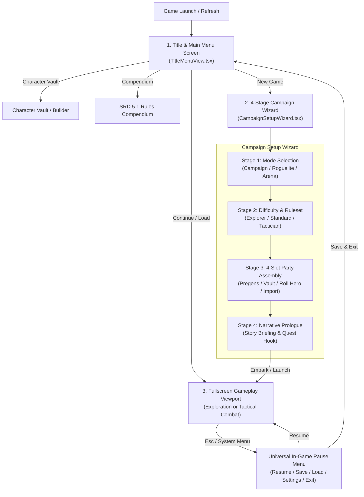
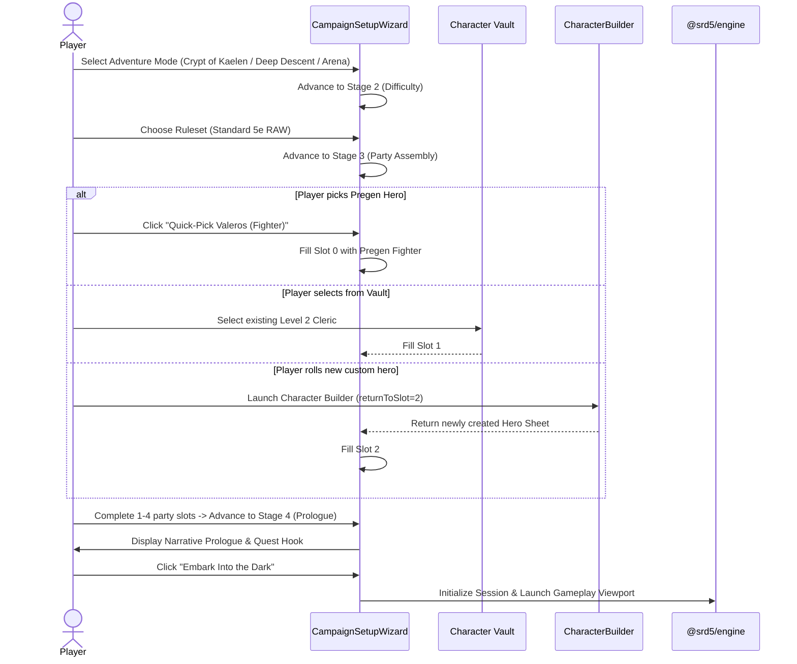

# 07 — Steam-Ready Title Screen, Main Menu & "New Game" Campaign Setup Wizard

## 1. Executive Summary & Design Vision

To transition **SRD 5.1 Tactical Turn-Based Dungeon Crawler** into a commercial-grade, Steam-ready CRPG experience (in the vein of *Baldur's Gate 3*, *Solasta: Crown of the Magister*, *Pillars of Eternity*, or classic *Baldur's Gate*), the entry flow must abandon developer-centric tab bars in favor of an immersive, dark-fantasy front-end shell.

When a player launches the game—whether on Desktop Web, Steam Deck (1280×800 native 16:10), or mobile handheld—they are greeted by an atmospheric **Title Screen & Main Menu**. Selecting **New Game** launches an intuitive 4-stage **Campaign Setup Wizard** that guides the player through selecting their adventure mode, configuring ruleset difficulty, assembling or rolling their 1–4 hero party at a visual campfire, and reading the narrative prologue before descending into the tactical dungeon.



---

## 2. Front-End Shell & State Machine Architecture

### 2.1 Top-Level Navigation State Machine

The client application replaces direct navbar-tab switching with an authoritative view-state machine in `@srd5/client`:

```ts
export type AppViewMode =
  | 'title_menu'          // Atmospheric CRPG Main Menu
  | 'campaign_setup'      // 4-Stage "New Game" Campaign Setup Wizard
  | 'gameplay'            // Active tactical viewport (Exploration or Combat)
  | 'character_vault'     // Manage saved heroes, inspect sheets, export/import .srd5.json
  | 'character_builder'   // 7-step builder (can be opened standalone or returned to party slot)
  | 'compendium'          // Offline SRD 5.1 reference compendium
  | 'settings';           // Global audio, graphics, and keybinding settings
```

### 2.2 Active Session & Save Metadata Contract

```ts
export type CampaignModeId = 'campaign_kaelen' | 'deep_descent' | 'arena';

export type DifficultyPresetId = 'explorer' | 'standard' | 'tactician' | 'custom';

export interface CampaignDifficultyConfig {
  preset: DifficultyPresetId;
  permadeath: boolean;                // Party wipe deletes save (Tactician default: true)
  campSuppliesRequired: boolean;      // Rations needed for Long Rests (Standard/Tactician: true)
  fogOfWarEnabled: boolean;           // Dynamic Line of Sight mask (Standard: true)
  deathSaveRule: 'core_raw' | 'forgiving' | 'hardcore';
  enemyHealthModifier: number;        // Multiplier on monster Max HP (e.g., 0.8 for Explorer, 1.0 for Standard, 1.2 for Tactician)
  enemyAttackBonus: number;           // Flat modifier to enemy attack rolls & DCs (+0 or +1)
  fastAiTurns: boolean;               // Skip or accelerate AI movement animations
}

export interface PartySlotAssignment {
  slotIndex: number;                  // 0, 1, 2, or 3
  roleSuggestion: 'frontline' | 'striker' | 'controller' | 'support';
  character: DerivedCharacterSheet | null;
  seatType: 'local' | 'network_remote'; // For future co-op multiplayer seat assignment
  playerSeatId?: string;              // e.g. 'Player 1', 'Player 2'
}

export interface ActiveGameSession {
  sessionId: string;
  mode: CampaignModeId;
  difficulty: CampaignDifficultyConfig;
  party: DerivedCharacterSheet[];
  currentFloor: number;
  dungeonState?: DungeonFloorState;
  combatState?: CombatState;
  createdAt: number;
  updatedAt: number;
  playtimeSeconds: number;
}
```

---

## 3. Title Screen & Main Menu Interface (`TitleMenuView`)

### 3.1 Visual & Audio Presentation
- **Theme**: Dark fantasy parchment and weathered iron, glowing runic accents, and ambient floating torch embers (CSS/WebGL particles).
- **Title Branding**: 
  - Main Title: **DUNGEONS OF KAELEN**
  - Subtitle: **A Tactical 5e SRD Roleplaying Game**
- **Navigation Menu Options**:
  1. **CONTINUE**
     - Enabled if an active autosave or quicksave exists in `IndexedDB`.
     - Displays session metadata subtitle: e.g., *"The Sunken Crypt — Floor 2 · Party of 4 · Played 1h 24m"*.
  2. **NEW GAME**
     - Directs to `CampaignSetupWizard`.
     - Prompts confirmation if an active unsaved session would be overwritten.
  3. **LOAD GAME**
     - Opens the Save/Load Management modal.
     - Displays timestamped slots with party thumbnail portraits, current floor/biome, and playtime.
  4. **CHARACTER VAULT**
     - Full-featured roster manager to inspect, level up, delete, or export `.srd5.json` character files.
     - Includes a prominent *"Roll New Hero"* button launching the 7-step builder.
  5. **SRD 5.1 COMPENDIUM**
     - Opens the offline reference manual (Races, Classes, Spells, Monsters, Equipment).
  6. **SETTINGS & OPTIONS**
     - Audio/SFX volumes, UI display scaling (100%–150% for high-DPI/handhelds), 5-ft grid visibility, combat animation speed, and 3D dice tray toggle.
  7. **CREDITS & LICENSING**
     - Displays the statutory Creative Commons Attribution 4.0 International notice (SRD 5.1), CC0 Kenney asset attributions, CC-BY 3.0 game-icons.net artist list, and DawnLike tile attributions.

---

## 4. The 4-Stage "New Game" Campaign Setup Wizard

The wizard is implemented as a clean, responsive 4-step stepper (`CampaignSetupWizard.tsx`). Players can move freely back and forth between stages before embarking.



### 4.1 Stage 1: Adventure & Game Mode Selection
Presents large visual mode cards with difficulty indicators, estimated play length, and level boundaries:

1. **The Sunken Crypt of Kaelen** (Narrative Campaign)
   - *Levels 1–4 · Handcrafted 3-Floor Crypt · Traps, Puzzles & Boss Encounter*
   - Story-driven campaign with pre-authored encounters, secret chambers, levers, locked sarcophagi, and the ancient curse of High Priest Kaelen.
2. **The Deep Descent** (Endless Roguelite Gauntlet)
   - *Levels 1–20 · Procedural Multi-Biome Dungeon · Permadeath & High Scores*
   - NetHack-inspired descending dungeon crawl with depth scaling, biomes (Catacombs, Sunken Tombs, Magma Caverns, Abyssal Vaults), Shrines of Fate, and supply management.
3. **The Arena** (Tactical Skirmish & Waves)
   - *Configurable Levels · Instant Combat · PvE Waves & 1v1 Hot-Seat Party Duels*
   - Quick-action skirmish arena to test party builds against monster packs or duel a second human player in local hot-seat mode.

### 4.2 Stage 2: Difficulty & Ruleset Configuration
Provides 3 curated presets plus a custom toggle drawer:

| Setting | Explorer (Story) | Standard (5e Core) | Tactician (Hardcore) |
| :--- | :---: | :---: | :---: |
| **Ruleset Enforcement** | Relaxed | 100% SRD 5.1 RAW | Strict RAW + Hardcore |
| **Party Health Modifier** | +20% Max HP | 100% Core HP | 100% Core HP |
| **Death Saving Throws** | Advantage on rolls | Normal (DC 10) | Nat 1 = 3 fails (Instant Death) |
| **Camp Supplies / Rations**| Disabled | Required for Long Rest | Required + Food Spoilage |
| **Monster Attack / DC** | -1 penalty | Normal SRD Stats | +1 bonus to hit & DCs |
| **Monster AI Priority** | Standard Threat | Threat + Opportunistic | Actively focuses downed heroes & casters |
| **Permadeath** | Disabled | Optional | Enabled (Iron Man) |

### 4.3 Stage 3: 4-Slot Party Assembly & Campfire Lineup
The centerpiece of the CRPG experience is the **Campfire Party Lineup**, visually presenting 4 hero pedestals/slots:
- **Slot 0 (Frontline / Tank)**: Suggested Fighter, Paladin, or Barbarian.
- **Slot 1 (Striker / Scout)**: Suggested Rogue, Ranger, or Monk.
- **Slot 2 (Arcane / Controller)**: Suggested Wizard, Sorcerer, or Warlock.
- **Slot 3 (Divine / Support)**: Suggested Cleric, Druid, or Bard.

#### Party Assembly Actions per Slot:
1. **Quick-Pick Iconic Pregen**: One-click fill with official SRD Level 1 characters:
   - *Valeros* (Human Fighter — Sword & Shield Defense)
   - *Merisiel* (Elf Rogue — Finesse Dual Daggers & Stealth)
   - *Kyra* (Human Cleric — Life Domain Healing & Mace)
   - *Ezren* (Human Wizard — Evocation Magic Missile & Shield)
2. **Import from Vault**: Opens a drawer showing all previously saved characters on the device.
3. **Roll New Hero**: Seamlessly transitions to the 7-step `CharacterBuilder` with a return callback parameter (`returnToPartySlot: number`), returning the newly minted hero directly to that slot upon completion.
4. **Drop `.srd5.json` File**: Drag-and-drop or file upload to instantly load any exported character JSON.
5. **Multiplayer Seat Assignment (Future-Ready Hook)**: Assign slot to "Local Player" or "Network Seat (Player 2–4)".

#### Live Party Synergy Advisor:
Displays tactical tags and guidance:
- `✓ Frontline Anchor` (at least 1 high-AC/HP melee character)
- `✓ Trap & Lock Specialist` (proficient in Thieves' Tools / high Sleight of Hand)
- `✓ Divine Healing` (possesses *Cure Wounds*, *Healing Word*, or Lay on Hands)
- `✓ Arcane Utility` (possesses *Detect Magic*, *Identify*, or AoE damage)
- Warns with a soft warning badge if party is undersized (< 4 heroes) or missing critical roles, while still allowing the player to proceed if they choose a solo or challenging run.

### 4.4 Stage 4: Narrative Prologue & Quest Hook
Before dropping the party onto the grid, an atmospheric parchment briefing provides narrative context:
- For *The Sunken Crypt of Kaelen*:
  > *"Rain lashes against the crumbling stone ruins of the Blackwood Ridge. Below lies the ancient crypt of Lord Kaelen, an elven high priest whose resting place was sealed four centuries ago. Recently, the tomb's protective wards have shattered, and villagers whisper of eerie emerald lights flickering in the mist. Your company has been tasked with delving into the sunken halls, cleansing whatever darkness stirs within, and recovering the lost Sunstone Relic."*
- Displays the primary quest objective and ruleset summary.
- Primary CTA: **"EMBARK INTO THE CRYPT"** (or **"DESCEND INTO THE DEPTHS"** / **"ENTER THE ARENA"**).

---

## 5. Universal In-Game Pause / System Menu (`PauseMenuModal`)

During active gameplay (both Exploration and Tactical Combat), pressing **`Esc`** or clicking the top-right **System Menu (Gear)** button opens a non-destructive modal overlay:

1. **RESUME GAME**: Closes modal and returns immediately to the action.
2. **QUICKSAVE / SAVE GAME**:
   - Creates a serialized JSON snapshot of current dungeon state, fog of war, combat turn state, and party inventories in `IndexedDB`.
   - Generates a timestamped save slot with floor number, party level, and thumbnail icons.
3. **LOAD GAME**: Lists available save slots with date, mode, and party composition.
4. **PARTY SHEET & INVENTORY**:
   - Opens full-width inspection drawer to examine character stats, prepared spells, active conditions, hit dice, and attunement slots.
5. **SETTINGS**:
   - Access to sound volume, combat animation speed (Normal, Fast, Instant), grid brightness, and touch control scaling.
6. **EXIT TO MAIN MENU**:
   - Prompts confirmation: *"Any unsaved progress since your last rest or quicksave will be lost. Return to Title Menu?"*
   - Safely resets active session and transitions to `TitleMenuView`.

---

## 6. Steam Deck & Handheld Responsive Layout Ergonomics

To ensure seamless operation on **Steam Deck (1280×800)**, desktop browsers, and touch tablets:

1. **Target Viewport Baseline**:
   - Designed around a native **16:10 / 1280×800** canvas with automatic scaling to 16:9 (1920×1080) and 21:9 ultrawide.
   - Canvas dynamically letterboxes or adapts tile viewport while HUD panels stay pinned to corners.
2. **Touch & Gamepad Friendly Dimensions**:
   - All interactive buttons and slot selectors maintain a minimum hit-target size of **48×48px**.
   - Input forms use large typography (minimum 14px / 16px) with high-contrast borders (`slate-700` / `amber-500` active ring).
3. **Sticky Action Bars**:
   - In wizard stages and character sheets, confirmation buttons ("Continue", "Embark", "Save") are fixed in a sticky bottom footer bar (`sticky bottom-0 bg-slate-950/95 backdrop-blur-md`) with prominent elevation (`z-20`), ensuring they are never obscured by scrolling content on low-height screens.
4. **Hardware Keybindings**:
   - `Esc`: Toggle Pause Menu / Cancel / Go Back.
   - `Enter` / `Space`: Confirm primary action / Advance wizard stage.
   - `1`–`4`: Select party slot or action hotbar shortcut.
   - `Tab`: Cycle interactive elements.

---

## 7. Automated Verification & Acceptance Criteria

1. **Title Screen Navigation**:
   - Verification that launching `App.tsx` renders `TitleMenuView` by default.
   - Clicking "New Game" transitions cleanly to `CampaignSetupWizard`.
   - Clicking "Character Vault" opens the roster manager.
   - Clicking "Compendium" opens the rules reference.
2. **Campaign Setup Flow**:
   - Playwright test navigates Stage 1 (Mode) &rarr; Stage 2 (Difficulty) &rarr; Stage 3 (Party Assembly) &rarr; Stage 4 (Prologue) &rarr; launches Gameplay.
   - Tests that clicking "Quick-Pick All Pregens" instantly populates all 4 party slots with valid Level 1 sheets.
   - Tests that launching "Roll New Hero" from Slot 2 opens `CharacterBuilder`, and completing creation returns the new hero directly to Slot 2.
3. **In-Game System Menu**:
   - Pressing `Esc` in exploration or combat opens `PauseMenuModal`.
   - Clicking "Resume" resumes gameplay without mutating state.
   - Clicking "Exit to Main Menu" returns safely to `TitleMenuView`.
4. **Handheld Viewport Test**:
   - Automated visual test at 1280×800 (Steam Deck viewport) verifies zero overlapping text, zero clipped buttons, and full access to all wizard and HUD controls.
